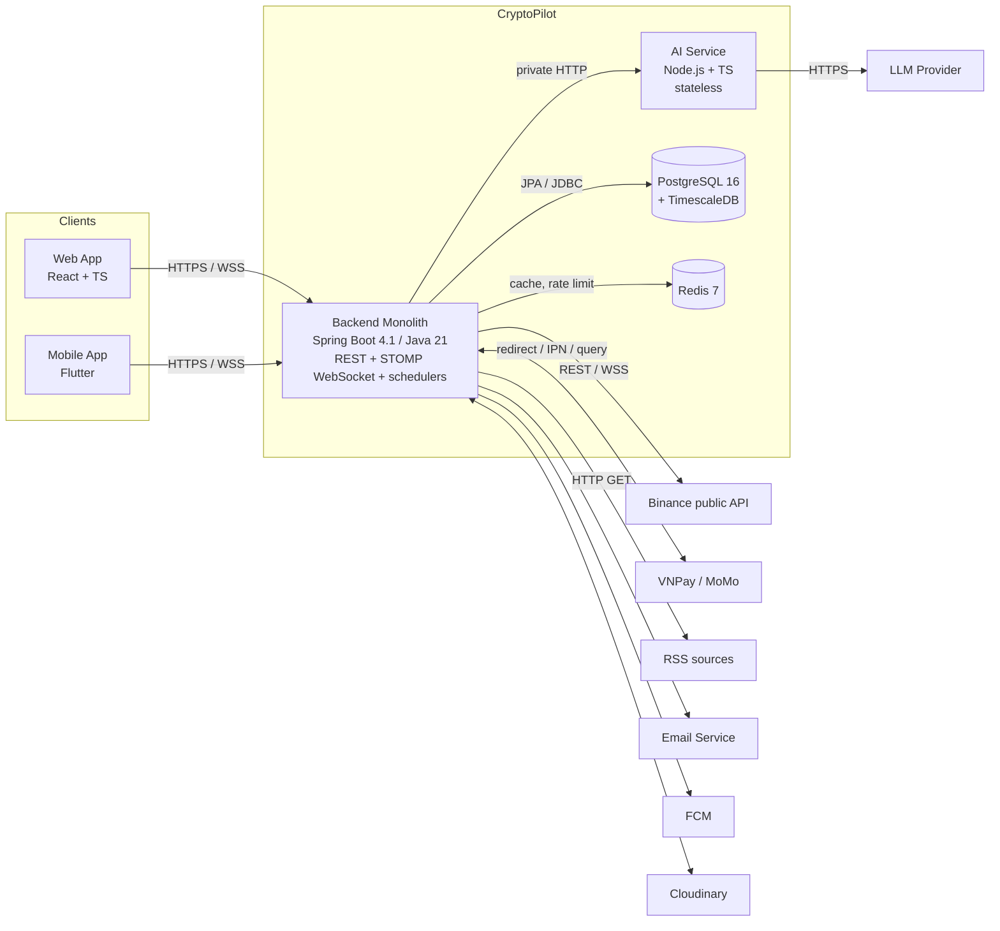

# CryptoPilot – Technical Design (Implementation Guide)

Version 2.0 · 2026-09-19 · Status: DRAFT FOR TEAM REVIEW · Backend: Java 21 + Spring Boot 4.1 (Maven)

This document turns the SRS (Report 3, v1.0) into an implementable design: architecture, folder structure, design patterns, data conventions, algorithms, APIs and the test strategy. Progress is tracked in `CURRENT_STATE.md`; AI agent rules are in `CLAUDE.md`. This document, the ADRs, the SRS copy, `CLAUDE.md` and `CURRENT_STATE.md` are local-only files: they are kept out of git by `.git/info/exclude` (see `CLAUDE.md` section 9).

Version 2.0 replaces the .NET design of version 1.0. Business rules, algorithms (section 7), the data model and the task plan are unchanged; the technology, the package structure and the tooling are Java.

---

## 0. Sources of truth and conflict rule

| Priority | Source | Owns |
|---|---|---|
| 1 | SRS v1.0 section 5.1 Business Rules (BR-xx) | What the system must do |
| 2 | This document | How it is built |
| 3 | `docs/design/CryptoPilot_Logical_Model.txt` | Data structure |
| 4 | Code | Implementation |

If two sources disagree, the higher priority wins. Any intentional deviation is recorded in section 13 (SRS Alignment Items) and must be approved by the team before the code relies on it. Never silently "fix" a business rule in code.

---

## 1. Architecture overview

### 1.1 Style

Modular monolith (one deployable Spring Boot application with strict internal module boundaries) plus one separate stateless AI Service (Node.js). Rationale: 4-person team, 6-month schedule, single database, simple operations; module boundaries keep the option to extract services later (ADR-001). Module boundaries are verified by Spring Modulith and ArchUnit tests, so a violation fails the build.

### 1.2 Container view (C4 level 2)



Only the backend owns the database (single writer). The AI Service has no database access: the backend sends it the configuration and context, the AI Service returns text and token usage (ADR-004).

### 1.3 Technology stack

| Concern | Choice | Notes |
|---|---|---|
| Language / runtime | Java 21 LTS (Eclipse Temurin) | Virtual threads enabled (`spring.threads.virtual.enabled=true`) |
| Framework | Spring Boot 4.1.x (Spring Framework 7) | 3.5 reached OSS end of life on 30/06/2026 and 4.0 ends 31/12/2026; 4.1 covers the project period (ADR-002) |
| Build | Maven with Maven Wrapper (`mvnw`) | Nobody installs Maven; versions come from the Spring Boot BOM |
| Module boundaries | Spring Modulith (+ ArchUnit rules inside modules) | ADR-003 |
| Web | Spring MVC (`spring-boot-starter-webmvc`) | Boot 4 renamed the starter from `spring-boot-starter-web`. Not WebFlux; blocking code on virtual threads |
| Realtime | Spring WebSocket + STOMP, simple in-memory broker | ADR-005 |
| Persistence | Spring Data JPA (Hibernate) + native SQL for TimescaleDB and reports | `ddl-auto=validate` |
| Migrations | Flyway (SQL files in `db/migration`) | Schema is written by hand in SQL |
| Database | PostgreSQL 16 + TimescaleDB 2.x | Hypertables for time series |
| Cache | Redis 7, image `redis:7.4.11-alpine` pinned (Spring Data Redis, Lettuce) | Latest prices only; cache only, so losing it never loses business data (Q-09) |
| Scheduling | Spring `@Scheduled` | Single instance; ShedLock only if a second instance is ever added |
| Async side effects | Spring Modulith event publication registry (JDBC) + `@ApplicationModuleListener` | Transactional outbox (ADR-010) |
| HTTP clients | Spring `RestClient` over the JDK `HttpClient` (connect and read timeouts); JDK `java.net.http.WebSocket` for Binance streams | T-017: `market.client.BinanceRestClient` (7.1.2) |
| Resilience | Timeouts on every client; Spring Framework 7 `RetryTemplate` / `@Retryable` / `@ConcurrencyLimit`; the Binance client's circuit breaker is written in the client (D-37, accepted 2026-09-24, 7.1.2) because Resilience4j's Boot 4 support was not confirmed; its IP ban is persisted in `binance_ban` | |
| Validation | Jakarta Bean Validation (`spring-boot-starter-validation`) | Request DTOs |
| Security | Spring Security, OAuth2 Resource Server (JWT, HS256), `BCryptPasswordEncoder(12)` | |
| Rate limiting | Bucket4j (in-memory) in a servlet filter | |
| API docs | springdoc-openapi (release line compatible with Spring Boot 4) | |
| Logging | SLF4J + Logback; Spring Boot structured logging (JSON) outside `dev` | Correlation id in MDC |
| IDs | UUID v7 from `com.fasterxml.uuid:java-uuid-generator` | ADR-009 |
| Boilerplate | Lombok, limited to entities and constructor injection (section 3.4) | DTOs are Java records |
| Formatting | Spotless with Palantir Java Format | `./mvnw spotless:apply` |
| Coverage | JaCoCo | Gates in section 11 |
| AI Service | Node.js LTS, TypeScript, Fastify, zod, @anthropic-ai/sdk, bottleneck | Unchanged |
| Web | React 18 + TypeScript + Vite, TanStack Query, React Router, React Hook Form + zod, @stomp/stompjs, TradingView Lightweight Charts | |
| Mobile | Flutter (stable), Riverpod, dio, go_router, stomp_dart_client | Chart library in ADR-012 |
| Tests | JUnit Jupiter, AssertJ, Mockito — Boot 4 has no single `spring-boot-starter-test`; pull the per-slice starters (`spring-boot-starter-webmvc-test`, `-actuator-test`, `-validation-test`, later `-data-jpa-test`). Plus Testcontainers, WireMock (not yet added — the Binance client is tested against a JDK `com.sun.net.httpserver` stand-in, D-36, accepted 2026-09-24), ArchUnit, Spring Modulith Test, jqwik; Vitest, Playwright, k6 | |

Library versions are managed by the Spring Boot BOM wherever possible; any extra library version is declared once in the `<properties>` of `backend/pom.xml`.

Libraries NOT to add: ModelMapper (reflection mapping), MapStruct (not needed; manual mapping), Spring WebFlux, Kafka/RabbitMQ, Lombok `@Data`/`@Setter` on entities, any exchange trading SDK.

### 1.4 Architecture Decision Records (summary)

| ADR | Decision | Status |
|---|---|---|
| ADR-001 | Modular monolith + separate AI Service | Accepted |
| ADR-002 | Java 21 LTS + Spring Boot 4.1 + Maven | Accepted (2026-09-19, D-02); pinned to 4.1.1 in T-002 |
| ADR-003 | Package by module, then by layer; boundaries verified by Spring Modulith and ArchUnit | Accepted (2026-09-19, D-03) |
| ADR-004 | AI Service stateless; backend is the only DB writer | Proposed |
| ADR-005 | Realtime via Spring WebSocket + STOMP; Redis only as cache | Proposed |
| ADR-006 | `@Scheduled` for schedules, virtual-thread workers for streams, Modulith events for durable async work | Proposed |
| ADR-007 | Manual mapping with records; no ModelMapper/MapStruct; Lombok limited | Proposed |
| ADR-008 | `BigDecimal` precision and rounding policy (section 5.4) | Proposed |
| ADR-009 | UUID v7 primary keys generated by the application | Proposed |
| ADR-010 | Transactional outbox through the Spring Modulith event publication registry | Proposed |
| ADR-011 | Matching engine price source = kline_1m stream (high/low) + mark price stream | Proposed |
| ADR-012 | Flutter chart library | Open (decide in phase P14) |

Full ADRs live in `docs/adr/ADR-0xx-*.md` (template: Context, Decision, Consequences, Alternatives).

---

## 2. Module decomposition

One module = one direct sub-package of `com.cryptopilot`. Spring Modulith treats each of them as an application module.

| Module | Responsibility | Owns tables | SRS refs |
|---|---|---|---|
| `auth` | Registration, email verification, login, JWT, refresh tokens, password reset, security configuration | user_token | UC-01…05, UC-07, BR-01…04 |
| `user` | Accounts, roles, status, profile, notification preferences, devices, admin user management | user_account, user_profile, user_device | UC-06, UC-08, UC-42, BR-05, BR-06, BR-58 |
| `market` | Coins, pairs, candles, snapshots, Binance streams and backfill, leverage brackets, indicators, support/resistance, setup score | coin, crypto_pair, ohlcv, spot_market_data, futures_market_data, funding_rate_history, leverage_bracket, technical_indicator | UC-09…11, UC-45, UC-46, NSF-01…05, BR-07…14 |
| `watchlist` | Watchlist, alerts, alert engine | watchlist, alert | UC-12…14, NSF-06, BR-15…20 |
| `trading` | Trading plans, risk and liquidation calculation, warnings, strategies, simulated matching | trading_plan, trading_plan_warning, trading_strategy | UC-16…21, NSF-07…09, BR-21…39 |
| `journal` | Journal records, trade reviews, manual trades, performance statistics | trading_journal (+ performance views) | UC-22…25, BR-40…42 |
| `community` | Posts, comments, likes/saves, media, reports, moderation, official announcements | forum_post, post_coin, forum_comment, engagement, post_media, post_report | UC-26…33, UC-43, UC-44, BR-43…47, BR-61 |
| `news` | News sources, crawling, deduplication, tagging, summaries | news_source, news_crawl_log, news_article, news_tag, news_article_tag, news_article_coin | UC-34, UC-49, NSF-10, NSF-11, BR-48, BR-49 |
| `ai` | Conversations, messages, AI configuration, quota, AI Service client | ai_conversation, ai_message, ai_configuration | UC-35, UC-36, UC-50, NSF-16, BR-50…52 |
| `billing` | Packages, orders, subscriptions, VNPay/MoMo, IPN, entitlement | subscription_package, subscription_order, user_subscription | UC-37…39, UC-47, UC-48, NSF-12…14, BR-53…56 |
| `notification` | In-app notifications, email and push dispatch | notification | UC-15, NSF-15 |
| `admin` | System settings, audit log, dashboard and management reports | system_setting, audit_log | UC-40, UC-41, UC-51, UC-52, NSF-17, NSF-18, BR-57 |
| `common` | Shared kernel (open module): base entity, error codes, global exception handling, shared configuration, utilities | — | CR-01…09 |

Module rules:
1. A module writes only its own tables.
2. A module calls another module only through that module's **public API**: the classes placed directly in the module's root package (e.g. `com.cryptopilot.user.UserApi`, `UserSummary`) and the events in its `event` package. Everything else in a module (`controller`, `service`, `repository`, `entity`, `dto`, …) is internal. Spring Modulith's `ApplicationModules.verify()` fails the build on a violation.
3. Synchronous reads/commands across modules use the other module's `XxxApi`; reactions use events (`@ApplicationModuleListener`), which are persisted by the event publication registry (outbox).
4. No cyclic dependencies between modules (verified by Spring Modulith).
5. `trading` records executions through `journal.JournalApi` (the journal module owns the table).
6. Moderation screens are served by `community` (admin endpoints under `/api/v1/admin/...` inside `community.controller`), because moderation changes community tables.

---

## 3. Package structure, layer rules and design patterns

### 3.1 Layers inside a module

Every module uses the same sub-packages. Create only the ones the module needs.

| Package | Contains | May depend on | Must not depend on |
|---|---|---|---|
| `controller` | `@RestController`, STOMP `@Controller`; request validation; maps to/from DTOs | `service`, `dto` | `repository`, `entity` |
| `service` | Business use cases, `@Transactional` boundaries, authorization of ownership, calls to other modules' APIs, event publishing | `repository`, `entity`, `dto`, `calculator`, `client`, `event`, other modules' root API and events, `common` | `controller` |
| `repository` | Spring Data JPA repositories, native queries | `entity` | `service`, `controller` |
| `entity` | JPA entities, enums, embeddable value objects; invariants and state transitions as methods | `common` | `service`, `repository`, `controller` |
| `dto` | Request/response records (`record`), with Bean Validation annotations | `entity` enums only | `service`, `repository` |
| `calculator` | Pure business formulas (risk, liquidation, fees, P/L, indicators, setup score, period calculation) | `java.*`, `common.util` | Spring, JPA, `repository`, `service` |
| `client` | Adapters to external systems (Binance, VNPay, MoMo, AI Service, SMTP, FCM, Cloudinary, RSS) | own records, `common` | `repository`, `controller` |
| `job` | `@Scheduled` jobs, stream workers, event listeners; orchestration only | `service` | `repository` directly |
| `event` | Event records published to other modules (named interface) | — | anything internal |
| `config` | Module-specific `@Configuration` (e.g. `auth.config.SecurityConfig`) | module internals | other modules' internals |

These rules are ArchUnit tests in `backend/src/test/java/com/cryptopilot/architecture/LayerRulesTest.java`; module boundaries are verified by `ModularityTest` (Spring Modulith). A failing architecture test fails the build.

The SRS layers map as follows: presentation = `controller`; application = `service`; domain = `entity` + `calculator`; infrastructure = `repository` + `client` + `job`.

### 3.2 Pattern catalogue

| Pattern | Where | Why | Reference |
|---|---|---|---|
| Layered architecture per module | Section 3.1 | Presentation, application, domain and infrastructure separated; SRS 4.2.5 | Evans 2003 ch. 4; Martin 2017 |
| Modular monolith with verified boundaries | Section 2, Spring Modulith | Independent modules in one deployable | Richardson 2018; Spring Modulith reference documentation |
| Entity with invariants (rich domain model) | `TradingPlan.activate()`, `SubscriptionOrder.markPaid()` | Invariants in one place; no setters | Evans 2003 |
| Pure domain calculator | `RiskCalculator`, `LiquidationCalculator`, `FeeCalculator`, `FundingCalculator`, `PnlCalculator`, `IndicatorEngine`, `SetupScoreCalculator` | Deterministic, unit-testable without Spring or DB | Evans 2003 |
| State pattern / explicit transition table | `TradingPlan`, `Alert`, `SubscriptionOrder`, `PostReport` lifecycles | Illegal transitions impossible | Gamma et al. 1994 |
| Strategy | Warning rules (`WarningRule`), alert conditions (`AlertCondition`), payment gateways (`PaymentGateway`) | Add rules/gateways without editing existing code | Gamma et al. 1994 |
| Specification / rule object | BR-22, BR-25, BR-26, BR-28, BR-29 | Each BR is one class with one test class | Evans & Fowler 1997 |
| Adapter / anti-corruption layer | `BinanceMarketClient`, `VnPayGateway`, `MoMoGateway`, `AiServiceClient` | External models never leak into entities | Evans 2003; Gamma et al. 1994 |
| Facade (module API) | `UserApi`, `MarketApi`, `JournalApi`, `BillingApi` | One narrow entry point per module | Gamma et al. 1994 |
| Repository + Unit of Work | Spring Data JPA; `@Transactional` service method | Transaction boundary = one use case | Fowler 2002 |
| Command–query separation | Service methods either change state or return data | Predictable side effects | Meyer 1988 |
| Domain events + transactional outbox | Spring Modulith event publication registry | No lost or duplicated side effects | Richardson 2018 |
| Idempotent consumer | IPN handler, backfill upserts, event listeners | At-least-once inputs, exactly-once effects | Richardson 2018; Kleppmann 2017 |
| Producer–consumer with bounded queues | Market events → indicator, alert and matching workers | Decoupled high-frequency processing | Hohpe & Woolf 2003 |
| Actor-style single consumer | One consumer per market partition in the matching engine | No locks, deterministic ordering | Hewitt et al. 1973 |
| Retry with back-off, timeout, circuit breaker | Outbound HTTP/WebSocket | Resilience to provider failures | Nygard 2018 |
| Exception translation | `BusinessException(ErrorCode)` → `ProblemDetail` in `GlobalExceptionHandler` | One error format mapped to SRS messages | RFC 9457 |
| Options / typed configuration | `@ConfigurationProperties` records, validated | No magic strings | Spring Boot reference documentation |

### 3.3 Naming

| Kind | Convention | Example |
|---|---|---|
| Controller | `<Resource>Controller` | `TradingPlanController` |
| Service | `<Resource>Service` (class, no interface unless there are two implementations) | `TradingPlanService` |
| Repository | `<Entity>Repository` | `TradingPlanRepository` |
| Entity | Singular noun, table name via `@Table` | `TradingPlan` → `trading_plan` |
| DTO | `<Action><Resource>Request`, `<Resource>Response` | `CreateTradingPlanRequest` |
| Module API | `<Module>Api` in the module root package | `JournalApi` |
| Event | Past tense record | `PositionClosed`, `AlertTriggered` |
| Calculator | `<Concept>Calculator` / `<Concept>Engine` | `LiquidationCalculator` |
| Test | `<ClassUnderTest>Test`; method `<RuleId>_<scenario>_<expected>` | `BR28_longStopBelowLiquidation_returnsBlocking` |

### 3.4 Coding rules

- Constructor injection only (`private final` fields). Lombok `@RequiredArgsConstructor(access = AccessLevel.PACKAGE)` where the constructor is a pure assignment; written out by hand where it does anything else, as in `AuthService` and `JwtConfig` (D-29). No field `@Autowired`.
- Entities: `@Getter` on the class; an accessor that computes something (`isNew`, `isEmailVerified`, `isLockedOutAt`, `isUsableAt`) stays hand-written, because it is behaviour wearing a getter's name. `@NoArgsConstructor(access = PROTECTED)` is permitted but not used — `protected UserAccount() {}` is shorter and says why it exists (D-29). State changes through methods that enforce the rules.
- `@Setter`, `@Data`, `@EqualsAndHashCode` and `@ToString` are compile errors everywhere, set in `backend/lombok.config` rather than left as a rule to remember (D-29).
- A constant that two layers must read belongs in the module's root package, not in either of them. ArchUnit cannot see a constant dependency — javac inlines it — so the layer table is also asserted over the import lines by `LayerSourceRulesTest` (D-30).
- DTOs and events are `record`s.
- `@Transactional` only on service methods; read-only queries use `@Transactional(readOnly = true)`.
- Time: inject `java.time.Clock` (UTC); never call `Instant.now()`, `LocalDateTime.now()` or `new Date()` without it. Store `Instant` ↔ `timestamptz`.
- Money, prices and quantities: `BigDecimal` only; compare with `compareTo`, never `equals`; explicit `RoundingMode` on every `setScale`/`divide` (section 5.4).
- No business logic in controllers, repositories, jobs or `@Configuration` classes.
- Public classes and methods in `calculator` packages carry Javadoc with the rule id and the reference (see `CLAUDE.md` section 3).

---

## 4. Repository and folder structure

### 4.1 Backend package tree (final)

Every module follows the same pattern. A sub-package exists only when the module needs it; the tree below lists all of them.

```
backend/
├── pom.xml
├── mvnw  mvnw.cmd  .mvn/wrapper/
└── src/
    ├── main/
    │   ├── java/com/cryptopilot/
    │   │   ├── CryptoPilotApplication.java
    │   │   │
    │   │   ├── common/                               # shared kernel, open module (no business logic)
    │   │   │   ├── config/        CorsConfig, OpenApiConfig, JacksonConfig, ClockConfig, AsyncConfig
    │   │   │   ├── exception/     GlobalExceptionHandler, BusinessException, ResourceNotFoundException, ErrorCode
    │   │   │   ├── entity/        BaseEntity (UUID v7 id, createdAt, updatedAt, version)
    │   │   │   ├── web/           PageResponse, CorrelationIdFilter, RateLimitFilter
    │   │   │   └── util/          UuidV7, Rounding
    │   │   │
    │   │   ├── auth/                                 # register, verify, login, JWT, refresh, reset password
    │   │   │   ├── AuthApi.java   PasswordPolicy.java   # BR-02 is read by dto and service, so it sits above both (D-30)
    │   │   │   ├── config/        SecurityConfig, JwtConfig
    │   │   │   ├── controller/    AuthController, PasswordChangeController   # PUT /me/password (UC-07)
    │   │   │   ├── service/       AuthService, PasswordChangeService, AccessTokenIssuer, SecureTokenFactory, FamilyRevoker
    │   │   │   │                  # UC-07 is its own service: it has a session, names no address and spends no link (D-32)
    │   │   │   │                  # UC-04 lives on AuthService, not a PasswordResetService: it shares the
    │   │   │   │                  # token table, the non-enumeration rule and the session revocation with
    │   │   │   │                  # UC-02 and UC-05, and a second class would have to reach all three (D-32)
    │   │   │   ├── repository/    UserTokenRepository
    │   │   │   ├── entity/        UserToken, TokenType
    │   │   │   ├── dto/           RegisterRequest, LoginRequest, TokenResponse …
    │   │   │   └── security/      JwtAuthenticationConverter, CurrentUser
    │   │   │
    │   │   ├── user/                                 # account, profile, preferences, devices, admin user management
    │   │   │   ├── UserApi.java   UserSummary.java
    │   │   │   ├── controller/    ProfileController, DeviceController, AdminUserController
    │   │   │   ├── service/       UserService, ProfileService, DeviceService
    │   │   │   ├── repository/    UserAccountRepository, UserProfileRepository, UserDeviceRepository
    │   │   │   ├── entity/        UserAccount, UserProfile, UserDevice, Role, AccountStatus
    │   │   │   └── dto/
    │   │   │
    │   │   ├── market/                               # pairs, candles, snapshots, Binance, brackets, indicators, setup score
    │   │   │   ├── MarketApi.java PairFilters.java MarketType.java   # PairFilters and MarketType exist since T-018 (D-38); MarketApi arrives with its first caller
    │   │   │   ├── controller/    MarketController, AnalysisController, AdminPairController
    │   │   │   ├── service/       PairService, CandleService, AnalysisService, LeverageBracketService, MarketBroadcastService
    │   │   │   ├── repository/    CoinRepository, CryptoPairRepository, OhlcvRepository, TechnicalIndicatorRepository …
    │   │   │   ├── entity/        Coin, CryptoPair, Ohlcv, SpotMarketData, FuturesMarketData, LeverageBracket, TechnicalIndicator
    │   │   │   ├── dto/
    │   │   │   ├── calculator/    IndicatorEngine, SwingDetector, SetupScoreCalculator
    │   │   │   ├── client/        BinanceRestClient, BinanceStreamShard
    │   │   │   ├── job/           SymbolSyncJob, StreamSupervisor, FuturesMetricsJob, SnapshotJob, BackfillListener, IndicatorWorker
    │   │   │   └── event/         PriceTick, CandleClosed, IndicatorsComputed, PairMarketEnabled, GapDetected
    │   │   │
    │   │   ├── watchlist/                            # watchlist, alerts, alert engine
    │   │   │   ├── controller/    WatchlistController, AlertController
    │   │   │   ├── service/       WatchlistService, AlertService
    │   │   │   ├── repository/    WatchlistRepository, AlertRepository
    │   │   │   ├── entity/        Watchlist, Alert, AlertType, AlertStatus, TriggerMode
    │   │   │   ├── dto/
    │   │   │   ├── calculator/    AlertConditionEvaluator, condition/ (PriceCrossCondition, RsiCondition …)
    │   │   │   ├── job/           AlertEngineWorker
    │   │   │   └── event/         AlertTriggered
    │   │   │
    │   │   ├── trading/                              # plans, risk, liquidation, warnings, strategies, simulated matching
    │   │   │   ├── TradingApi.java
    │   │   │   ├── controller/    TradingPlanController, StrategyController
    │   │   │   ├── service/       TradingPlanService, PositionService
    │   │   │   ├── repository/    TradingPlanRepository, TradingPlanWarningRepository, TradingStrategyRepository
    │   │   │   ├── entity/        TradingPlan, TradingPlanWarning, TradingStrategy, PlanStatus, Direction, MarketType
    │   │   │   ├── dto/
    │   │   │   ├── calculator/    RiskCalculator, LiquidationCalculator, FeeCalculator, FundingCalculator
    │   │   │   │   └── warning/   WarningRule, LowRiskRewardRule, HighLeverageRule, StopBeyondLiquidationRule …
    │   │   │   ├── matching/      OrderBook, MatchingEngine, MatchingWorker, ReplayService
    │   │   │   ├── job/           PlanExpiryJob
    │   │   │   └── event/         PlanExecuted, PositionClosed
    │   │   │
    │   │   ├── journal/                              # journal records, reviews, manual trades, performance
    │   │   │   ├── JournalApi.java
    │   │   │   ├── controller/    JournalController, PerformanceController
    │   │   │   ├── service/       JournalService, PerformanceService
    │   │   │   ├── repository/    TradingJournalRepository, PerformanceQueryRepository
    │   │   │   ├── entity/        TradingJournal, TradeSource, TradeStatus
    │   │   │   ├── dto/
    │   │   │   └── calculator/    PnlCalculator, PerformanceMetrics
    │   │   │
    │   │   ├── community/                            # posts, comments, likes/saves, media, reports, moderation, announcements
    │   │   │   ├── controller/    PostController, CommentController, ModerationController, AnnouncementController
    │   │   │   ├── service/       PostService, CommentService, EngagementService, ReportService, ModerationService, MediaService
    │   │   │   ├── repository/
    │   │   │   ├── entity/        ForumPost, PostCoin, ForumComment, Engagement, PostMedia, PostReport
    │   │   │   ├── dto/
    │   │   │   └── client/        CloudinaryClient
    │   │   │
    │   │   ├── news/                                 # sources, crawl, dedup, tagging, summaries
    │   │   │   ├── controller/    NewsController, AdminNewsSourceController
    │   │   │   ├── service/       NewsService, NewsSourceService, CrawlService
    │   │   │   ├── repository/
    │   │   │   ├── entity/        NewsSource, NewsCrawlLog, NewsArticle, NewsTag, NewsArticleTag, NewsArticleCoin
    │   │   │   ├── dto/
    │   │   │   ├── calculator/    UrlNormalizer, TitleNormalizer, CoinTagger
    │   │   │   ├── client/        RssClient
    │   │   │   └── job/           NewsCrawlJob, NewsSummaryJob
    │   │   │
    │   │   ├── ai/                                   # conversations, messages, configuration, quota
    │   │   │   ├── controller/    AiConversationController, AdminAiConfigController
    │   │   │   ├── service/       AiChatService, QuotaService, ContextSnapshotService, AiConfigurationService
    │   │   │   ├── repository/
    │   │   │   ├── entity/        AiConversation, AiMessage, AiConfiguration
    │   │   │   ├── dto/
    │   │   │   ├── client/        AiServiceClient
    │   │   │   ├── job/           AiRequestListener
    │   │   │   └── event/         AiQuestionAsked
    │   │   │
    │   │   ├── billing/                              # packages, orders, VNPay/MoMo, IPN, subscriptions, entitlement
    │   │   │   ├── BillingApi.java
    │   │   │   ├── controller/    PackageController, OrderController, PaymentCallbackController, AdminBillingController
    │   │   │   ├── service/       OrderService, PaymentService, SubscriptionService, EntitlementService
    │   │   │   ├── repository/
    │   │   │   ├── entity/        SubscriptionPackage, SubscriptionOrder, UserSubscription, OrderStatus
    │   │   │   ├── dto/
    │   │   │   ├── calculator/    SubscriptionPeriodCalculator
    │   │   │   ├── client/        PaymentGateway, VnPayGateway, MoMoGateway
    │   │   │   ├── job/           ReconciliationJob, SubscriptionExpiryJob
    │   │   │   └── event/         SubscriptionActivated
    │   │   │
    │   │   ├── notification/                         # in-app notifications, email, push
    │   │   │   ├── NotificationApi.java
    │   │   │   ├── controller/    NotificationController
    │   │   │   ├── service/       NotificationService
    │   │   │   ├── repository/    NotificationRepository
    │   │   │   ├── entity/        Notification, NotificationType
    │   │   │   ├── dto/
    │   │   │   ├── client/        EmailSender, FcmSender
    │   │   │   └── job/           NotificationListeners (AlertTriggered, PositionClosed, SubscriptionActivated …)
    │   │   │
    │   │   └── admin/                                # settings, audit log, dashboard, reports, retention
    │   │       ├── AdminApi.java
    │   │       ├── controller/    DashboardController, ReportController, SettingController, AuditLogController
    │   │       ├── service/       SettingService, AuditService, ReportService
    │   │       ├── repository/    SystemSettingRepository, AuditLogRepository, ReportQueryRepository
    │   │       ├── entity/        SystemSetting, AuditLog
    │   │       ├── dto/
    │   │       └── job/           RetentionJob
    │   │
    │   └── resources/
    │       ├── application.yml          # shared defaults, no secrets
    │       ├── application-dev.yml      # local development
    │       ├── application-prod.yml     # staging / demo
    │       └── db/migration/            # V1__baseline_schema.sql, V2__timescale.sql, V3__reference_data.sql …
    │
    └── test/
        ├── java/com/cryptopilot/
        │   ├── architecture/            # ModularityTest (Spring Modulith), LayerRulesTest (ArchUnit)
        │   ├── support/                 # TestcontainersConfig, FixedClock, TradingPlanBuilder, CandleSeriesBuilder
        │   └── <module>/<layer>/        # same packages as main, e.g. trading/calculator/RiskCalculatorTest
        └── resources/
            ├── application-test.yml
            └── golden/                  # indicator reference CSV files
```

### 4.2 What goes where (quick rules)

| If the code… | Put it in | Example |
|---|---|---|
| Receives an HTTP request or STOMP message | `controller/` | `TradingPlanController` |
| Implements a use case, opens a transaction, checks ownership | `service/` | `TradingPlanService.create()` |
| Reads or writes a table of this module | `repository/` | `TradingPlanRepository` |
| Is a table row with its rules and state changes | `entity/` | `TradingPlan.activate()` |
| Is a request/response shape | `dto/` (record) | `CreateTradingPlanRequest` |
| Is a business formula from the SRS (BR-xx), no I/O | `calculator/` | `LiquidationCalculator` (BR-27) |
| Talks to an external system | `client/` | `BinanceRestClient`, `VnPayGateway` |
| Runs on a schedule, loops on a stream, or reacts to an event | `job/` | `PlanExpiryJob`, `AlertEngineWorker` |
| Is announced to other modules | `event/` (record) | `PositionClosed` |
| Is needed by another module | root package `XxxApi` | `JournalApi.recordExecution(...)` |
| Is used by every module and has no business logic | `common/` | `BusinessException`, `BaseEntity` |

Other folders of the repository:

```
cryptopilot_project/
├── backend/                    # above
├── ai-service/src/ { server.ts, config/, routes/, llm/, prompts/, limiter/, schemas/ }, test/
├── web/src/ { app/, features/<module>/{api,components,hooks,pages}, shared/{api,components,lib,realtime,i18n} }
├── mobile/lib/ { core/, features/<module>/{data,domain,presentation} }, test/
├── tools/golden/               # script that generates reference indicator data
├── deploy/ { docker-compose.dev.yml, docker-compose.yml, .env.example, nginx/ }
├── .github/ { pull_request_template.md, workflows/ }
├── README.md  .gitignore  .gitattributes  .editorconfig
└── [local only] CLAUDE.md  CURRENT_STATE.md  .claude/  docs/
```

### 4.3 Example — use case "create trading plan" (UC-16)

| File | Role |
|---|---|
| `trading/controller/TradingPlanController.java` | `POST /api/v1/plans`, validates `CreateTradingPlanRequest`, calls the service |
| `trading/dto/CreateTradingPlanRequest.java`, `TradingPlanResponse.java` | Records |
| `trading/service/TradingPlanService.java` | `@Transactional create(...)`: loads pair filters via `MarketApi`, calls the calculators, applies warning rules, saves |
| `trading/calculator/RiskCalculator.java`, `LiquidationCalculator.java`, `warning/*Rule.java` | BR-23…29, pure |
| `trading/entity/TradingPlan.java`, `TradingPlanWarning.java`, `PlanStatus.java` | Entity with `activate()`, `cancel()`, `markExecuted()` (BR-32) |
| `trading/repository/TradingPlanRepository.java` | Spring Data JPA |
| `src/test/java/com/cryptopilot/trading/calculator/RiskCalculatorTest.java` | `BR23_…`, `BR24_…`, `BR25_…` |

---

## 5. Cross-cutting design

### 5.1 Errors and API responses
- Business errors: `throw new BusinessException(ErrorCode.X, args)`. `ErrorCode` (in `common.exception`) has a stable code (e.g. `TRADING_BLOCKING_WARNING`), the HTTP status and the SRS message code (MSGxx).
- `GlobalExceptionHandler` (`@RestControllerAdvice`) returns `ProblemDetail` (RFC 9457) with properties `code`, `messageCode`, `traceId` and, for validation, `errors` (field → message).
- `ResourceNotFoundException` → 404 (MSG41 context); `MethodArgumentNotValidException` → 400 with field errors (MSG01/MSG15…); access denied → 403; unhandled → 500 with reference code (MSG43), no stack trace.

### 5.2 Time
- All times are `Instant` (UTC) in code and `timestamptz` in the database; a `Clock` bean (UTC) is injected everywhere.
- Candle boundaries are UTC (BR-08); UTC+7 conversion happens only in clients.

### 5.3 Security
- Access token JWT (RFC 7519), 15 minutes, HS256 with a key of at least 256 bits from the environment; issued with `NimbusJwtEncoder`, validated by the OAuth2 Resource Server.
- Refresh token: 256-bit random, stored as SHA-256 hash, rotated on every use; family id per login; reuse of a used token revokes the whole family (7.15).
- Authorization, three checks in three places (SRS 4.2.4 requires all three):
  - **Role** — the matrix of SRS 3.1.3, enforced by the filter chain in `auth.config.SecurityConfig` as path rules (`hasRole`), ending in `anyRequest().denyAll()` so an unclaimed path is closed. The chain is the enforcement point rather than `@PreAuthorize` because the matrix is itself a path-to-role table, because "Guest" is a column no method annotation can express, and because `denyAll` means a path must be named in the chain to be reachable at all — an annotation could not open one. The `role` claim becomes a `ROLE_*` authority in `auth.config.AccessTokenAuthenticationConverter`; the resource server's default converter reads `scope`/`scp` and would grant nothing.
  - **Ownership** — checked in services (`resource.userId == currentUser.id`), because it is a property of the row and not of the path: the matrix grants two Traders the same area and they must not read each other's rows.
  - **Entitlement** — subscription state, via `@PreAuthorize("@entitlement.has(authentication, 'AI')")` backed by `BillingApi` (7.12). Applies to SCR-29 and to posting a video; both are `TRADER` in the chain with the entitlement as a second check, because "Trader (Subscribed)" is an entitlement of the Trader role and not a fourth role (SRS 3.1.3), and because a fact that expires must not be encoded in a token that cannot be recalled.
- The payment callbacks `/billing/ipn/*` and `/billing/return/{gateway}` are not screens and carry no bearer token: they are authenticated by the gateway signature (BR-53) and must never fall under a role rule.
- Rate limits (Bucket4j filter): login 10/min/IP, API 120/min/user, AI 10/min/user.
- CORS restricted to the configured web origins.

### 5.4 Numeric precision and rounding (ADR-008)

| Kind | Java type | PostgreSQL type | Rule |
|---|---|---|---|
| Price, quantity | `BigDecimal` | `NUMERIC(28,12)` | Never `double` |
| USDT amount (P/L, fee, margin) | `BigDecimal` | `NUMERIC(28,8)` | |
| VND amount | `BigDecimal` (scale 0) | `NUMERIC(18,0)` | |
| Rates (fee, funding, MMR) | `BigDecimal` | `NUMERIC(12,8)` | |
| Percent input (risk %) | `BigDecimal` | `NUMERIC(6,3)` | |
| Indicators | computed in `double`, stored rounded to 10 dp | `NUMERIC(28,10)` | Analytical values only |
| Scores | `BigDecimal` | `NUMERIC(5,2)` | |
| Market change percent (24h) | `BigDecimal` | `NUMERIC(28,10)` | Computed from the exchange snapshot, not entered by a user, so it follows the analytical scale and not the risk-percent one |
| Model temperature | `BigDecimal` | `NUMERIC(3,2)` | `ai_configuration.temperature` only; a provider setting between 0 and 2, never money |

| Operation | Rounding |
|---|---|
| Division inside calculations | `MathContext.DECIMAL128` |
| Quantity | Floor to step size (BR-23): `RoundingMode.DOWN` on multiples of step |
| User-entered price | Nearest tick, `RoundingMode.HALF_UP` (BR-30) |
| Liquidation price | Conservative: LONG `CEILING` to tick, SHORT `FLOOR` to tick |
| Fees, P/L, margin | Full precision in calculation; stored with scale 8, `HALF_EVEN` |
| Display | Half-up (CR-02, CR-03) |

`BigDecimal` values are serialized to JSON as strings (global Jackson configuration in `common.config.JacksonConfig`).

### 5.5 Concurrency and idempotency
- Mutable entities use optimistic locking (`@Version long version`). Every table an entity maps — that is, every table with a single `uuid` primary key — carries `version bigint NOT NULL DEFAULT 0`, so `ddl-auto=validate` accepts the mapping. The four time-series tables, the association tables with composite keys, `system_setting`, `leverage_bracket` and `event_publication` are not entities and carry no version.
- State transitions that race (fill vs cancel, IPN vs reconciliation) use a compare-and-set update: `@Modifying @Query("update TradingPlan p set p.status = :to … where p.id = :id and p.status = :expected")`; exactly one caller gets `1` row updated.
- Upserts use native `INSERT … ON CONFLICT DO NOTHING` (candles, snapshots, articles).
- IPN processing locks the order row (`@Lock(PESSIMISTIC_WRITE)`) inside one transaction.
- Event listeners are idempotent: they check a natural key (notification id, order code, AI message id) before acting.

### 5.6 Redis keys

| Key | Type | TTL | Content |
|---|---|---|---|
| `px:{market}:{symbol}` | hash | 5 min | last, bid, ask, mark, index, funding, nextFundingTime, updatedAt |
| `k1m:{market}:{symbol}` | hash | 5 min | forming 1m candle o/h/l/c, openTime |

Redis is a cache: losing it must never lose business data.

---

## 6. Physical data design conventions

- Names: snake_case, singular table names; `USER` → `user_account` (reserved word). All other logical names map 1:1. Entities map with `@Table(name = "...")` and `@Column(name = "...")` where Java and SQL names differ.
- Primary keys: `uuid` v7 assigned by the application in `BaseEntity` (which implements `Persistable<UUID>` so Spring Data inserts without a preceding select); composite keys for time series as in the logical model (`@IdClass` or `@EmbeddedId`).
- Enumerations: `varchar(32)` + `CHECK (col IN (...))`, mapped with `@Enumerated(EnumType.STRING)`.
- Timestamps: `timestamptz`; `created_at` and `updated_at` on every table `BaseEntity` maps, set from the injected `Clock` and never by a database default, so a test can pin them. The same tables carry `version` (5.5). These three are physical columns of the design, not business attributes: the logical model does not list them and never will.
- Deletes cascade only from an aggregate root to rows that are part of it. An account is never hard-deleted — BR-05 moves it to `LOCKED` or `BANNED` — so the only foreign keys to `user_account` that cascade are the three rows that are the account itself: `user_profile`, `user_token` and `user_device`. Trading plans, journals, orders, subscriptions, community content and the audit trail keep the SQL default, so the database refuses a delete that would erase them. The complete cascade list is: `user_profile`, `user_token`, `user_device` → `user_account`; `leverage_bracket` → `crypto_pair`; `alert` → `watchlist`; `trading_plan_warning` → `trading_plan`; `ai_message` → `ai_conversation`; `post_coin`, `forum_comment`, `engagement`, `post_media`, `post_report` → `forum_post`; `forum_comment`, `engagement` → `forum_comment`; `news_crawl_log` → `news_source`; `news_article_tag`, `news_article_coin` → `news_article`; `news_article_tag` → `news_tag`. `notification.alert_id` is `ON DELETE SET NULL`: a deleted alert must not take the notification history with it. `SchemaCatalogueTest` holds this list and fails on any addition.
- Soft delete only where BR-47 requires (status DELETED).
- Hypertables (TimescaleDB): `ohlcv` (chunk 30 days, compression after 60 days, segment by pair_id, market_type, timeframe), `technical_indicator` (same), `spot_market_data` and `futures_market_data` (chunk 7 days). `funding_rate_history` is deliberately **not** a hypertable: funding settles every 1 to 8 hours depending on the symbol (the interval is read from the source, never assumed — BR-11; on 2026-09-25 `fundingInfo` listed 321 symbols at 8 h, 469 at 4 h and 1 at 1 h, and all 13 demo pairs at 8 h), so it grows by 3 to 24 rows per pair per day (~55k to ~440k rows a year at 50 pairs), which needs neither chunking nor compression, and a plain table keeps it freely joinable. `HypertableTest` asserts that the four above are the only hypertables.
- Hypertable primary keys include the time column (already true in the logical model).
- Do not create a physical FK from `technical_indicator` to `ohlcv` (hypertable-to-hypertable FKs are not supported in all TimescaleDB versions). Consistency is guaranteed because both rows are written by the same ingestion flow.
- Retention (NSF-17): spot_market_data 7 days; futures_market_data 90 days (every row is a periodic snapshot); funding_rate_history, ohlcv and technical_indicator kept permanently; user_token expired > 7 days deleted; notification > 90 days deleted; completed event publications > 7 days deleted.
- **Why the settled funding rates have their own table (A-12).** `futures_market_data` was designed to hold two kinds of row told apart by `snapshot_type`: periodic snapshots worth 90 days, and funding settlements the P/L reads and that must outlive them (BR-37, A-05). A TimescaleDB retention policy drops whole chunks and cannot look at a column, so no single policy on that table can keep one kind and drop the other — the first policy to remove a 90-day-old chunk would take the funding history inside it. The settlements therefore live in `funding_rate_history (pair_id, funding_time, funding_rate, mark_price)`, primary key `(pair_id, funding_time)`, with no retention policy; `futures_market_data` holds periodic snapshots only and `snapshot_type` is gone. Both changes are in `V2__timescale_hypertables.sql`, beside the policies that force them.
- The two `funding_rate` columns are different numbers and must not be substituted for one another: `futures_market_data.funding_rate` is the **predicted** rate of the moment, streamed from `@markPrice@1s` and read by the setup score (7.4); `funding_rate_history.funding_rate` is the rate that was actually **charged** at a settlement, and is the only one the realized P/L may use (7.8).
- Technical tables (not business entities, not in the logical ERD): `event_publication` (Spring Modulith registry), `flyway_schema_history`. Approved as such in A-09; they are never added to the logical model and no module treats them as its own tables.
- Target: PostgreSQL 16 with the TimescaleDB 2.x extension, Docker image `timescale/timescaledb:2.30.1-pg16` (D-18). The tag is pinned, not floating, and the same one is used by `deploy/docker-compose.dev.yml`, by the Testcontainers setup of section 11 and by staging, so a migration cannot pass locally and fail on the server. The plain tag rather than `-oss`: compression and continuous aggregates are Timescale-licensed features and the retention design below relies on compression. Staging runs this image on a self-hosted VPS; a managed PostgreSQL service is ruled out because it cannot install the extension.
- Migrations: Flyway only, SQL files `V<n>__<description>.sql` in `backend/src/main/resources/db/migration`; TimescaleDB statements in their own migration. Flyway 10 and later moved PostgreSQL support into `org.flywaydb:flyway-database-postgresql`, so the build needs that module next to `flyway-core`; both versions come from the Spring Boot BOM. `spring.jpa.hibernate.ddl-auto=validate`, so every entity change needs a migration. Never edit a migration that has been merged to `develop`.

Key indexes (in addition to PKs and FKs):

| Table | Index | Purpose |
|---|---|---|
| ohlcv | PK (pair_id, market_type, timeframe, open_time DESC) | latest N candles |
| trading_plan | (pair_id, plan_status) WHERE plan_status = 'ACTIVE' | engine rebuild |
| trading_journal | (user_id, trade_status, exit_time DESC) | journal, performance |
| trading_journal | (pair_id, trade_status) WHERE trade_status = 'OPEN' | engine rebuild |
| alert | (watchlist_id), (alert_status) WHERE alert_status = 'ACTIVE' | engine rebuild |
| notification | (user_id, is_read, created_at DESC) | bell badge |
| news_article | UNIQUE url_hash; (title_hash, published_at); (published_at DESC) | dedup, feed |
| subscription_order | UNIQUE order_code; (order_status, created_at) | IPN, reconciliation |
| user_subscription | UNIQUE order_id; (subscription_status, end_at) | entitlement, expiry |
| engagement | UNIQUE (user_id, post_id, action_type), UNIQUE (user_id, comment_id, action_type) | BR-45 |
| post_report | UNIQUE (post_id, reporter_id) | BR-46 |
| watchlist | UNIQUE (user_id, pair_id) | BR-15 |

---

## 7. Core algorithms

Every algorithm below lives in a `calculator` (or `trading.matching`) package as a pure class — I/O orchestration stays in services and jobs — carries Javadoc with the references listed, and has the mandatory tests of section 11.4.

### 7.1 Market data ingestion (NSF-01..04)

Endpoints: Spot REST `https://api.binance.com`, Spot streams `wss://stream.binance.com:9443`; Futures REST `https://fapi.binance.com`, Futures streams `wss://fstream.binance.com/market` (klines and mark prices are `/market` streams; the unrouted host carries only `/public` ones since 2026-04-23 — D-43). Public data only (BR-09). The server must run in a region where Binance APIs are reachable.

Streams per enabled pair (BR-07: `ACTIVE`, the market switch on, and TRADING on the exchange — D-44): `<s>@kline_<tf>` for tf ∈ {15m,1h,4h,1d} (storage), spot `<s>@ticker`, futures `<s>@markPrice@1s` — five per pair and market, never split across connections. `<s>@kline_1m` (matching and alert high/low, not stored) is added by T-042 (D-43).

Algorithm:
1. Shard streams into combined-stream connections of at most 100 streams (`/stream?streams=a/b/c`), one `BinanceStreamShard` per connection.
2. For each message (T-021): parse into `StreamMessage`; a ticker or mark price overwrites the pair's entry in `LatestMarketData` (in memory until T-022 moves it to Redis); a closed kline is offered — never waited for — to the bounded `ArrayBlockingQueue` of its partition (market, pair; 4 partitions, one virtual thread each), so one series is stored in order. A full queue refuses the candle; its gap is found at the next close.
3. On a kline with `x == true` (closed) and tf ∈ storage set: `INSERT … ON CONFLICT DO NOTHING` into `ohlcv` in its own transaction, then publish `CandleClosed` (for every close, also one the backfill had stored).
4. Gap detection: keep `lastOpenTime[(pair,market,tf)]`, read from `ohlcv` the first time a series is seen. If `newOpenTime > lastOpenTime + tf`, publish `GapDetected` for `(lastOpenTime + tf, newOpenTime − tf)`; for a series with nothing stored, from the D-41 depth start. `CandleBackfillJob` queues it (in memory) and `CandleBackfillService.fillGap` fetches exactly that range with `startTime`/`endTime`, paced like the backfill, before the catch-up of the same run (A-33). **At start-up** the stored series of the last `gap-scan-window` (7 days) are scanned with `lag(open_time)` over `(pair, market, timeframe)`; every step larger than the timeframe is queued as a gap the same way, so a gap held only in memory before a restart is still filled.
5. Backfill (NSF-02, T-020): targets are pairs TRADING on the market (D-42), timeframes 15m/1h/4h/1d each fetched natively; resume from the latest stored `open_time`, or now − depth (D-41) for an empty series; REST klines with `startTime` and `limit` = 1000 on Spot, 500 on futures, looping until the exchange has nothing newer; keep only closed candles (`closeTime < now`); each page `INSERT … ON CONFLICT DO NOTHING` in its own transaction after the call; stop at 50 % of the venue's weight budget and continue the next minute (the client itself stops everyone at 80 %). Runs after each symbol sync and hourly at `0 1 * * * *` UTC.
6. Reconnect: exponential back-off 1 s, 2 s, 4 s … max 60 s, each wait shortened at random by up to 20 %, reset after a successful connection; proactively renew each shard after 23 h by opening the new connection before closing the old one (no loss, no event); a connection silent for 60 s is aborted and reconnected (every shard carries a once-a-second ticker or mark price). A reconnection after a loss publishes `MarketStreamReconnected`, and NSF-02 runs a catch-up of that market at once; later gaps are found by step 4. The JDK `WebSocket` answers pings with the same payload itself. A connection the exchange closes before `buildAsync` completes is still a loss: each connection's listener records that it ended, and opening an ended connection schedules a reconnect.
7. Snapshots: every 60 s, at the whole minute, write one `spot_market_data` / `futures_market_data` row per streamed pair from the latest values (in memory until T-022), skipping values older than 2 minutes. Spot: `ON CONFLICT DO NOTHING` on `(pair_id, snapshot_time)`. Futures (T-023 fix): on a conflict NSF-03 fills its own four columns only when they are all still `NULL` — a row NSF-04 created first — and otherwise changes nothing, so a repeated write keeps the first values and NSF-04's metric columns are never touched. The futures row carries mark price, index price, predicted funding rate and next funding time; open interest and ratios are NSF-04's.
8b. Demo pairs, `dev` only (Q-16, T-021): `cryptopilot.market.demo.activate-seed-symbols` enables the seed symbols on each market where they are TRADING, once per market after its first sync, before the other listeners of `SymbolsSynchronised`. Idempotent; false by default and in `prod` (BR-07).
8a. Symbol synchronisation (NSF-01, T-019): at start-up and daily at 00:05 UTC, per market in one transaction,
   `exchangeInfo` is reconciled with the registered pairs plus `cryptopilot.market.sync.seed-symbols`: filters
   replaced, the exchange status normalized to TRADING / NOT_TRADING / DELISTED in `*_exchange_status` with the raw
   text in `*_exchange_status_raw` (V8), a pair gone from a market it was on marked DELISTED (never deleted), seeds
   created INACTIVE. Idempotent except `last_synced_at`. Refusals follow the caller contract of 7.1.2 (D-39).
8. Futures metrics and funding settlement (NSF-04, T-023). `FuturesMetricsJob` runs on `30 1/5 * * * *` UTC (every 5 minutes, 90 s after the 5-minute instant) over the pairs NSF-03 streams (enabled on futures and TRADING there, D-44): first the settlements, then the metrics. Refusals follow the caller contract of 7.1.2; a run never overlaps the previous one.
   - **Open interest and long/short account ratio (D-45)** are read from the 5-minute histories `/futures/data/openInterestHist` (open interest *and its value*, which SCR-11 charts) and `/futures/data/globalLongShortAccountRatio`, not from the present-value `/fapi/v1/openInterest`: every reading carries the instant of its period, so all pairs land on the same 5-minute instants, and readings missed during a downtime can still be read for the month the source keeps (BR-10). Each metric resumes from its own latest stored instant (or `depth`, 30 days, back), paging forward in windows of `page-size` (500) periods with **both** `startTime` and `endTime` — with a start and no end the source answers its latest entries, not those after the start (measured 2026-09-25). At most `max-requests-per-run` (400) history calls per run; the next run continues from the data. They are written into **`futures_market_data`**, the row NSF-03 writes every minute, key `(pair_id, snapshot_time)` = the source's 5-minute instant: each metric is an upsert that sets its own columns only (`open_interest`, `open_interest_value` / `long_short_ratio`, `long_account_ratio`, `short_account_ratio`), inserting a row with the mark price columns `NULL` when NSF-03 has none. The four minute rows between two readings keep the metric columns `NULL` — never forward-filled. Only instants before the current minute are written, so NSF-03's snapshot of that minute has normally happened already; if NSF-04 still creates the row first, NSF-03 fills its empty columns on the conflict (step 7). A period not yet published is simply asked for again by the next run.
   - **Settlements.** `FundingSettlementDue` (calculator) decides per pair: due when nothing is stored, when the source states no interval for the symbol, or when `nextFundingTime − fundingInterval` has passed and no settlement at or after it is stored (stored settlements are compared at their normalized instant). An interval change is safe: settlements are always read from the latest stored one onwards, so a `fundingInfo` lagging behind the stream only delays a settlement by one interval. `nextFundingTime` is the streamed one while fresh (`mark-price-max-age`, 2 min), otherwise `/fapi/v1/premiumIndex`; the interval is `fundingIntervalHours` of `/fapi/v1/fundingInfo`, which lists only symbols whose cap, floor or interval were adjusted — **a symbol it omits has no interval and is checked on every run; no interval is ever assumed (BR-11)**. A due pair reads `/fapi/v1/fundingRate` from the latest stored settlement + 1 ms (or `settlement-depth`, 30 days, back) in pages of 1000 and writes one `funding_rate_history` row per pair and settlement instant — **the instant normalized by `FundingTimes.normalize`, rounded to the nearest minute (half up), the one rule for every write to the table**, because the source stamps one settlement a few ms apart (`…600000` and `…600005` seen); the next read starts at `FundingTimes.after(stored)` = stored + 30 s — `INSERT … ON CONFLICT DO NOTHING` (idempotent by the primary key `(pair_id, funding_time)`). A settlement dated after now, or without a mark price (the column requires it and the P/L multiplies by it), is not stored. These rows are never deleted: a closed trade's P/L is recomputed from them (7.8). The periodic snapshot of step 7 keeps carrying the *predicted* rate; the two are not interchangeable (section 6).

Complexity: O(1) per message; backfill O(N/1000) requests.

#### 7.1.1 Binance limits, verified 2026-09-24 (T-017)

Every value below was read from the official documentation on 2026-09-24, not remembered. The code takes none of
them as a literal: base URLs and weight budgets are `cryptopilot.market.binance.*` properties, and the current
use is read from the response header on every call. Re-check the sources when a limit is changed.

| Item | Spot | USD-M Futures | Source |
|---|---|---|---|
| REST base URL | `https://api.binance.com` | `https://fapi.binance.com` | [spot general endpoints](https://developers.binance.com/docs/binance-spot-api-docs/rest-api/general-endpoints), [futures general info](https://developers.binance.com/docs/derivatives/usds-margined-futures/general-info) |
| REQUEST_WEIGHT budget | 6000 per 1 minute, per IP | 2400 per 1 minute, per IP | `rateLimits` of spot `GET /api/v3/exchangeInfo` ([spot](https://developers.binance.com/docs/binance-spot-api-docs/rest-api/general-endpoints)) and of `GET /fapi/v1/exchangeInfo` ([futures](https://developers.binance.com/docs/derivatives/usds-margined-futures/market-data/rest-api/Exchange-Information)) |
| Used-weight header | `X-MBX-USED-WEIGHT-(intervalNum)(intervalLetter)`, i.e. `X-MBX-USED-WEIGHT-1M` | same | [spot limits](https://developers.binance.com/docs/binance-spot-api-docs/rest-api/limits), [futures general info](https://developers.binance.com/docs/derivatives/usds-margined-futures/general-info) |
| 429 | Rate limit exceeded; `Retry-After` gives the **seconds** to wait to avoid a ban | 429 on violation; back off | same two pages |
| 418 | IP auto-banned for continuing after 429; bans scale from 2 minutes to 3 days; `Retry-After` tells when the ban ends | same wording, same range | same two pages |
| Limits keyed by | IP, not API key | IP | [spot limits](https://developers.binance.com/docs/binance-spot-api-docs/rest-api/limits) |
| 503 / 5XX | — | "Service unavailable" may be retried with exponential back-off; a timeout with "Unknown error" means the outcome is unknown (relevant to orders only, which this system never sends) | [futures general info](https://developers.binance.com/docs/derivatives/usds-margined-futures/general-info) |
| Endpoint weights used by T-017 | `exchangeInfo` 20; `klines` 2 (limit max 1000, default 500) | `exchangeInfo` 1; `klines` 1–10 by limit (max 1500); `premiumIndex` 1 with symbol; `/futures/data/globalLongShortAccountRatio` 0 (period 5m…1d, limit max 500, latest 30 days only) | [spot market data](https://developers.binance.com/docs/binance-spot-api-docs/rest-api/market-data-endpoints), [futures market data](https://developers.binance.com/docs/derivatives/usds-margined-futures/market-data/rest-api) |
| NSF-04 endpoints, verified 2026-09-25 (T-023) | — | `/futures/data/openInterestHist` and `/futures/data/globalLongShortAccountRatio`: IP weight 0, **1000 requests / 5 min / IP**, period 5m (the shortest; `1m` answers `[]`), limit default 30, max 500; open interest history "latest 1 month", ratio "latest 30 days"; entries stamped at the period instant; with `startTime` and no `endTime` the **latest** `limit` entries are returned (measured), so forward paging sends both. `/fapi/v1/fundingRate`: shares **500 requests / 5 min / IP** with `/fapi/v1/fundingInfo`, limit default 100, max 1000, ascending, pages forward from `startTime`; `fundingTime` may be a few ms after the round instant (`…600005` measured). `/fapi/v1/fundingInfo`: weight 0; lists only "symbols that had FundingRateCap/FundingRateFloor/fundingIntervalHours adjustment"; `fundingIntervalHours` a JSON integer (791 symbols listed on 2026-09-25: 321 × 8 h, 469 × 4 h, 1 × 1 h), `updateTime` may be `null`. `/fapi/v1/openInterest`: weight 1, present value only | [Open Interest Statistics](https://developers.binance.com/docs/derivatives/usds-margined-futures/market-data/rest-api/Open-Interest-Statistics), [Long/Short Ratio](https://developers.binance.com/docs/derivatives/usds-margined-futures/market-data/rest-api/Long-Short-Ratio), [Get Funding Rate History](https://developers.binance.com/docs/derivatives/usds-margined-futures/market-data/rest-api/Get-Funding-Rate-History), [Get Funding Rate Info](https://developers.binance.com/docs/derivatives/usds-margined-futures/market-data/rest-api/Get-Funding-Rate-Info) |
| Klines, measured 2026-09-24 (T-020) | weight 2 at limit 500 and 1000; limit max 1000 (docs); limit 1001 answered 200 | weight 1 at limit ≤ 100, 2 at ≤ 500, 5 at 1000, 10 above 1000 (max 1500) — measured from `X-MBX-USED-WEIGHT-1M` before and after one call, because the page did not render the table | [spot REST (repo)](https://github.com/binance/binance-spot-api-docs/blob/master/rest-api.md), [futures klines](https://developers.binance.com/docs/derivatives/usds-margined-futures/market-data/rest-api/Kline-Candlestick-Data) |
| Stream base | `wss://stream.binance.com:9443` or `:443`; combined `/stream?streams=a/b` | `wss://fstream.binance.com/market` for klines, mark price, tickers, aggTrade; `/public` for depth and bookTicker; `/private` for user data; combined `/<route>/stream?streams=a/b`. Legacy unrouted URLs receive only `/public` data since 2026-04-23 (re-checked 2026-09-24, T-021: 0 messages on the unrouted host, 23 in 6 s under `/market`) | [spot WSS](https://github.com/binance/binance-spot-api-docs/blob/master/web-socket-streams.md), [futures connect](https://developers.binance.com/docs/derivatives/usds-margined-futures/websocket-market-streams/Connect), [futures WebSocket change notice](https://developers.binance.com/docs/derivatives/usds-margined-futures/websocket-market-streams/Important-WebSocket-Change-Notice) |
| Futures stream URL change, verified 2026-09-24 (T-021, D-43) | unchanged: `wss://stream.binance.com:9443/stream?streams=…` | **old:** `wss://fstream.binance.com/stream?streams=btcusdt@kline_1m/btcusdt@markPrice@1s` — connects, then sends nothing for `/market` streams (0 messages in 6 s). **New:** `wss://fstream.binance.com/market/stream?streams=btcusdt@kline_1m/btcusdt@markPrice@1s` (23 messages in 6 s). The notice: "Legacy URLs will remain available until 2026-04-23" and afterwards "any connections not migrated will ONLY be able to receive data from wss://fstream.binance.com/public. Channels under /market and /private will stop pushing data." Configured as `cryptopilot.market.stream.futures-url` | [Important WebSocket Change Notice](https://developers.binance.com/docs/derivatives/usds-margined-futures/websocket-market-streams/Important-WebSocket-Change-Notice), [Connect](https://developers.binance.com/docs/derivatives/usds-margined-futures/websocket-market-streams/Connect), [change log 2026-03-05 / 2026-04-02](https://developers.binance.com/docs/derivatives/change-log) |
| Connection lifetime | 24 hours; disconnected at the 24-hour mark; `serverShutdown` event before a shutdown | 24 hours | same |
| Ping / pong | Server pings every **20 s**; no pong within **1 minute** → disconnected; pong must copy the ping payload | Server pings every **3 minutes**; no pong within **10 minutes** → disconnected | same |
| Incoming messages | **5** per second per connection; beyond it disconnected, repeat offenders may be banned | **10** per second | same |
| Streams per connection | 1024 | 1024 | same |
| Connection attempts | 300 connections per 5 minutes per IP | not stated on the page read | [spot WSS](https://github.com/binance/binance-spot-api-docs/blob/master/web-socket-streams.md) |

Two consequences for later tasks. **T-021:** step 1 above caps a combined connection at 100 streams, well under
the 1024 allowed, and the proactive 23-hour reconnect of step 6 stays inside the 24-hour lifetime; the spot pong
deadline (1 minute) is far tighter than the futures one (10 minutes), so the JDK `WebSocket` must answer pings
itself on both. **T-017:** step 5's "pause when above 80% of limit" is enforced by the client itself (below).

#### 7.1.2 REST client (T-017)

`market.client.BinanceRestClient` is the only class that calls the Binance REST API, and it is an
anti-corruption layer: the wire shapes stay package-private and callers receive `ExchangeSymbol`, `Kline`,
`PremiumIndex`, `FundingRate`, `FundingInfo`, `OpenInterest`, `OpenInterestStatistic` and `LongShortRatio`, with every price and quantity parsed from the
exchange's string straight into `BigDecimal`. Endpoints are the ones T-019, T-020 and T-023 need and no others:
spot and futures `exchangeInfo` and `klines`; futures `premiumIndex`, `fundingRate`, `fundingInfo`,
`openInterest`, `openInterestHist` and `globalLongShortAccountRatio` (the last three added or used by T-023). Public endpoints only, no key (BR-09).

Resilience, per venue (spot and futures have separate IP budgets, so separate state):

1. **Timeouts** on connect and read for every call (`connect-timeout`, `read-timeout`).
2. **Weight budget.** `X-MBX-USED-WEIGHT-1M` is recorded from every response. When it reaches
   `weight-pause-ratio` (0.8) of the venue's `request-weight-per-minute`, the client refuses further calls until
   the next minute begins, with `BinanceClientException` of kind `RATE_LIMITED` and the instant to retry at. The
   client never sleeps for a budget; the job that called it decides.
3. **429** — refuse every call until `Retry-After` seconds have passed (or `default-retry-after` when the header
   is missing). Never retried.
4. **418** — the IP is banned: refuse every call until `Retry-After`, and log at ERROR, the alert level. Never
   retried.
5. **5xx, timeout, connection failure** — retried with Spring Framework 7 `RetryTemplate` (exponential back-off
   with jitter, `retry.*` properties). A call that still fails counts towards the **circuit breaker**: after
   `circuit-breaker.failure-threshold` consecutive failed calls the venue is refused for
   `circuit-breaker.open-duration`, then one trial call is allowed. Written in the client rather than added as
   Resilience4j, because it is thirty lines and Resilience4j's Spring Boot 4 support was not confirmed.
6. **Other 4xx** (a bad symbol, a bad interval) — `REJECTED`, never retried, never counted as an outage.
7. **Malformed body** — `MALFORMED`, never retried. The string-only rule is for decimals only (prices,
   quantities, rates, ratios, open interest); the fields the documentation sends as JSON numbers — times and
   the kline trade count — are read as integers, and fields the client does not read are ignored whatever
   their type. MALFORMED and REJECTED never count towards the breaker: the exchange answered, so the host is
   up, and an answered request ends a run of failures. Only 5xx, timeouts and refused connections count.

**IP bans survive a restart (T-017 follow-up).** A 418 is written to `binance_ban` (V7, one row per market,
`banned_until`, `reason`, `updated_at`) before the refusal is returned, through the `BinanceBanStore` port
(`market.service.PersistentBinanceBans`), and read back the first time each venue is used after a start; a
ban already ended is ignored. Bans grow from 2 minutes to 3 days with every repeat (7.1.1), so a restart that
forgot one and called again would make the next one longer. `binance_ban` is a technical table, like
`event_publication`, not a business entity. A 429 back-off stays in memory.

**The caller contract.** Every public method returns data or throws the one final type
`BinanceClientException` with a kind: `RATE_LIMITED`, `BANNED`, `CIRCUIT_OPEN` (each with `retryAt`, the
instant a call may succeed), `UNAVAILABLE`, `REJECTED`, `MALFORMED` (no `retryAt`). Scheduled callers (T-019,
T-020, T-023) **skip the run and reschedule at or after `retryAt`**; on `UNAVAILABLE` they wait for their next
run; on `REJECTED`/`MALFORMED` they log a defect. They never loop on a refusal and never sleep in the calling
thread (Nygard 2018, ch. 5, Fail Fast).

### 7.2 Incremental indicators (NSF-05, BR-12)

State per (pair, market, timeframe) kept in memory and rebuilt at start-up from the last 1,000 closed candles.

| Indicator | Update per closed candle | Seed |
|---|---|---|
| SMA(n) | rolling sum over ring buffer: `S += c_t − c_{t−n}`; `SMA = S/n` | first n closes |
| EMA(n) | `EMA_t = α·c_t + (1−α)·EMA_{t−1}`, `α = 2/(n+1)` | SMA of first n closes |
| RSI(14), Wilder | `AG_t = (AG_{t−1}·13 + gain_t)/14`, `AL_t` same with loss; `RSI = 100 − 100/(1 + AG/AL)`; if `AL = 0` then RSI = 100 | simple mean of first 14 gains/losses |
| MACD | `MACD = EMA12 − EMA26`; `signal = EMA9(MACD)`; `hist = MACD − signal` | EMA seeds as above; signal seeded after 26+9−1 candles |
| Bollinger(20,2) | middle = SMA20; σ = population std of last 20 closes recomputed over the window (20 ops, exact); bands = middle ± 2σ | – |
| Volume SMA20 | rolling sum of volume | – |

Warm-up and accuracy: the influence of the EMA seed decays as `(1−α)^k`. For EMA200 (`α ≈ 0.00995`) after 800 further candles the residual weight is `e^{−7.96} ≈ 3.5·10⁻⁴`, so loading 1,000 candles makes stored values independent of where history starts within 0.05%. RSI (`α = 1/14`) converges after ~200 candles. When fewer than 200 closed candles exist, EMA200 and the setup score are null (SRS 3.3.2).

Correctness invariant: incremental result == batch recomputation over the same history (property test, 11.4).

Complexity: O(1) per candle per indicator (Bollinger O(20)); memory O(200) per series.

References: Wilder 1978 (RSI, smoothing); Appel 2005 (MACD); Bollinger 2001; Murphy 1999 (moving averages).

### 7.3 Swing support/resistance (BR-14)

1. Over the last 200 closed candles, candle i is a swing low if `low_i < low_{i±1}` and `low_i < low_{i±2}`; swing high symmetric with `high`.
2. The last two candles cannot be confirmed yet and are ignored.
3. `nearest_support = max{ low_i : swing low, low_i < close }`; `nearest_resistance = min{ high_i : swing high, high_i > close }`; null if none.

Complexity O(200) per candle. Reference: Williams 1995 (fractals), Murphy 1999.

### 7.4 Setup score v1.0 (BR-13) – requires team approval (SRS 5.4.1 item 7)

The score is computed for both directions d ∈ {LONG = +1, SHORT = −1}; the stored `setup_score` is the higher one and a bias label is derived. This avoids scoring a strong downtrend as "bad" when a futures short is a valid setup. (Needs a new column `setup_bias`, see A-07.)

Component scores for direction d (each 0–100):

- Trend T: 25 points for each true condition: `d·(close − EMA20) > 0`, `d·(EMA20 − EMA50) > 0`, `d·(EMA50 − EMA200) > 0`, `d·(close − EMA200) > 0`.
- Momentum Mo = RSI part (max 50) + MACD part (max 50).
  - LONG RSI part: 50 if RSI ∈ [50,70]; 25 if RSI ∈ [40,50) or (70,80]; else 0. SHORT: 50 if RSI ∈ [30,50]; 25 if RSI ∈ (50,60] or [20,30); else 0.
  - MACD part: 30 if `d·hist > 0`, plus 20 if `d·(hist − hist_prev) > 0`.
- Volume V: `r = volume / VolSMA20`; `V = 100·clamp((r − 0.5)/1.0, 0, 1)`; halved if `d·(close − open) < 0`.
- Level L: LONG `q = (R − close)/(close − S)`, SHORT `q = (close − S)/(R − close)`; `L = 100·clamp(q/3, 0, 1)`; if S or R is null, `L = 50`.
- Derivatives D (futures only): funding part `50·clamp((0.0005 − d·f)/0.001, 0, 1)` where f is the current funding rate; OI part (Δ over the last 1 h): `sign(Δprice) = d` and `ΔOI > 0` → 50 (new positions confirm the move); `sign(Δprice) = d` and `ΔOI ≤ 0` → 25 (move driven by closing positions); otherwise 0.

Total per direction: Spot `0.35T + 0.30Mo + 0.15V + 0.20L`; Futures `0.30T + 0.25Mo + 0.15V + 0.15L + 0.15D`; rounded to integer.

`setup_score = max(S_LONG, S_SHORT)`; `setup_bias = LONG` if `S_LONG − S_SHORT ≥ 10`, `SHORT` if `S_SHORT − S_LONG ≥ 10`, else `NEUTRAL`. Store the components of the winning direction and `score_version = "v1.0"`. Any formula change bumps the version; old rows are never recomputed.

### 7.5 Risk calculation and warnings (BR-21..31)

Input: market, direction d, entry E (MARKET: current last price), stop S, take profit T, capital C, risk % p, leverage L, pair filters (tick, step, minNotional), brackets.

```
validate price order (BR-22) and ranges (BR-30); Spot ⇒ d = LONG, L = 1
riskBudget  = C × p / 100
qtyRaw      = riskBudget / |E − S|
qty         = floor(qtyRaw / step) × step                    ; if qty = 0 → validation error MSG15
notional    = qty × E                                         ; if notional < minNotional → MSG15
riskAmt     = qty × |E − S|
rewardAmt   = qty × |T − E|
rr          = rewardAmt / riskAmt
Spot:    notional > C                → BLOCKING INSUFFICIENT_CAPITAL (BR-25)
Futures: bracket = first b with notional ∈ [floor_b, cap_b)
         L > bracket.maxLeverage      → validation error
         margin = notional / L; margin > C → BLOCKING INSUFFICIENT_CAPITAL (BR-26)
         LP = LiquidationCalculator(...) (7.6)
         LONG: S ≤ LP or SHORT: S ≥ LP → BLOCKING SL_BEYOND_LIQUIDATION (BR-28)
apply WarningRule list (BR-29) with thresholds from system_setting
```

Each warning rule is one class implementing `WarningRule#evaluate(PlanCalculation) → Optional<Warning>` (package `trading.calculator.warning`).

References: Tharp 2007 (position sizing by fixed fractional risk, R-multiples).

### 7.6 Liquidation price (BR-27, isolated margin, one-way mode)

Exact isolated-margin formula used by Binance USDⓈ-M with wallet balance = initial margin and maintenance amount `cum` of the bracket:

```
LONG:  LP = ( E·(1 − 1/L) − cum/qty ) / (1 − MMR)
SHORT: LP = ( E·(1 + 1/L) + cum/qty ) / (1 + MMR)
```

With `cum = 0` this is exactly BR-27. Including `cum` is more accurate for higher brackets → alignment item A-01. Rounding is conservative (5.4). Fees are ignored (stated as estimate on screen).

Worked example (test vector): E = 100, S = 95, C = 1,000, p = 1, step 0.001, tick 0.01, MMR 0.004, cum 0.
- qty = 10/5 = 2.000; notional 200.
- L = 10: margin 20; LP = 90/0.996 = 90.3614… → ceil → 90.37; S = 95 > 90.37 → OK.
- L = 20: LP = 95/0.996 = 95.3815… → 95.39; S = 95 ≤ 95.39 → BLOCKING SL_BEYOND_LIQUIDATION.
- SHORT E = 100, S = 105, L = 10: LP = 110/1.004 = 109.5617… → floor → 109.56; S < LP → OK.

### 7.7 Simulated matching engine (NSF-07, BR-33..39, ADR-011)

Price sources: entry, TP and SL use the traded price range of the forming 1m candle (`kline_1m` updates carry cumulative high/low); futures liquidation uses `markPrice@1s`. Using the high/low range detects touches that happen between ticker updates.

Data structures per (market, symbol), owned by one consumer task (no locks):
- `BelowBook`: sorted set of (level, orderId) that fire when price ≤ level: LONG limit entries, LONG stop losses, SHORT take profits, LONG liquidations (mark).
- `AboveBook`: sorted set that fire when price ≥ level: SHORT limit entries, SHORT stop losses, LONG take profits, SHORT liquidations (mark).
- Implemented with `TreeMap<BigDecimal, Set<UUID>>` (a red-black tree, O(log n)); CLRS 2009.

Per update with range [lo, hi] (last-price books) or single value m (mark books):
```
fired = BelowBook.tailMap(lo, true)  ∪  AboveBook.headMap(hi, true)
group fired by position; for a position with both SL and TP fired → keep SL only (BR-35)
for entries: fill price = entry level (BR-33); for SL/TP: fill at the level; liquidation: at LP
persist each outcome in its own transaction with compare-and-set on status; on success update books and raise events
```
Complexity: O(k log n) per update, k = fired orders.

Activation of a plan: if the entry condition already holds at the current last price, or entry type is MARKET → immediate fill at the current last price (BR-33).

Recovery after restart: rebuild books from ACTIVE plans and OPEN journal records; for each pair fetch 1m klines through REST from `last_processed_at` to now and replay chronologically with the same rules (more accurate than 15m candles → alignment item A-04). Missing mark prices during downtime: use futures mark price klines for the same interval.

References: Cormen et al. 2009 (balanced search trees); Hewitt et al. 1973 (actor model).

### 7.8 Fees, funding and realized P/L (BR-36..38)

```
fee(fill) = fillPrice × qty × rate(role)      role: maker for LIMIT entry and TP, taker otherwise
funding   = Σ_{t ∈ settlements, entry_time < t ≤ exit_time}  −d × qty × mark_t × rate_t
P/L LONG  = (exit − entry) × qty − Σfees + funding
P/L SHORT = (entry − exit) × qty − Σfees + funding
Liquidation: price P/L = −initialMargin; then fees and funding apply as above (A-02 clarifies BR-35)
```

Funding is computed from `funding_rate_history` rows (7.1 step 8) when the position closes and on read for open positions; no per-event write is needed and the calculation is idempotent (alignment item A-05). Those rows carry the settled rate and the mark price at settlement, and no retention policy can reach them (A-12), so the figure stays reproducible for as long as the journal keeps the trade.

Test vector: LONG futures qty 2, entry 100 (LIMIT, maker 0.02%), exit TP 115 (maker), one funding at mark 101 rate 0.0001:
fees = 0.04 + 0.046 = 0.086; funding = −0.0202; P/L = 30 − 0.086 − 0.0202 = 29.8938.

### 7.9 Alert engine (NSF-06, BR-18..20)

- Price alerts are indexed like the matching books: `CROSS_ABOVE`/`GREATER_THAN` in an AboveBook, `CROSS_BELOW`/`LESS_THAN` in a BelowBook, per (market, symbol).
- On each price update with previous value p₀ and current p₁:
  - CROSS_ABOVE fires for thresholds in (p₀, p₁] when p₁ > p₀; CROSS_BELOW for thresholds in [p₁, p₀) when p₁ < p₀ (BR-20).
  - GREATER_THAN / LESS_THAN fire for all thresholds satisfied by p₁, filtered by cooldown and trigger mode.
- Trigger modes (BR-19): ONCE → status TRIGGERED and removal from the book; ONCE_PER_BAR → store `lastBarOpenTime`; EVERY_TIME → `now − last_triggered_at ≥ cooldown`.
- Indicator alerts: dictionary (pair, market, timeframe) → alerts, evaluated on `IndicatorsComputed`. MACD_CROSS uses sign change of `hist`; EMA_CROSS uses sign change of `EMA20 − EMA50`.
- Output: `AlertTriggered` domain event → notification via outbox.

Complexity: O(log n + k) per price update.

### 7.10 Performance statistics (BR-42)

Computed by SQL over closed journal records of the user with the selected filters:
- wins, losses, breakeven via `COUNT(*) FILTER (WHERE …)`; win rate = wins / (wins + losses).
- profit factor = `SUM(pnl) FILTER (pnl > 0) / ABS(SUM(pnl) FILTER (pnl < 0))`.
- realized R = pnl / risk_amount (from the plan for SIMULATED, from stop loss for MANUAL; excluded if no stop loss).
- equity curve: `SUM(pnl) OVER (ORDER BY exit_time)`.
- maximum consecutive losses: gaps-and-islands with `ROW_NUMBER()` differences.
- breakdowns: GROUP BY coin, strategy, market (views `v_performance_by_coin`, `v_performance_by_strategy`, `v_performance_by_market`).

### 7.11 Payment (NSF-12, NSF-13, BR-53..56)

Create order: order_code = `CP` + UTC `yyMMddHHmmss` + 4 random base36 chars (unique index); amount = package price (BR-56); expires_at = now + ORDER_EXPIRY_MINUTES.

VNPay (API 2.1.0): build parameters `vnp_*` (amount × 100, create/expire date in GMT+7), sort by key, encode exactly as the official sample, `vnp_SecureHash = HMAC-SHA512(secret, query)`. IPN response JSON `{ "RspCode", "Message" }`: `00` confirmed, `01` order not found, `02` order already confirmed, `04` invalid amount, `97` invalid signature, `99` unknown error.

MoMo (API v2, captureWallet): signature HMAC-SHA256 over the raw string of fields in the order defined by the documentation; IPN success when `resultCode = 0`; respond HTTP 204.

IPN algorithm (both gateways behind the `PaymentGateway` strategy interface):
```
verify signature                           → fail: reject, audit
BEGIN; SELECT order FOR UPDATE by order_code  → not found: reject
amount ≠ order.amount                       → reject, audit
order.status = PAID                         → acknowledge "already confirmed" (idempotent)
result = success:
    status PAID, paid_at, gateway_txn_no
    period = SubscriptionPeriodCalculator(now, latest active end, package.duration_days) (BR-55)
    insert user_subscription (unique order_id)
    publish SubscriptionActivated (event registry): notification + receipt email
result = failure: status FAILED
COMMIT; acknowledge
```
Late success for an order already EXPIRED: money was captured, so the order is set PAID and the subscription activated, with an audit entry (alignment item A-03).

Reconciliation job every 5 min: PENDING orders older than 5 min → gateway query → same handler; PENDING past expiry and confirmed unpaid → EXPIRED.

### 7.12 Entitlement check

`BillingApi.hasActiveEntitlement(userId, feature, now)` = exists user_subscription with `start_at ≤ now < end_at` and package flag for the feature. Cached per request only (no long cache), so access ends exactly at `end_at`.

AI quota: `COUNT(ai_message WHERE sender_role = USER AND status IN (PENDING, COMPLETED) AND created_at ≥ today 00:00 UTC+7)` < package.ai_daily_quota (BR-50). To prevent two parallel requests from both passing the check, the service takes a transaction-scoped advisory lock `pg_advisory_xact_lock(hashtext(user_id::text))` (per-user mutex without touching another module's table), counts PENDING and COMPLETED questions of the day, and inserts the new PENDING question in the same transaction. A question that ends FAILED no longer counts.

### 7.13 News crawl (NSF-10, BR-48)

- URL normalization (RFC 3986): lowercase scheme and host, remove default port, remove fragment, remove `utm_*`, `fbclid`, `gclid`, sort remaining query parameters; `url_hash = SHA-256(normalized)`.
- Title normalization: Unicode NFKC, lowercase, remove punctuation, collapse spaces; `title_hash = SHA-256`. Duplicate if same title_hash within 48 h.
- Coin tagging: one compiled regex per crawl built from coins in the system: names case-insensitive with word boundaries; symbols case-sensitive upper case with word boundaries; symbols shorter than 3 characters require `$` prefix or a name match. Primary coin = first match in the title.
- Excerpt: strip HTML, decode entities, cut at 500 characters on a word boundary.

### 7.14 AI request pipeline (NSF-16, BR-50..52)

1. `AiChatService` validates entitlement and quota, stores the USER message (PENDING) with `context_snapshot` (JSON: indicators, setup components, S/R, futures metrics, selected plan calculation and warnings, optional performance summary; no email or name).
2. `AiQuestionAsked` event (registry, after commit) → `AiRequestListener` → `AiServiceClient` `POST /v1/chat` with the active configuration (model, system prompt, temperature, max tokens), recent conversation turns (max 10) and the snapshot.
3. AI Service: zod-validates input, applies rate limiter, calls the LLM with a 60 s timeout, one retry on 429/5xx, returns `{ text, inputTokens, outputTokens }`.
4. Backend stores the ASSISTANT message COMPLETED and marks the question COMPLETED (quota consumed); on failure both are FAILED (no quota), MSG31.
5. The system prompt enforces BR-51 (explain, never instruct to buy/sell, include disclaimer); a server-side check appends the disclaimer if missing.

### 7.15 Refresh token rotation (5.3)

```
refresh(token):
  h = SHA-256(token); rec = find by h
  if rec is null → 401
  if rec.used_at != null → revoke all tokens of rec.family; 401 (reuse detected)
  if rec.expires_at ≤ now → 401
  mark rec used; issue new refresh (same family) + new access token
```

Every access token carries a `sid` claim naming the family of the refresh token issued beside it (T-014, D-33). It grants nothing; it says which session a request belongs to. Two things read it:

- **Every request.** `SessionLivenessValidator` runs in the resource server's decoder after signature, expiry and issuer, and refuses (401, MSG44) a token whose family holds no unused refresh token for its subject (`UserTokenRepository.countUnusedInSession`). So a sign-out, reuse detection, a password reset, a password change or the A-30 threshold ends the access tokens of those sessions at once, not at their expiry. The answer is cached in memory by `auth.service.LiveSessions` for at most one minute (never longer than the access token lifetime) and evicted per account after the commit of every path that ends sessions; a generation counter discards an answer read before the latest eviction. The cache is per process: a second backend instance would need the shared cache (Redis) instead. A token without `sid` (issued before T-014) is accepted until it expires.
- **The password change.** SRS 3.2.5 revokes every session *other than* the caller's (`UserTokenRepository.revokeOtherSessions`); a token without the claim names no session, and then every session is revoked.

The paths that end sessions and must evict: `FamilyRevoker` (logout, reuse), `AuthService.resetPassword`, `PasswordChangeService`, `WrongCurrentPasswordRecorder`. **Any later path that ends sessions — BR-06 lock and ban in T-083 — must call `LiveSessions.evictAccountAfterCommit` too.**

**Wrong current password (A-30, resolved 2026-09-24).** `PUT /me/password` counts wrong current passwords in `user_account.failed_password_change_count` (V6), separate from the BR-03 sign-in counter, against the same threshold of five consecutive. The fifth ends every session of the account including the caller's (the answer to that request is still MSG08, 400, D-35; the next request is 401) and restarts the count; the sign-in is not locked, because the guesser holds a session and the owner does not need to be locked out. A successful change or reset restarts the count. The counter commits in its own transaction (`WrongCurrentPasswordRecorder`, `REQUIRES_NEW`), as BR-03's does.

---

## 8. API design

- Base path `/api/v1`; JSON; camelCase; ISO 8601 UTC timestamps; decimals serialized as strings to avoid precision loss in JavaScript.
- Pagination: `?page=1&pageSize=20` (max 100), response `{ items, page, pageSize, total }`.
- Idempotency: `POST /billing/orders` accepts `Idempotency-Key` header.
- OpenAPI document at `/v3/api-docs` and Swagger UI at `/swagger-ui.html` (springdoc; disabled in profile `prod`).

Endpoint catalogue (summary):

| Module | Endpoints |
|---|---|
| auth | POST /auth/register, /auth/verify-email, /auth/resend-verification, /auth/login, /auth/refresh, /auth/logout, /auth/forgot-password, /auth/reset-password; PUT /me/password |
| user | GET/PUT /me/profile; PUT /me/notification-preferences; POST /me/devices (one `INSERT ... ON CONFLICT (fcm_token) DO UPDATE`, D-34); DELETE /me/devices/{deviceId}. `POST /auth/logout` also accepts an optional `fcmToken`, and that device of the session's account is deactivated with the session (SRS 3.2.5) |
| market | GET /market/pairs?market=; GET /market/{market}/{symbol}/candles?tf=&limit=; GET /market/{market}/{symbol}/stats; GET /market/futures/{symbol}/metrics?range= |
| market (analysis) | GET /analysis/{market}/{symbol}?tf= (latest indicators, S/R, setup score) |
| watchlist | GET/POST /watchlist; PATCH/DELETE /watchlist/{id}; GET/POST /alerts; PUT/DELETE /alerts/{id}; POST /alerts/{id}/pause, /resume |
| trading | POST /plans/calculate (no persistence); GET/POST /plans; GET/PUT /plans/{id}; POST /plans/{id}/activate, /cancel, /close-position |
| journal | GET /journal; GET/PUT /journal/{id}; POST /journal/manual; DELETE /journal/{id} (MANUAL only); GET /performance |
| community | GET/POST /posts; GET/PUT/DELETE /posts/{id}; POST/DELETE /posts/{id}/like, /save; GET/POST /posts/{id}/comments; PUT/DELETE /comments/{id}; POST/DELETE /comments/{id}/like; POST /posts/{id}/reports; POST /media/upload-signature |
| news | GET /news?coin=&sentiment=&range=; GET /news/sentiment-summary |
| ai | GET/POST /ai/conversations; PATCH/DELETE /ai/conversations/{id}; GET/POST /ai/conversations/{id}/messages |
| billing | GET /billing/packages; POST /billing/orders; GET /billing/orders; GET /billing/orders/{code}; GET /billing/subscription; POST /billing/ipn/vnpay; POST /billing/ipn/momo; GET /billing/return/{gateway} |
| notification | GET /notifications; POST /notifications/{id}/read; POST /notifications/read-all |
| admin (+ community for /admin/reports-queue and /admin/announcements; user for /admin/users; market for /admin/pairs and /admin/leverage-brackets; billing for /admin/packages and /admin/orders; news for /admin/news-sources; ai for /admin/ai-configurations) | /admin/dashboard, /admin/reports, /admin/users, /admin/reports-queue, /admin/pairs, /admin/leverage-brackets, /admin/packages, /admin/orders, /admin/news-sources, /admin/ai-configurations, /admin/settings, /admin/audit-log, /admin/announcements |

---

## 9. Realtime design

- Spring WebSocket with STOMP over a single endpoint `/ws` (SockJS fallback disabled); simple in-memory broker (`/topic`, `/queue`), application prefix `/app`, user destinations `/user`.
- Public market destinations (anonymous allowed): `/topic/ticker.{market}.{symbol}`, `/topic/kline.{market}.{symbol}.{tf}`, `/topic/overview.{market}`.
- User destinations (authenticated): `/user/queue/notifications`, `/user/queue/positions`, `/user/queue/ai`.
- Authentication: the client sends `Authorization: Bearer <access token>` in the STOMP `CONNECT` frame; a `ChannelInterceptor` validates it with the same JWT decoder; subscriptions to `/user/**` require an authenticated session.
- Throttling: ticker messages coalesced to at most 1 per second per destination; overview batched every 2 s.
- Clients: web `@stomp/stompjs`, mobile `stomp_dart_client`. Clients show Live/Delayed (CR-09) based on the last message time (> 10 s → Delayed, then REST polling).
- A second backend instance would need an external broker relay; not planned (ADR-005).

---

## 10. Background processing

Workers that read Binance streams and the in-process pipelines run on virtual threads. Durable asynchronous work goes through events persisted by the Spring Modulith event publication registry: the event row is written in the same transaction as the business change, the listener runs after commit, and incomplete publications are resubmitted on restart and by a scheduled job (ADR-006, ADR-010).

| Function | Mechanism | Schedule / trigger | Idempotency |
|---|---|---|---|
| NSF-01 Symbol sync | `@Scheduled` `market.job.SymbolSyncJob` | 00:05 UTC daily + `ApplicationReadyEvent` | Upsert |
| NSF-02 Backfill | `market.job.CandleBackfillJob` (TaskScheduler); plain `@EventListener` on `SymbolsSynchronised`, `GapDetected`, `MarketStreamReconnected` (the publication registry is not switched on) | After each sync, hourly `0 1 * * * *`, gap, reconnection | ON CONFLICT DO NOTHING |
| NSF-03 Streams | `market.job.MarketStreamSupervisor` (JDK `WebSocket` per shard; `ClosedCandlePipeline` partitions on virtual threads); `MarketSnapshotJob` | Continuous; pairs re-read every 5 min and after each sync; snapshots every minute | ON CONFLICT DO NOTHING |
| NSF-04 Futures metrics | `@Scheduled` | Every 5 min; funding after each settlement | PK upsert |
| NSF-05 Indicators | Queue consumer (virtual thread) | `CandleClosed` | PK upsert |
| NSF-06 Alerts | Queue consumer (virtual thread) | Price updates, `IndicatorsComputed` | Trigger bookkeeping in DB |
| NSF-07 Matching | One queue consumer per partition | kline_1m and mark price updates | Compare-and-set status |
| NSF-08 Funding | Computed on close/read (7.8) | – | Pure calculation |
| NSF-09 Plan expiry | `@Scheduled` | Every minute | Compare-and-set |
| NSF-10 News crawl | `@Scheduled` | Every 5 min (due sources only) | url_hash unique |
| NSF-11 News summary | `@Scheduled` | Every 5 min | Only rows without summary |
| NSF-12 IPN | REST endpoint | Gateway callback | Row lock + status |
| NSF-13 Reconciliation | `@Scheduled` | Every 5 min | Same service method as IPN |
| NSF-14 Subscription expiry | `@Scheduled` | Hourly | Status update |
| NSF-15 Dispatch | `@ApplicationModuleListener` on `NotificationCreated` | After commit | Notification id; retry through registry |
| NSF-16 AI | `@ApplicationModuleListener` on `AiQuestionAsked` | After commit | Message status |
| NSF-17 Retention | `@Scheduled` | 01:00 UTC daily | Delete by predicate |
| NSF-18 Audit | `AdminApi.audit(...)` inside the command transaction | Every admin/security command | Same transaction |

In-process market pipeline: stream shard → `ArrayBlockingQueue<MarketEvent>` per partition (market, symbol hash mod N) → consumers for indicators, alerts and matching. Queues are bounded; when full, ticker updates for the same symbol are coalesced (latest wins); kline-close events are never dropped.

---

## 11. Test strategy

### 11.1 Levels and gates

| Level | Scope | Tools | Gate |
|---|---|---|---|
| Unit | Calculators, entities (state transitions), services with mocked repositories/APIs | JUnit Jupiter, AssertJ, Mockito | All pass; `calculator` packages line coverage ≥ 90%; every BR formula covered |
| Property-based | Invariants (incremental = batch indicators, quantity never exceeds risk budget, order-book firing monotonic) | jqwik | All pass |
| Golden data | Indicators vs reference implementation | CSV fixtures in `src/test/resources/golden` | Relative error ≤ 1e-8 after warm-up |
| Architecture | Module boundaries and layer rules (3.1) | Spring Modulith `ApplicationModules.verify()`, ArchUnit | All pass |
| Integration | JPA mappings, Flyway migrations, native SQL/views, Binance/VNPay/MoMo adapters, event registry, jobs | `@SpringBootTest`/`@DataJpaTest` + Testcontainers (`timescale/timescaledb`, Redis), WireMock | All pass |
| API | Auth, authorization matrix (SRS 3.1.3), validation, ProblemDetail | `@SpringBootTest` + MockMvc / `RestTestClient` | All pass |
| Module | One module in isolation with its events | Spring Modulith `@ApplicationModuleTest`, `Scenario` | All pass |
| AI Service | Schema validation, retry, timeout, disclaimer | Vitest, nock | All pass; coverage ≥ 80% |
| Web | Components and hooks | Vitest, Testing Library | All pass |
| E2E | Register → verify → login; create/activate plan → fill → close → journal; purchase (sandbox) | Playwright | Nightly |
| Mobile | Widget and provider tests | flutter_test | All pass |
| Performance | NFR 4.2.3 targets | k6 | Before release |
| Security | OWASP baseline scan, dependency audit | OWASP ZAP baseline, OWASP dependency-check (Maven), `npm audit` | No High findings |

Overall backend line coverage ≥ 70% (SRS 4.2.5; the JaCoCo bundle gate is set higher since T-020: line ≥ 95 %, branch ≥ 90 %, the interim coverage-drop gate of T-009), enforced by the JaCoCo `check` goal in `./mvnw verify` (installed in T-002; `CryptoPilotApplication` is excluded from the bundle). Test method names contain the rule id: `BR28_longStopBelowLiquidation_returnsBlocking`.

### 11.2 Golden indicator data
`tools/golden/` contains a script that generates reference SMA/EMA/RSI/MACD/Bollinger values from a public OHLCV sample using an established library (e.g. TA-Lib, whose EMA and RSI seeding match 7.2). The generated CSV and the library version are committed under `backend/src/test/resources/golden`; tests compare after the warm-up period.

### 11.3 Test data builders
`TradingPlanBuilder`, `CandleSeriesBuilder`, `PairFiltersBuilder`, `FixedClock` (a `Clock.fixed(...)` factory), `FakePriceFeed` live in `src/test/java/com/cryptopilot/support`. No test depends on real network access. Integration tests share one Testcontainers setup (`@ServiceConnection`).

### 11.4 Mandatory test cases (minimum)

| Area | Cases |
|---|---|
| Risk (7.5) | Worked example 7.6; qty floor to step (C=1,000, p=1.5, E=27,123.45, S=26,500 → qty 0.024); qty = 0 error; minNotional error; Spot notional > capital BLOCKING; each BR-29 threshold at boundary (equal, just above, just below) |
| Liquidation (7.6) | LONG/SHORT examples; cum ≠ 0 bracket; conservative rounding direction |
| Plan state (BR-32) | All legal transitions; every illegal transition rejected; edit only in DRAFT |
| Matching (7.7) | LIMIT LONG fills when low ≤ entry; not filled when low > entry; marketable limit fills at last; MARKET fill; SL and TP in same range → SL; liquidation by mark while last above SL; expiry before fill; cancel vs fill race → one outcome; restart replay equals live processing |
| P/L (7.8) | Test vector 7.8; SHORT; liquidation; manual trade with user fees |
| Indicators (7.2) | Golden data; incremental = batch (property); RSI with zero losses = 100; insufficient history → null |
| S/R (7.3) | No swing → null; equal lows are not swings; unconfirmed last 2 candles ignored |
| Setup score (7.4) | Fixed fixtures for strong up-trend (LONG bias), strong down-trend (SHORT bias), range (NEUTRAL); spot has no derivatives component; version stored |
| Alerts (7.9) | CROSS_ABOVE at exact threshold fires; prev = threshold does not fire; ONCE_PER_BAR; cooldown; expired not evaluated; watchlist removal deletes alerts (BR-16) |
| Payment (7.11) | Valid VNPay IPN (sample signature from sandbox docs); duplicate IPN; wrong amount (04); bad signature (97); unknown order (01); late success after expiry; reconciliation path; renewal start = max(now, current end) |
| Auth (7.15) | Lockout after 5 failures (BR-03); refresh rotation; reuse detection revokes family; reset revokes sessions (BR-04) |
| News (7.13) | URL normalization cases; duplicate URL; duplicate title within 48 h; symbol false positive ("ONE" lower case); excerpt cut |
| Authorization | Every row of SRS 3.1.3 matrix as an API test, each driven three ways (no credential, TRADER, ADMIN). A refusal is asserted exactly (401 for no credential, 403 for the wrong role); an admission is asserted as the absence of a refusal, because the endpoint behind it belongs to a later task and its success status will change. The declared path lists are asserted as data too, since `denyAll` refuses a deleted area just as firmly as a rule would |
| Architecture | Every module passes `ApplicationModules.verify()`; every rule of 3.1 has an ArchUnit rule |

---

## 12. CI/CD and environments

- Branches: `main` (protected, release), `develop` (integration), `feature/T-xxx-short-name`. Pull request required; at least one reviewer; CI green.
- Commits: Conventional Commits (`feat(trading): …`, `fix(billing): …`, `test(market): …`, `docs: …`, `chore: …`), footer `Refs: T-xxx`. No AI attribution or co-author trailers.
- Backend pipeline (`.github/workflows/ci.yml`, job `build-and-test`, Temurin 21, since T-009 / PR #7): `./mvnw -B -ntp verify` on pull requests into `develop`/`main` and pushes to `develop` — compile (warnings fail the build), Spotless check, unit + architecture + integration tests (Testcontainers on the runner's Docker, test database pinned to `max_connections=300`), JaCoCo gates; reports uploaded as artifacts. **Still to come (rest of T-009):** Docker image build and push (main/develop) and a coverage-drop gate. Make `build-and-test` a required check on `develop` and `main`.
- Environments: `dev` (`deploy/docker-compose.dev.yml` for PostgreSQL and Redis; backend from the IDE with profile `dev`), `staging` = demo VPS (`deploy/docker-compose.yml`, profile `prod`). Payment gateways in sandbox mode for all environments.
- Configuration via environment variables (`deploy/.env.example` lists all keys, never real values), bound to `@ConfigurationProperties`: DB, Redis, JWT key, Binance base URLs, AI service URL and shared secret (LLM key in the AI Service only), VNPay, MoMo, SMTP, FCM service account path, Cloudinary.

---

## 13. SRS alignment items (require team approval, then update SRS and logical model)

| ID | Item | Proposal | Affects |
|---|---|---|---|
| A-01 | BR-27 ignores maintenance amount | Use exact formula with `cum` (7.6) | BR-27 |
| A-02 | BR-35 "loss equals initial margin" vs fees in BR-36 | Price loss = initial margin; fees and funding added separately | BR-35 |
| A-03 | BR-53 requires PENDING; late gateway success after expiry | Accept late success, activate, audit | BR-53, BR-54 |
| A-04 | NSF-07 recovery uses 15m candles | Replay 1m klines fetched by REST | SRS 3.5.4 |
| A-05 | NSF-08 applies funding at each funding time | Compute from `funding_rate_history` rows at close/read; same result | NSF-08 |
| A-12 | Retention cannot keep funding settlements inside `futures_market_data` | Split them into `funding_rate_history`; `futures_market_data` holds periodic snapshots only and loses `snapshot_type` | NSF-17, BR-37, logical model |
| A-06 | NSF-16 says AI Service stores the answer | AI Service stateless; backend persists | NSF-16, 4.1.3 |
| A-07 | Setup score direction | Two-direction score and `setup_bias` column on TECHNICAL_INDICATOR | BR-13, logical model |
| A-08 | Backend runtime | SRS is technology-neutral; runtime recorded in ADR-002 only. No SRS change | — |
| A-09 | Physical technical tables | `event_publication` (Spring Modulith) and `flyway_schema_history` documented as non-business tables | SRS 3.1.5 note |
| A-30 | SRS 3.2.5 does not say what a wrong current password counts towards | **Resolved 2026-09-24:** a separate per-account counter with BR-03's threshold of five; the fifth ends all sessions of the account, the sign-in is not locked, success resets it (7.15) | SRS 3.2.5, BR-03 |

---

## 14. References

- Appel, G. (2005). *Technical Analysis: Power Tools for Active Investors*. FT Prentice Hall.
- Binance (2026). *Binance Spot API* and *USDⓈ-M Futures API* documentation (market data endpoints, streams, liquidation price).
- Bollinger, J. (2001). *Bollinger on Bollinger Bands*. McGraw-Hill.
- Cohn, M. (2009). *Succeeding with Agile*. Addison-Wesley (test pyramid).
- Cormen, T. H., Leiserson, C. E., Rivest, R. L., & Stein, C. (2009). *Introduction to Algorithms* (3rd ed.). MIT Press.
- Bloch, J. (2018). *Effective Java* (3rd ed.). Addison-Wesley (Item 60: avoid float and double if exact answers are required).
- Goetz, B., Peierls, T., Bloch, J., Bowbeer, J., Holmes, D., & Lea, D. (2006). *Java Concurrency in Practice*. Addison-Wesley (bounded queues, producer–consumer).
- Claessen, K., & Hughes, J. (2000). QuickCheck: A lightweight tool for random testing of Haskell programs. *ICFP 2000*.
- Evans, E. (2003). *Domain-Driven Design*. Addison-Wesley.
- Evans, E., & Fowler, M. (1997). *Specifications*. martinfowler.com.
- Fowler, M. (2002). *Patterns of Enterprise Application Architecture*. Addison-Wesley.
- Gamma, E., Helm, R., Johnson, R., & Vlissides, J. (1994). *Design Patterns*. Addison-Wesley.
- Hewitt, C., Bishop, P., & Steiger, R. (1973). A universal modular ACTOR formalism for artificial intelligence. *IJCAI 1973*.
- Hohpe, G., & Woolf, B. (2003). *Enterprise Integration Patterns*. Addison-Wesley.
- IETF RFC 3986 (URI syntax), RFC 7519 (JWT), RFC 9457 (Problem Details for HTTP APIs).
- Kleppmann, M. (2017). *Designing Data-Intensive Applications*. O'Reilly.
- Martin, R. C. (2017). *Clean Architecture*. Prentice Hall.
- Meszaros, G. (2007). *xUnit Test Patterns*. Addison-Wesley.
- Meyer, B. (1988). *Object-Oriented Software Construction*. Prentice Hall (command–query separation).
- Murphy, J. J. (1999). *Technical Analysis of the Financial Markets*. New York Institute of Finance.
- Nygard, M. T. (2018). *Release It!* (2nd ed.). Pragmatic Bookshelf.
- OWASP (2021). *OWASP Top 10*; OWASP ASVS 4.0.
- Richardson, C. (2018). *Microservices Patterns*. Manning (transactional outbox, idempotent consumer).
- Tharp, V. K. (2007). *Trade Your Way to Financial Freedom* (2nd ed.). McGraw-Hill.
- VNPay (2024). *VNPAY Payment Gateway Integration, API 2.1.0*. MoMo (2024). *MoMo Payment Platform API v2*.
- Wilder, J. W. (1978). *New Concepts in Technical Trading Systems*. Trend Research.
- Williams, B. (1995). *Trading Chaos*. Wiley.
- Spring (2026). *Spring Boot*, *Spring Modulith* and *Spring Security* reference documentation.
- TNG Technology Consulting (2026). *ArchUnit User Guide*.
