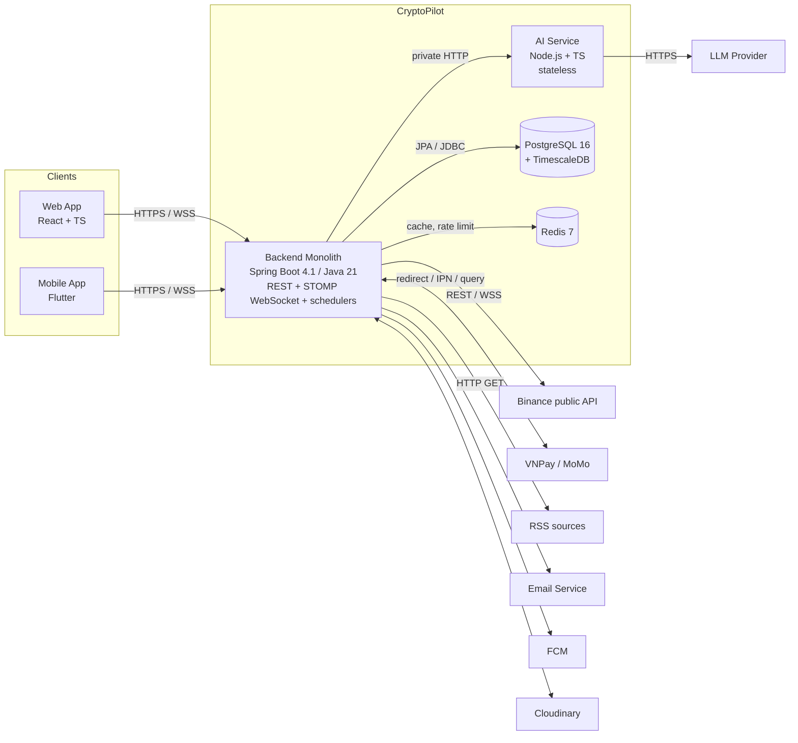

# CryptoPilot – Technical Design (Implementation Guide)

Version 2.0 · 2026-09-19 · Status: DRAFT FOR TEAM REVIEW · Backend: Java 21 + Spring Boot 4.1 (Maven)

This document turns the SRS (Report 3, v1.0) into an implementable design: architecture, folder structure, design patterns, data conventions, algorithms, APIs and the test strategy. Progress is tracked in `CURRENT_STATE.md`; AI agent rules are in `CLAUDE.md`. This document, the ADRs, the SRS copy, `CLAUDE.md` and `CURRENT_STATE.md` are local-only files: they are kept out of git by `.git/info/exclude` (see `CLAUDE.md` section 9).

Version 2.0 replaces the .NET design of version 1.0. Business rules, algorithms (section 7), the data model and the task plan are unchanged; the technology, the package structure and the tooling are Java.

---

## 0. Sources of truth and conflict rule

| Priority | Source | Owns |
|---|---|---|
| 1 | SRS v1.0 section 5.1 Business Rules (BR-xx) | What the system must do |
| 2 | This document | How it is built |
| 3 | `docs/design/CryptoPilot_Logical_Model.txt` | Data structure |
| 4 | Code | Implementation |

If two sources disagree, the higher priority wins. Any intentional deviation is recorded in section 13 (SRS Alignment Items) and must be approved by the team before the code relies on it. Never silently "fix" a business rule in code.

---

## 1. Architecture overview

### 1.1 Style

Modular monolith (one deployable Spring Boot application with strict internal module boundaries) plus one separate stateless AI Service (Node.js). Rationale: 4-person team, 6-month schedule, single database, simple operations; module boundaries keep the option to extract services later (ADR-001). Module boundaries are verified by Spring Modulith and ArchUnit tests, so a violation fails the build.

### 1.2 Container view (C4 level 2)



Only the backend owns the database (single writer). The AI Service has no database access: the backend sends it the configuration and context, the AI Service returns text and token usage (ADR-004).

### 1.3 Technology stack

| Concern | Choice | Notes |
|---|---|---|
| Language / runtime | Java 21 LTS (Eclipse Temurin) | Virtual threads enabled (`spring.threads.virtual.enabled=true`) |
| Framework | Spring Boot 4.1.x (Spring Framework 7) | 3.5 reached OSS end of life on 30/06/2026 and 4.0 ends 31/12/2026; 4.1 covers the project period (ADR-002) |
| Build | Maven with Maven Wrapper (`mvnw`) | Nobody installs Maven; versions come from the Spring Boot BOM |
| Module boundaries | Spring Modulith (+ ArchUnit rules inside modules) | ADR-003 |
| Web | Spring MVC (`spring-boot-starter-webmvc`) | Boot 4 renamed the starter from `spring-boot-starter-web`. Not WebFlux; blocking code on virtual threads |
| Realtime | Spring WebSocket + STOMP, simple in-memory broker | ADR-005 |
| Persistence | Spring Data JPA (Hibernate) + native SQL for TimescaleDB and reports | `ddl-auto=validate` |
| Migrations | Flyway (SQL files in `db/migration`) | Schema is written by hand in SQL |
| Database | PostgreSQL 16 + TimescaleDB 2.x | Hypertables for time series |
| Cache | Redis 7, image `redis:7.4.11-alpine` pinned (Spring Data Redis, Lettuce) | Latest prices only; cache only, so losing it never loses business data (Q-09) |
| Scheduling | Spring `@Scheduled` | Single instance; ShedLock only if a second instance is ever added |
| Async side effects | Spring Modulith event publication registry (JDBC) + `@ApplicationModuleListener` | Transactional outbox (ADR-010). Since T-056 (D-95): `spring-modulith-starter-jdbc`, schema from Flyway V1 (initializer off), `registry-trigger-annotation` = `ApplicationModuleListener` (the in-memory `@TransactionalEventListener` hand-offs are not recorded), completion mode `delete`; `common.job.OutboxProcessorJob` resubmits FAILED rows at least 1, 2, 4 min after the last attempt (about 2, 2, 4 min on the 1-min run), max 3 retries, one WARN on give-up, fails rows unfinished > 5 min, deletes rows > 24 h |
| Mail | `spring-boot-starter-mail` (Jakarta Mail, Spring Boot BOM) | T-057 (D-95): port `notification.client.EmailSender`; SMTP adapter when `SMTP_HOST` is set, log adapter otherwise; the prod profile refuses to start without `SMTP_HOST` or with an invalid `SMTP_FROM`. STARTTLS required (`SMTP_STARTTLS_REQUIRED`, default true) with server-name check. No template engine: text + minimal HTML built in code |
| HTTP clients | Spring `RestClient` over the JDK `HttpClient` (connect and read timeouts); JDK `java.net.http.WebSocket` for Binance streams | T-017: `market.client.BinanceRestClient` (7.1.2) |
| Resilience | Timeouts on every client; Spring Framework 7 `RetryTemplate` / `@Retryable` / `@ConcurrencyLimit`; the Binance client's circuit breaker is written in the client (D-37, accepted 2026-09-24, 7.1.2) because Resilience4j's Boot 4 support was not confirmed; its IP ban is persisted in `binance_ban` | |
| Validation | Jakarta Bean Validation (`spring-boot-starter-validation`) | Request DTOs |
| Security | Spring Security, OAuth2 Resource Server (JWT, HS256), `BCryptPasswordEncoder(12)` | |
| Rate limiting | Fixed-window counter in Redis (`StringRedisTemplate` + one Lua script) in a servlet filter, no extra library | ADR-014 (2026-10-04) replaces the Bucket4j plan: counters shared across instances and kept across restarts, window testable on the injected clock |
| API docs | springdoc-openapi (release line compatible with Spring Boot 4) | `springdoc-openapi-starter-webmvc-ui` 3.1.1 since T-024 (2026-09-25): the 3.x line is the one for Boot 4, and 3.1.1 is built on Boot 4.1.0; `common.config.OpenApiConfig` describes `BigDecimal` as a string of format `decimal` and declares the `bearerAuth` scheme |
| Logging | SLF4J + Logback; Spring Boot structured logging (JSON) outside `dev` | Correlation id in MDC |
| IDs | UUID v7 from `com.fasterxml.uuid:java-uuid-generator` | ADR-009 |
| Boilerplate | Lombok, limited to entities and constructor injection (section 3.4) | DTOs are Java records |
| Formatting | Spotless with Palantir Java Format | `./mvnw spotless:apply` |
| Coverage | JaCoCo | Gates in section 11 |
| AI Service | Node.js LTS, TypeScript, Fastify, zod, @anthropic-ai/sdk, bottleneck | Unchanged |
| Web | React 19 + TypeScript + Vite, Tailwind CSS 4, React Router, React Hook Form + zod; TanStack Query, @stomp/stompjs and TradingView Lightweight Charts added by the first task that needs them | Separate repository `cryptopilot-frontend` (D-90, ADR-015); React 19 and the added packages in ADR-016 (D-100) |
| Mobile | Flutter (stable), Riverpod, dio, go_router, stomp_dart_client | Chart library in ADR-012 |
| Tests | JUnit Jupiter, AssertJ, Mockito — Boot 4 has no single `spring-boot-starter-test`; pull the per-slice starters (`spring-boot-starter-webmvc-test`, `-actuator-test`, `-validation-test`, later `-data-jpa-test`). Plus Testcontainers, WireMock (not yet added — the Binance client is tested against a JDK `com.sun.net.httpserver` stand-in, D-36, accepted 2026-09-24), ArchUnit, Spring Modulith Test, jqwik; Vitest, Playwright, k6 | |

Library versions are managed by the Spring Boot BOM wherever possible; any extra library version is declared once in the `<properties>` of `backend/pom.xml`.

Libraries NOT to add: ModelMapper (reflection mapping), MapStruct (not needed; manual mapping), Spring WebFlux, Kafka/RabbitMQ, Lombok `@Data`/`@Setter` on entities, any exchange trading SDK.

### 1.4 Architecture Decision Records (summary)

| ADR | Decision | Status |
|---|---|---|
| ADR-001 | Modular monolith + separate AI Service | Accepted |
| ADR-002 | Java 21 LTS + Spring Boot 4.1 + Maven | Accepted (2026-09-19, D-02); pinned to 4.1.1 in T-002 |
| ADR-003 | Package by module, then by layer; boundaries verified by Spring Modulith and ArchUnit | Accepted (2026-09-19, D-03) |
| ADR-004 | AI Service stateless; backend is the only DB writer | Proposed |
| ADR-005 | Realtime via Spring WebSocket + STOMP; Redis only as cache | Proposed |
| ADR-006 | `@Scheduled` for schedules, virtual-thread workers for streams, Modulith events for durable async work | Proposed |
| ADR-007 | Manual mapping with records; no ModelMapper/MapStruct; Lombok limited | Proposed |
| ADR-008 | `BigDecimal` precision and rounding policy (section 5.4) | Proposed |
| ADR-009 | UUID v7 primary keys generated by the application | Proposed |
| ADR-010 | Transactional outbox through the Spring Modulith event publication registry | Proposed |
| ADR-011 | Matching engine price source = kline_1m stream (high/low) + mark price stream | Proposed |
| ADR-012 | Flutter chart library | Open (decide in phase P14) |
| ADR-013 | Two-axis model: style presets for the setup score, risk profiles for capital management | Accepted 2026-09-26 (D-53) |

Full ADRs live in `docs/adr/ADR-0xx-*.md` (template: Context, Decision, Consequences, Alternatives).

---

## 2. Module decomposition

One module = one direct sub-package of `com.cryptopilot`. Spring Modulith treats each of them as an application module.

| Module | Responsibility | Owns tables | SRS refs |
|---|---|---|---|
| `auth` | Registration, email verification, login, JWT, refresh tokens, password reset, security configuration | user_token | UC-01…05, UC-07, BR-01…04 |
| `user` | Accounts, roles, status, profile, notification preferences, devices, admin user management | user_account, user_profile, user_device | UC-06, UC-08, UC-42, BR-05, BR-06, BR-58 |
| `market` | Coins, pairs, candles, snapshots, Binance streams and backfill, leverage brackets, indicators, support/resistance, setup score | coin, crypto_pair, ohlcv, spot_market_data, futures_market_data, funding_rate_history, leverage_bracket, technical_indicator | UC-09…11, UC-45, UC-46, NSF-01…05, BR-07…14 |
| `watchlist` | Watchlist, alerts, alert engine | watchlist, alert | UC-12…14, NSF-06, BR-15…20 |
| `trading` | Trading plans, risk and liquidation calculation, warnings, strategies, simulated matching | trading_plan, trading_plan_warning, trading_strategy | UC-16…21, NSF-07…09, BR-21…39 |
| `journal` | Journal records, trade reviews, manual trades, performance statistics | trading_journal (+ performance views) | UC-22…25, BR-40…42 |
| `community` | Posts, comments, likes/saves, media, reports, moderation, official announcements | forum_post, post_coin, forum_comment, engagement, post_media, post_report | UC-26…33, UC-43, UC-44, BR-43…47, BR-61 |
| `news` | News sources, crawling, deduplication, tagging, summaries | news_source, news_crawl_log, news_article, news_tag, news_article_tag, news_article_coin | UC-34, UC-49, NSF-10, NSF-11, BR-48, BR-49 |
| `ai` | Conversations, messages, AI configuration, quota, AI Service client | ai_conversation, ai_message, ai_configuration | UC-35, UC-36, UC-50, NSF-16, BR-50…52 |
| `billing` | Packages, orders, subscriptions, VNPay/MoMo, IPN, entitlement | subscription_package, subscription_order, user_subscription | UC-37…39, UC-47, UC-48, NSF-12…14, BR-53…56 |
| `notification` | In-app notifications, email and push dispatch | notification | UC-15, NSF-15 |
| `admin` | System settings, audit log, dashboard and management reports | system_setting, audit_log | UC-40, UC-41, UC-51, UC-52, NSF-17, NSF-18, BR-57 |
| `common` | Shared kernel (open module): base entity, error codes, global exception handling, shared configuration, utilities | — | CR-01…09 |

Module rules:
1. A module writes only its own tables.
2. A module calls another module only through that module's **public API**: the classes placed directly in the module's root package (e.g. `com.cryptopilot.user.UserApi`, `UserSummary`) and the events in its `event` package. Everything else in a module (`controller`, `service`, `repository`, `entity`, `dto`, …) is internal. Spring Modulith's `ApplicationModules.verify()` fails the build on a violation.
3. Synchronous reads/commands across modules use the other module's `XxxApi`; reactions use events (`@ApplicationModuleListener`), which are persisted by the event publication registry (outbox).
4. No cyclic dependencies between modules (verified by Spring Modulith).
5. `trading` records executions through `journal.JournalApi` (the journal module owns the table).
6. Moderation screens are served by `community` (admin endpoints under `/api/v1/admin/...` inside `community.controller`), because moderation changes community tables.

---

## 3. Package structure, layer rules and design patterns

### 3.1 Layers inside a module

Every module uses the same sub-packages. Create only the ones the module needs.

| Package | Contains | May depend on | Must not depend on |
|---|---|---|---|
| `controller` | `@RestController`, STOMP `@Controller`; request validation; maps to/from DTOs | `service`, `dto` | `repository`, `entity` |
| `service` | Service **interfaces** (`FooService`) only; the one exception is `auth.service.LiveSessions`, which `auth.config` injects (D-48) | `repository`, `entity`, `dto`, `model`, `calculator`, `client`, `event`, other modules' root API and events, `common` | `controller` |
| `service.impl` | `@Service` implementations (`FooServiceImpl implements FooService`): business use cases, `@Transactional` boundaries, authorization of ownership, calls to other modules' APIs, event publishing; and every other non-interface class of the service layer — helper components and pure helpers the implementations use (D-48; only exception `auth.service.LiveSessions`, injected by `auth.config`) | as `service` | `controller`; only the module's own `service.impl` classes and jobs inject a class of `impl`, never a controller or another module |
| `repository` | Spring Data JPA repositories, native queries | `entity` | `service`, `controller` |
| `entity` | JPA entities, embeddable value objects; invariants and state transitions as methods | `common`, `model.enums` | `service`, `repository`, `controller` |
| `dto.request`, `dto.response` | API request and response records (`record`), request ones with Bean Validation annotations; `dto.request` = accepted by a controller, `dto.response` = returned by one (D-48) | `model.enums` | `service`, `repository`, `entity` |
| `model` | Internal records that never cross the API: results and values passed between services, jobs, repositories and clients (e.g. `BackfillRun`, `IssuedSession`) (D-48). Every top-level enum lives in `model.enums`, the module's named interface `enums`, usable by every layer and by other modules | `entity`, `common`, own `client` records | `controller`, `service` |
| `calculator` | Pure business formulas (risk, liquidation, fees, P/L, indicators, setup score, period calculation) | `java.*`, `common.util` | Spring, JPA, `repository`, `service` |
| `client` | Adapters to external systems (Binance, VNPay, MoMo, AI Service, SMTP, FCM, Cloudinary, RSS) | own records, `common` | `repository`, `controller` |
| `job` | `@Scheduled` jobs, stream workers, event listeners; orchestration only | `service` | `repository` directly |
| `event` | Event records published to other modules (named interface) | — | anything internal |
| `config` | Module-specific `@Configuration` (e.g. `auth.config.SecurityConfig`) | module internals | other modules' internals |

These rules are ArchUnit tests in `backend/src/test/java/com/cryptopilot/architecture/LayerRulesTest.java`; module boundaries are verified by `ModularityTest` (Spring Modulith). A failing architecture test fails the build.

The SRS layers map as follows: presentation = `controller`; application = `service`; domain = `entity` + `calculator`; infrastructure = `repository` + `client` + `job`.

### 3.2 Pattern catalogue

| Pattern | Where | Why | Reference |
|---|---|---|---|
| Layered architecture per module | Section 3.1 | Presentation, application, domain and infrastructure separated; SRS 4.2.5 | Evans 2003 ch. 4; Martin 2017 |
| Modular monolith with verified boundaries | Section 2, Spring Modulith | Independent modules in one deployable | Richardson 2018; Spring Modulith reference documentation |
| Entity with invariants (rich domain model) | `TradingPlan.activate()`, `SubscriptionOrder.markPaid()` | Invariants in one place; no setters | Evans 2003 |
| Pure domain calculator | `RiskCalculator`, `LiquidationCalculator`, `FeeCalculator`, `FundingCalculator`, `PnlCalculator`, `IndicatorEngine`, `SetupScoreCalculator` | Deterministic, unit-testable without Spring or DB | Evans 2003 |
| State pattern / explicit transition table | `TradingPlan`, `Alert`, `SubscriptionOrder`, `PostReport` lifecycles | Illegal transitions impossible | Gamma et al. 1994 |
| Strategy | Warning rules (`WarningRule`), alert conditions (`AlertCondition`), payment gateways (`PaymentGateway`) | Add rules/gateways without editing existing code | Gamma et al. 1994 |
| Specification / rule object | BR-22, BR-25, BR-26, BR-28, BR-29 | Each BR is one class with one test class | Evans & Fowler 1997 |
| Adapter / anti-corruption layer | `BinanceMarketClient`, `VnPayGateway`, `MoMoGateway`, `AiServiceClient` | External models never leak into entities | Evans 2003; Gamma et al. 1994 |
| Facade (module API) | `UserApi`, `MarketApi`, `JournalApi`, `BillingApi` | One narrow entry point per module | Gamma et al. 1994 |
| Repository + Unit of Work | Spring Data JPA; `@Transactional` service method | Transaction boundary = one use case | Fowler 2002 |
| Command–query separation | Service methods either change state or return data | Predictable side effects | Meyer 1988 |
| Domain events + transactional outbox | Spring Modulith event publication registry | No lost or duplicated side effects | Richardson 2018 |
| Idempotent consumer | IPN handler, backfill upserts, event listeners | At-least-once inputs, exactly-once effects | Richardson 2018; Kleppmann 2017 |
| Producer–consumer with bounded queues | Market events → indicator, alert and matching workers | Decoupled high-frequency processing | Hohpe & Woolf 2003 |
| Actor-style single consumer | One consumer per market partition in the matching engine | No locks, deterministic ordering | Hewitt et al. 1973 |
| Retry with back-off, timeout, circuit breaker | Outbound HTTP/WebSocket | Resilience to provider failures | Nygard 2018 |
| Exception translation | `BusinessException(ErrorCode)` → `ProblemDetail` in `GlobalExceptionHandler` | One error format mapped to SRS messages | RFC 9457 |
| Options / typed configuration | `@ConfigurationProperties` records, validated | No magic strings | Spring Boot reference documentation |

### 3.3 Naming

| Kind | Convention | Example |
|---|---|---|
| Controller | `<Resource>Controller` | `TradingPlanController` |
| Service | Interface `<Resource>Service` in `service`; implementation `<Resource>ServiceImpl` in `service.impl`, injected only through the interface (D-48, supersedes "class, no interface"). A bean that already implements a port declared in `client` or in another module needs no second interface (`PersistentBinanceBans implements BinanceBanStore`) | `TradingPlanService`, `TradingPlanServiceImpl` |
| Repository | `<Entity>Repository` | `TradingPlanRepository` |
| Entity | Singular noun, table name via `@Table` | `TradingPlan` → `trading_plan` |
| DTO | `<Action><Resource>Request` in `dto.request`, `<Resource>Response` in `dto.response` (D-48) | `CreateTradingPlanRequest` |
| Internal model | Noun or past-participle record in `model` (D-48) | `BackfillRun`, `IssuedSession` |
| Module API | `<Module>Api` in the module root package | `JournalApi` |
| Event | Past tense record | `PositionClosed`, `AlertTriggered` |
| Calculator | `<Concept>Calculator` / `<Concept>Engine` | `LiquidationCalculator` |
| Test | `<ClassUnderTest>Test`; method `<RuleId>_<scenario>_<expected>` | `BR28_longStopBelowLiquidation_returnsBlocking` |

### 3.4 Coding rules

- Constructor injection only (`private final` fields). Lombok `@RequiredArgsConstructor(access = AccessLevel.PACKAGE)` where the constructor is a pure assignment; written out by hand where it does anything else, as in `AuthService` and `JwtConfig` (D-29). No field `@Autowired`.
- Entities: `@Getter` on the class; an accessor that computes something (`isNew`, `isEmailVerified`, `isLockedOutAt`, `isUsableAt`) stays hand-written, because it is behaviour wearing a getter's name. `@NoArgsConstructor(access = PROTECTED)` is permitted but not used — `protected UserAccount() {}` is shorter and says why it exists (D-29). State changes through methods that enforce the rules.
- `@Setter`, `@Data`, `@EqualsAndHashCode` and `@ToString` are compile errors everywhere, set in `backend/lombok.config` rather than left as a rule to remember (D-29).
- A constant that two layers must read belongs in the module's root package, not in either of them. ArchUnit cannot see a constant dependency — javac inlines it — so the layer table is also asserted over the import lines by `LayerSourceRulesTest` (D-30).
- DTOs and events are `record`s.
- `@Transactional` only on service methods; read-only queries use `@Transactional(readOnly = true)`.
- Time: inject `java.time.Clock` (UTC); never call `Instant.now()`, `LocalDateTime.now()` or `new Date()` without it. Store `Instant` ↔ `timestamptz`.
- Money, prices and quantities: `BigDecimal` only; compare with `compareTo`, never `equals`; explicit `RoundingMode` on every `setScale`/`divide` (section 5.4).
- No business logic in controllers, repositories, jobs or `@Configuration` classes.
- Public classes and methods in `calculator` packages carry Javadoc with the rule id and the reference (see `CLAUDE.md` section 3).

---

## 4. Repository and folder structure

### 4.1 Backend package tree (final)

Every module follows the same pattern. A sub-package exists only when the module needs it; the tree below lists all of them. Since D-48 (2026-09-25) every `service/` holds interfaces only (exception: `auth.service.LiveSessions`), `service/impl/` the implementations and the helpers they use, `dto/` splits into `dto/request/` and `dto/response/`, internal records live in `model/`, and every top-level enum lives in `model/enums/`; the per-module listings below name the classes and do not repeat the split.

```
backend/
├── pom.xml
├── mvnw  mvnw.cmd  .mvn/wrapper/
└── src/
    ├── main/
    │   ├── java/com/cryptopilot/
    │   │   ├── CryptoPilotApplication.java
    │   │   │
    │   │   ├── common/                               # shared kernel, open module (no business logic)
    │   │   │   ├── config/        CorsConfig, OpenApiConfig, JacksonConfig, ClockConfig, AsyncConfig
    │   │   │   ├── exception/     GlobalExceptionHandler, BusinessException, ResourceNotFoundException, ErrorCode
    │   │   │   ├── entity/        BaseEntity (UUID v7 id, createdAt, updatedAt, version)
    │   │   │   ├── web/           PageResponse, CorrelationIdFilter, RateLimitFilter
    │   │   │   └── util/          UuidV7, Rounding
    │   │   │
    │   │   ├── auth/                                 # register, verify, login, JWT, refresh, reset password
    │   │   │   ├── AuthApi.java   PasswordPolicy.java   # BR-02 is read by dto and service, so it sits above both (D-30)
    │   │   │   ├── config/        SecurityConfig, JwtConfig
    │   │   │   ├── controller/    AuthController, PasswordChangeController   # PUT /me/password (UC-07)
    │   │   │   ├── service/       AuthService, PasswordChangeService, LiveSessions   # LiveSessions: the one non-interface, auth.config injects it
    │   │   │   │                  # UC-07 is its own service: it has a session, names no address and spends no link (D-32)
    │   │   │   │                  # UC-04 lives on AuthService, not a PasswordResetService: it shares the
    │   │   │   │                  # token table, the non-enumeration rule and the session revocation with
    │   │   │   │                  # UC-02 and UC-05, and a second class would have to reach all three (D-32)
    │   │   │   ├── repository/    UserTokenRepository
    │   │   │   ├── entity/        UserToken
    │   │   │   ├── service/impl/  AuthServiceImpl, PasswordChangeServiceImpl, AccessTokenIssuer, SecureTokenFactory, FamilyRevoker, WrongCurrentPasswordRecorder   # D-48
    │   │   │   ├── model/         IssuedSession                                        # D-48
    │   │   │   ├── model/enums/   TokenType
    │   │   │   ├── dto/request/   RegisterRequest, LoginRequest …                      # D-48
    │   │   │   ├── dto/response/  SessionResponse …
    │   │   │   └── security/      JwtAuthenticationConverter, CurrentUser
    │   │   │
    │   │   ├── user/                                 # account, profile, preferences, devices, admin user management
    │   │   │   ├── UserApi.java   UserSummary.java
    │   │   │   ├── controller/    ProfileController, DeviceController, AdminUserController
    │   │   │   ├── service/       UserService, ProfileService, DeviceService, RiskProfileService
    │   │   │   ├── service/impl/  UserServiceImpl, ProfileServiceImpl, DeviceServiceImpl, RiskProfileServiceImpl, FailedLoginRecorder, ProfileSetupStyleSource
    │   │   │   ├── repository/    UserAccountRepository, UserProfileRepository, UserDeviceRepository
    │   │   │   ├── entity/        UserAccount, UserProfile, UserDevice
    │   │   │   ├── model/enums/   Role, UserRole, AccountStatus, DevicePlatform, TradingStyle, RiskProfile, QuestionGroup
    │   │   │   └── dto/
    │   │   │
    │   │   ├── market/                               # pairs, candles, snapshots, Binance, brackets, indicators, setup score
    │   │   │   ├── MarketApi.java PairFilters.java   # PairFilters exists since T-018 (D-38); MarketApi arrives with its first caller
    │   │   │   ├── controller/    MarketController, AnalysisController, AdminPairController
    │   │   │   ├── service/       PairService, CandleService, AnalysisService, LeverageBracketService, MarketBroadcastService
    │   │   │   ├── service/impl/  one implementation per interface; helpers ExchangeSymbolMapper, LatestMarketData, SymbolSyncWriter, MarketRequests, PersistentBinanceBans
    │   │   │   ├── repository/    CoinRepository, CryptoPairRepository, OhlcvRepository, TechnicalIndicatorRepository …
    │   │   │   ├── entity/        Coin, CryptoPair, Ohlcv, SpotMarketData, FuturesMarketData, LeverageBracket, TechnicalIndicator
    │   │   │   ├── model/enums/   MarketType, MarketInterval, BinanceVenue, ExchangeStatus, PairStatus, DominantSide, IndicatorOutcome, SetupStyle
    │   │   │   ├── dto/
    │   │   │   ├── calculator/    IndicatorEngine, SwingDetector, SetupScoreCalculator
    │   │   │   ├── client/        BinanceRestClient, BinanceStreamShard
    │   │   │   ├── job/           SymbolSyncJob, StreamSupervisor, FuturesMetricsJob, SnapshotJob, BackfillListener, IndicatorWorker
    │   │   │   └── event/         PriceTick, CandleClosed, IndicatorsComputed, PairMarketEnabled, GapDetected
    │   │   │
    │   │   ├── watchlist/                            # watchlist, alerts, alert engine
    │   │   │   ├── controller/    WatchlistController, AlertController
    │   │   │   ├── service/       WatchlistService, AlertService
    │   │   │   ├── repository/    WatchlistRepository, AlertRepository
    │   │   │   ├── entity/        Watchlist, Alert
    │   │   │   ├── model/enums/   AlertType, AlertStatus, TriggerMode
    │   │   │   ├── dto/
    │   │   │   ├── calculator/    AlertConditionEvaluator, condition/ (PriceCrossCondition, RsiCondition …)
    │   │   │   ├── job/           AlertEngineWorker
    │   │   │   └── event/         AlertTriggered
    │   │   │
    │   │   ├── trading/                              # plans, risk, liquidation, warnings, strategies, simulated matching
    │   │   │   ├── TradingApi.java
    │   │   │   ├── controller/    TradingPlanController, StrategyController
    │   │   │   ├── service/       TradingPlanService, PositionService
    │   │   │   ├── repository/    TradingPlanRepository (warnings saved through the plan, D-68), TradingStrategyRepository
    │   │   │   ├── entity/        TradingPlan, TradingPlanWarning, TradingStrategy
    │   │   │   ├── model/enums/   Direction, WarningType, WarningSeverity, PlanStatus, EntryType, MarginMode
    │   │   │   ├── exception/     IllegalPlanStateException, PlanActivationBlockedException (D-66)
    │   │   │   ├── dto/
    │   │   │   ├── calculator/    RiskCalculator, LiquidationCalculator, FeeCalculator, FundingCalculator
    │   │   │   │   └── warning/   WarningRule, LowRiskRewardRule, HighLeverageRule, StopBeyondLiquidationRule …
    │   │   │   ├── matching/      PriceLevelBook, MatchingEngine, ReplayService (MatchingWorker: trading.job, T-042)
    │   │   │   ├── job/           PlanExpiryJob, MatchingWorker, MinuteKlineFeed (T-043: the kline_1m listener and replay)
    │   │   │   └── event/         PlanExecuted, PositionClosed
    │   │   │
    │   │   ├── journal/                              # journal records, reviews, manual trades, performance
    │   │   │   ├── JournalApi.java
    │   │   │   ├── controller/    JournalController, PerformanceController
    │   │   │   ├── service/       JournalService, PerformanceService
    │   │   │   ├── repository/    TradingJournalRepository, PerformanceQueryRepository
    │   │   │   ├── entity/        TradingJournal
    │   │   │   ├── model/enums/   TradeSource, TradeStatus
    │   │   │   ├── dto/
    │   │   │   └── calculator/    PnlCalculator, PerformanceMetrics
    │   │   │
    │   │   ├── community/                            # posts, comments, likes/saves, media, reports, moderation, announcements
    │   │   │   ├── controller/    PostController, CommentController, ModerationController, AnnouncementController
    │   │   │   ├── service/       PostService, CommentService, EngagementService, ReportService, ModerationService, MediaService
    │   │   │   ├── repository/
    │   │   │   ├── entity/        ForumPost, PostCoin, ForumComment, Engagement, PostMedia, PostReport
    │   │   │   ├── dto/
    │   │   │   └── client/        CloudinaryClient
    │   │   │
    │   │   ├── news/                                 # sources, crawl, dedup, tagging, summaries
    │   │   │   ├── controller/    NewsController, AdminNewsSourceController
    │   │   │   ├── service/       NewsService, NewsSourceService, CrawlService
    │   │   │   ├── repository/
    │   │   │   ├── entity/        NewsSource, NewsCrawlLog, NewsArticle, NewsTag, NewsArticleTag, NewsArticleCoin
    │   │   │   ├── dto/
    │   │   │   ├── calculator/    UrlNormalizer, TitleNormalizer, CoinTagger
    │   │   │   ├── client/        RssClient
    │   │   │   └── job/           NewsCrawlJob, NewsSummaryJob
    │   │   │
    │   │   ├── ai/                                   # conversations, messages, configuration, quota
    │   │   │   ├── controller/    AiConversationController, AdminAiConfigController
    │   │   │   ├── service/       AiChatService, QuotaService, ContextSnapshotService, AiConfigurationService
    │   │   │   ├── repository/
    │   │   │   ├── entity/        AiConversation, AiMessage, AiConfiguration
    │   │   │   ├── dto/
    │   │   │   ├── client/        AiServiceClient
    │   │   │   ├── job/           AiRequestListener
    │   │   │   └── event/         AiQuestionAsked
    │   │   │
    │   │   ├── billing/                              # packages, orders, VNPay/MoMo, IPN, subscriptions, entitlement
    │   │   │   ├── BillingApi.java
    │   │   │   ├── controller/    PackageController, OrderController, PaymentCallbackController, AdminBillingController
    │   │   │   ├── service/       OrderService, PaymentService, SubscriptionService, EntitlementService
    │   │   │   ├── repository/
    │   │   │   ├── entity/        SubscriptionPackage, SubscriptionOrder, UserSubscription
    │   │   │   ├── model/enums/   Feature, PlanTier, OrderStatus
    │   │   │   ├── dto/
    │   │   │   ├── calculator/    SubscriptionPeriodCalculator
    │   │   │   ├── client/        PaymentGateway, VnPayGateway, MoMoGateway
    │   │   │   ├── job/           ReconciliationJob, SubscriptionExpiryJob
    │   │   │   └── event/         SubscriptionActivated
    │   │   │
    │   │   ├── notification/                         # in-app notifications, email, push
    │   │   │   ├── NotificationApi.java
    │   │   │   ├── controller/    NotificationController
    │   │   │   ├── service/       NotificationService
    │   │   │   ├── repository/    NotificationRepository
    │   │   │   ├── entity/        Notification
    │   │   │   ├── model/enums/   NotificationType
    │   │   │   ├── dto/
    │   │   │   ├── client/        EmailSender, FcmSender
    │   │   │   └── job/           NotificationListeners (AlertTriggered, PositionClosed, SubscriptionActivated …)
    │   │   │
    │   │   └── admin/                                # settings, audit log, dashboard, reports, retention
    │   │       ├── AdminApi.java
    │   │       ├── controller/    DashboardController, ReportController, SettingController, AuditLogController
    │   │       ├── service/       SettingService, AuditService, ReportService
    │   │       ├── repository/    SystemSettingRepository, AuditLogRepository, ReportQueryRepository
    │   │       ├── entity/        SystemSetting, AuditLog
    │   │       ├── dto/
    │   │       └── job/           RetentionJob
    │   │
    │   └── resources/
    │       ├── application.yml          # shared defaults, no secrets
    │       ├── application-dev.yml      # local development
    │       ├── application-prod.yml     # staging / demo
    │       └── db/migration/            # V1__baseline_schema.sql, V2__timescale.sql, V3__reference_data.sql …
    │
    └── test/
        ├── java/com/cryptopilot/
        │   ├── architecture/            # ModularityTest (Spring Modulith), LayerRulesTest (ArchUnit)
        │   ├── support/                 # TestcontainersConfig, FixedClock, TradingPlanBuilder, CandleSeriesBuilder
        │   └── <module>/<layer>/        # same packages as main, e.g. trading/calculator/RiskCalculatorTest
        └── resources/
            ├── application-test.yml
            └── golden/                  # indicator reference CSV files
```

### 4.2 What goes where (quick rules)

| If the code… | Put it in | Example |
|---|---|---|
| Receives an HTTP request or STOMP message | `controller/` | `TradingPlanController` |
| Implements a use case, opens a transaction, checks ownership | `service/` (interface) and `service/impl/` (implementation) | `TradingPlanService.create()` |
| Reads or writes a table of this module | `repository/` | `TradingPlanRepository` |
| Is a table row with its rules and state changes | `entity/` | `TradingPlan.activate()` |
| Is a request/response shape | `dto/` (record) | `CreateTradingPlanRequest` |
| Is a business formula from the SRS (BR-xx), no I/O | `calculator/` | `LiquidationCalculator` (BR-27) |
| Talks to an external system | `client/` | `BinanceRestClient`, `VnPayGateway` |
| Runs on a schedule, loops on a stream, or reacts to an event | `job/` | `PlanExpiryJob`, `AlertEngineWorker` |
| Is announced to other modules | `event/` (record) | `PositionClosed` |
| Is needed by another module | root package `XxxApi` | `JournalApi.recordExecution(...)` |
| Is used by every module and has no business logic | `common/` | `BusinessException`, `BaseEntity` |

Other folders of the repository:

```
cryptopilot_project/
├── backend/                    # above
├── ai-service/src/ { server.ts, config/, routes/, llm/, prompts/, limiter/, schemas/ }, test/
├── web/                       # empty: the web client is the repository cryptopilot-frontend (4.4, D-90)
├── mobile/lib/ { core/, features/<module>/{data,domain,presentation} }, test/
├── tools/golden/               # script that generates reference indicator data
├── deploy/ { docker-compose.dev.yml, docker-compose.yml, .env.example, nginx/ }
├── .github/ { pull_request_template.md, workflows/ }
├── README.md  .gitignore  .gitattributes  .editorconfig
└── [local only] CLAUDE.md  CURRENT_STATE.md  .claude/  docs/
```

### 4.3 Example — use case "create trading plan" (UC-16)

| File | Role |
|---|---|
| `trading/controller/TradingPlanController.java` | `POST /api/v1/plans`, validates `CreateTradingPlanRequest`, calls the service |
| `trading/dto/CreateTradingPlanRequest.java`, `TradingPlanResponse.java` | Records |
| `trading/service/TradingPlanService.java` | `@Transactional create(...)`: loads pair filters via `MarketApi`, calls the calculators, applies warning rules, saves |
| `trading/calculator/RiskCalculator.java`, `LiquidationCalculator.java`, `warning/*Rule.java` | BR-23…29, pure |
| `trading/entity/TradingPlan.java`, `TradingPlanWarning.java`; `trading/model/enums/PlanStatus.java` | Aggregate root with `draft()`, `updateDraft()`, `activate()`, `markExecuted()`, `cancel()`, `expire()`; one transition table in `PlanStatus`; each terminal status stores its instant (BR-31, BR-32; D-66…D-69) |
| `trading/repository/TradingPlanRepository.java` | Spring Data JPA |
| `src/test/java/com/cryptopilot/trading/calculator/RiskCalculatorTest.java` | `BR23_…`, `BR24_…`, `BR25_…` |

### 4.4 Web client (separate repository, D-90)

The web client is the repository `cryptopilot-frontend` (ADR-015), not `web/` of this repository.
Stack: TECHNICAL_DESIGN 1.3 with the additions of ADR-016 (D-100). Folders under `src/` (as of T-030 and T-016):

| Folder | Holds | Must not |
|---|---|---|
| `app/` | Composition root (`providers/create-services.ts`), router and route guards, shells (`layouts/`), theme, environment | Hold business rules |
| `pages/{guest,trader,admin}/` | One thin page per screen (SCR-xx), composing feature components | Call services, `fetch` or `WebSocket` (ESLint) |
| `features/<module>/` | `components/`, `hooks/`, `schemas.ts` of one area (auth, market, trading-plan, …) | Import another feature's internals |
| `components/{ui,layout,feedback,charts,brand}/` | Domain-neutral controls from the design system | Know business data |
| `services/{api,auth,websocket}/` | Service interfaces, HTTP client (problem detail, MSG ids), session store, realtime client | Be imported by pages or components (ESLint) |
| `i18n/` | Every interface string, MSG texts of SRS 5.3 (A-45) | — |
| `types/domain.ts` | Client domain model; decimals stay strings (5.4) | Mirror wire DTOs; adapters map them |
| `dev/` | Development data and the labelled development sign-in | Reach a production build (the build fails) |

Rules:

1. Direction: page → feature hook → service interface → adapter → backend. A hook owns the request
   lifecycle and aborts on unmount.
2. An adapter decodes every response body at runtime before it becomes a typed value, and keeps only
   `code`, `messageCode`, `messageArgs`, field `errors` and `traceId` of a problem detail (5.1); the
   user sees the SRS message, never `detail`.
3. The contract is `docs/design/fe-guide/`. A service whose endpoint is not merged rejects with
   `NOT_CONFIGURED`; no endpoint, field or status is invented, and a failed request never falls back to
   development data.
4. Role guards follow SRS 3.1.3; plan tiers (D-58) only decide what the client offers, the backend
   decides every request.
5. Tests: Vitest, with Testing Library under jsdom for components (11.1).

---

## 5. Cross-cutting design

### 5.1 Errors and API responses
- Business errors: `throw new BusinessException(ErrorCode.X, args)`. A domain rule that rejects named input fields (e.g. a plan recalculated at activation) throws `FieldValidationException`: `VALIDATION_FAILED` (400, MSG01) with `errors` field → MSG code, the same shape as a failed request body (T-038). `ErrorCode` (in `common.exception`) has a stable code (e.g. `TRADING_BLOCKING_WARNING`), the HTTP status and the SRS message code (MSGxx).
- `GlobalExceptionHandler` (`@RestControllerAdvice`) returns `ProblemDetail` (RFC 9457) with properties `code`, `messageCode`, `traceId` and, for validation, `errors` (field → message).
- `ResourceNotFoundException` → 404 (MSG41 context); `MethodArgumentNotValidException` → 400 with field errors (MSG01/MSG15…); access denied → 403; unhandled → 500 with reference code (MSG43), no stack trace.

### 5.2 Time
- All times are `Instant` (UTC) in code and `timestamptz` in the database; a `Clock` bean (UTC) is injected everywhere.
- Candle boundaries are UTC (BR-08); UTC+7 conversion happens only in clients.

### 5.3 Security
- Access token JWT (RFC 7519), 15 minutes, HS256 with a key of at least 256 bits from the environment; issued with `NimbusJwtEncoder`, validated by the OAuth2 Resource Server.
- Refresh token: 256-bit random, stored as SHA-256 hash, rotated on every use; family id per login; reuse of a used token revokes the whole family (7.15).
- Authorization, three checks in three places (SRS 4.2.4 requires all three):
  - **Role** — the matrix of SRS 3.1.3, enforced by the filter chain in `auth.config.SecurityConfig` as path rules (`hasRole`), ending in `anyRequest().denyAll()` so an unclaimed path is closed. The chain is the enforcement point rather than `@PreAuthorize` because the matrix is itself a path-to-role table, because "Guest" is a column no method annotation can express, and because `denyAll` means a path must be named in the chain to be reachable at all — an annotation could not open one. The `role` claim becomes a `ROLE_*` authority in `auth.config.AccessTokenAuthenticationConverter`; the resource server's default converter reads `scope`/`scp` and would grant nothing.
  - **Ownership** — checked in services (`resource.userId == currentUser.id`), because it is a property of the row and not of the path: the matrix grants two Traders the same area and they must not read each other's rows.
  - **Entitlement** — subscription state, via `@PreAuthorize("@entitlement.has(authentication, 'AI')")` backed by `BillingApi` (7.12). Applies to SCR-29 and to posting a video; both are `TRADER` in the chain with the entitlement as a second check, because "Trader (Subscribed)" is an entitlement of the Trader role and not a fourth role (SRS 3.1.3), and because a fact that expires must not be encoded in a token that cannot be recalled.
- The payment callbacks `/billing/ipn/*` and `/billing/return/{gateway}` are not screens and carry no bearer token: they are authenticated by the gateway signature (BR-53) and must never fall under a role rule.
- Rate limits (ADR-014, `common.web.RateLimitFilter`, Redis fixed window): login 10/min per client address, other public auth calls 20/min per client address, authenticated API 120/min per account, calls without an account (Guests: market data, forum reads, D-99) 300/min per client address; AI 10/min/user when the AI endpoints exist. Over the limit: 429, `Retry-After` in seconds, `RATE_LIMITED` / MSG50 with the seconds as its argument. Off without a profile, on in `dev` (x10) and `prod`; `RATE_LIMIT_LOGIN`, `RATE_LIMIT_AUTH`, `RATE_LIMIT_API`, `RATE_LIMIT_GUEST`.
- Client address (R-11, `common.web.ClientAddressFilter`): `X-Forwarded-For` is read only when the direct peer is in `TRUSTED_PROXIES` (addresses or CIDR ranges), from the right, skipping trusted hops; otherwise the peer is the client. Every `getRemoteAddr()` (audit, limiter) sees the result; `server.forward-headers-strategy` stays `none`.
- CORS restricted to the configured web origins: `CORS_ALLOWED_ORIGINS` (`cryptopilot.web.cors.allowed-origins`) feeds both the REST policy (`common.config.CorsConfig`, applied by `http.cors(...)`) and the STOMP endpoint. No credentials, no bare `*`; a wildcard port only on localhost. Empty in `prod` until set, which refuses every cross-origin caller.

### 5.4 Numeric precision and rounding (ADR-008)

| Kind | Java type | PostgreSQL type | Rule |
|---|---|---|---|
| Price, quantity | `BigDecimal` | `NUMERIC(28,12)` | Never `double` |
| USDT amount (P/L, fee, margin) | `BigDecimal` | `NUMERIC(28,8)` | |
| VND amount | `BigDecimal` (scale 0) | `NUMERIC(18,0)` | |
| Rates (fee, funding, MMR) | `BigDecimal` | `NUMERIC(12,8)` | |
| Percent input (risk %) | `BigDecimal` | `NUMERIC(6,3)` | |
| Indicators | computed in `double`, stored rounded to 10 dp | `NUMERIC(28,10)` | Analytical values only |
| Scores | `BigDecimal` | `NUMERIC(5,2)` | |
| Market change percent (24h) | `BigDecimal` | `NUMERIC(28,10)` | Computed from the exchange snapshot, not entered by a user, so it follows the analytical scale and not the risk-percent one |
| Model temperature | `BigDecimal` | `NUMERIC(3,2)` | `ai_configuration.temperature` only; a provider setting between 0 and 2, never money |

| Operation | Rounding |
|---|---|
| Division inside calculations | `MathContext.DECIMAL128` |
| Quantity | Floor to step size (BR-23): `RoundingMode.DOWN` on multiples of step |
| User-entered price | Nearest tick, `RoundingMode.HALF_UP` (BR-30) |
| Liquidation price | Conservative: LONG `CEILING` to tick, SHORT `FLOOR` to tick |
| Fees, P/L, margin | Full precision in calculation; stored with scale 8, `HALF_EVEN` |
| Display | Half-up (CR-02, CR-03) |

`BigDecimal` values are serialized to JSON as strings (global Jackson configuration in `common.config.JacksonConfig`).

### 5.5 Concurrency and idempotency
- Mutable entities use optimistic locking (`@Version long version`). Every table an entity maps — that is, every table with a single `uuid` primary key — carries `version bigint NOT NULL DEFAULT 0`, so `ddl-auto=validate` accepts the mapping. The four time-series tables, the association tables with composite keys, `system_setting`, `leverage_bracket` and `event_publication` are not entities and carry no version.
- State transitions that race (fill vs cancel, IPN vs reconciliation) use a compare-and-set update: `@Modifying @Query("update TradingPlan p set p.status = :to … where p.id = :id and p.status = :expected")`; exactly one caller gets `1` row updated. T-042: the fill is `executeIfActive` (version + 1); the cancel reads the plan `FOR UPDATE` (`findForUpdate`), so a cancel that loses sees EXECUTED and answers `TRADING_PLAN_STATUS_TRANSITION_INVALID` (MSG43).
- Upserts use native `INSERT … ON CONFLICT DO NOTHING` (candles, snapshots, articles).
- IPN processing locks the order row (`@Lock(PESSIMISTIC_WRITE)`) inside one transaction.
- Event listeners are idempotent: they check a natural key (notification id, order code, AI message id) before acting.

### 5.6 Redis keys

| Key | Type | TTL | Content |
|---|---|---|---|
| `px:{market}:{symbol}` | hash | 5 min | last, bid, ask, mark, index, funding, nextFundingTime, updatedAt |
| `k1m:{market}:{symbol}` | hash | 5 min | forming 1m candle o/h/l/c, openTime |
| `rl:{rule}:{subject}:{window}` | string (counter) | one window (1 min) | requests of one client address or account in one window (ADR-014) |
| `rpl:{market}:{pairId}` | string (holder token) | 90 s, renewed every 30 s | a pair's restart replay is running (D-85); set NX, deleted when the replay ends, left to expire after a crash |

Redis is a cache: losing it must never lose business data.

Built in T-022: `px:{market}:{symbol}` is written by `PriceCacheServiceImpl` — values gathered in memory from the stream (newest by the exchange's instant), flushed every 250 ms with a Lua script that refuses a value older than the cached `updatedAt`, then `PEXPIRE` 5 min. Reads answer `FOUND`, `EXPIRED` (older than the TTL by source instant, returned with it), `MISSING` or `UNAVAILABLE`. Failures are logged and counted (`cryptopilot.market.price.cache.failures`) and never reach the stream; Redis is excluded from the health check. `k1m:{market}:{symbol}` waits for the 1m streams of T-042.

---

## 6. Physical data design conventions

- Names: snake_case, singular table names; `USER` → `user_account` (reserved word). All other logical names map 1:1. Entities map with `@Table(name = "...")` and `@Column(name = "...")` where Java and SQL names differ.
- Primary keys: `uuid` v7 assigned by the application in `BaseEntity` (which implements `Persistable<UUID>` so Spring Data inserts without a preceding select); composite keys for time series as in the logical model (`@IdClass` or `@EmbeddedId`).
- Enumerations: `varchar(32)` + `CHECK (col IN (...))`, mapped with `@Enumerated(EnumType.STRING)`.
- Timestamps: `timestamptz`; `created_at` and `updated_at` on every table `BaseEntity` maps, set from the injected `Clock` and never by a database default, so a test can pin them. The same tables carry `version` (5.5). These three are physical columns of the design, not business attributes: the logical model does not list them and never will.
- Deletes cascade only from an aggregate root to rows that are part of it. An account is never hard-deleted — BR-05 moves it to `LOCKED` or `BANNED` — so the only foreign keys to `user_account` that cascade are the three rows that are the account itself: `user_profile`, `user_token` and `user_device`. Trading plans, journals, orders, subscriptions, community content and the audit trail keep the SQL default, so the database refuses a delete that would erase them. The complete cascade list is: `user_profile`, `user_token`, `user_device` → `user_account`; `leverage_bracket` → `crypto_pair`; `alert` → `watchlist`; `trading_plan_warning` → `trading_plan`; `ai_message` → `ai_conversation`; `post_coin`, `forum_comment`, `engagement`, `post_media`, `post_report` → `forum_post`; `forum_comment`, `engagement` → `forum_comment`; `news_crawl_log` → `news_source`; `news_article_tag`, `news_article_coin` → `news_article`; `news_article_tag` → `news_tag`. `notification.alert_id` is `ON DELETE SET NULL`: a deleted alert must not take the notification history with it. `SchemaCatalogueTest` holds this list and fails on any addition.
- Soft delete only where BR-47 requires (status DELETED).
- Hypertables (TimescaleDB): `ohlcv` (chunk 30 days, compression after 60 days, segment by pair_id, market_type, timeframe), `technical_indicator` (same), `spot_market_data` and `futures_market_data` (chunk 7 days). `funding_rate_history` is deliberately **not** a hypertable: funding settles every 1 to 8 hours depending on the symbol (the interval is read from the source, never assumed — BR-11; on 2026-09-25 `fundingInfo` listed 321 symbols at 8 h, 469 at 4 h and 1 at 1 h, and all 13 demo pairs at 8 h), so it grows by 3 to 24 rows per pair per day (~55k to ~440k rows a year at 50 pairs), which needs neither chunking nor compression, and a plain table keeps it freely joinable. `HypertableTest` asserts that the four above are the only hypertables.
- Hypertable primary keys include the time column (already true in the logical model).
- Do not create a physical FK from `technical_indicator` to `ohlcv` (hypertable-to-hypertable FKs are not supported in all TimescaleDB versions). Consistency is guaranteed because both rows are written by the same ingestion flow.
- Retention (NSF-17): spot_market_data 7 days; futures_market_data 90 days (every row is a periodic snapshot); funding_rate_history, ohlcv and technical_indicator kept permanently; user_token expired > 7 days deleted; notification > 90 days deleted; completed event publications > 7 days deleted.
- **Why the settled funding rates have their own table (A-12).** `futures_market_data` was designed to hold two kinds of row told apart by `snapshot_type`: periodic snapshots worth 90 days, and funding settlements the P/L reads and that must outlive them (BR-37, A-05). A TimescaleDB retention policy drops whole chunks and cannot look at a column, so no single policy on that table can keep one kind and drop the other — the first policy to remove a 90-day-old chunk would take the funding history inside it. The settlements therefore live in `funding_rate_history (pair_id, funding_time, funding_rate, mark_price)`, primary key `(pair_id, funding_time)`, with no retention policy; `futures_market_data` holds periodic snapshots only and `snapshot_type` is gone. Both changes are in `V2__timescale_hypertables.sql`, beside the policies that force them.
- The two `funding_rate` columns are different numbers and must not be substituted for one another: `futures_market_data.funding_rate` is the **predicted** rate of the moment, streamed from `@markPrice@1s` and read by the setup score (7.4); `funding_rate_history.funding_rate` is the rate that was actually **charged** at a settlement, and is the only one the realized P/L may use (7.8).
- Technical tables (not business entities, not in the logical ERD): `event_publication` (Spring Modulith registry), `flyway_schema_history`. Approved as such in A-09; they are never added to the logical model and no module treats them as its own tables.
- Target: PostgreSQL 16 with the TimescaleDB 2.x extension, Docker image `timescale/timescaledb:2.30.1-pg16` (D-18). The tag is pinned, not floating, and the same one is used by `deploy/docker-compose.dev.yml`, by the Testcontainers setup of section 11 and by staging, so a migration cannot pass locally and fail on the server. The plain tag rather than `-oss`: compression and continuous aggregates are Timescale-licensed features and the retention design below relies on compression. Staging runs this image on a self-hosted VPS; a managed PostgreSQL service is ruled out because it cannot install the extension.
- Migrations: Flyway only, SQL files `V<n>__<description>.sql` in `backend/src/main/resources/db/migration`; TimescaleDB statements in their own migration. Flyway 10 and later moved PostgreSQL support into `org.flywaydb:flyway-database-postgresql`, so the build needs that module next to `flyway-core`; both versions come from the Spring Boot BOM. `spring.jpa.hibernate.ddl-auto=validate`, so every entity change needs a migration. Never edit a migration that has been merged to `develop`.

Key indexes (in addition to PKs and FKs):

| Table | Index | Purpose |
|---|---|---|
| ohlcv | PK (pair_id, market_type, timeframe, open_time DESC) | latest N candles |
| trading_plan | (pair_id, plan_status) WHERE plan_status = 'ACTIVE' | engine rebuild |
| trading_journal | (user_id, trade_status, exit_time DESC) | journal, performance |
| trading_journal | (pair_id, trade_status) WHERE trade_status = 'OPEN' | engine rebuild |
| alert | (watchlist_id), (alert_status) WHERE alert_status = 'ACTIVE' | engine rebuild |
| notification | (user_id, is_read, created_at DESC); (user_id, created_at DESC); (created_at); UNIQUE source_key (V32) | bell badge, SCR-15 list, NSF-17 sweep, one row per delivered event |
| news_article | UNIQUE url_hash; (title_hash, published_at); (published_at DESC) | dedup, feed |
| subscription_order | UNIQUE order_code; (order_status, created_at) | IPN, reconciliation |
| user_subscription | UNIQUE order_id; (subscription_status, end_at) | entitlement, expiry |
| engagement | UNIQUE (user_id, post_id, action_type), UNIQUE (user_id, comment_id, action_type) | BR-45 |
| post_report | UNIQUE (post_id, reporter_id) | BR-46 |
| watchlist | UNIQUE (user_id, pair_id) | BR-15 |

---

## 7. Core algorithms

Every algorithm below lives in a `calculator` (or `trading.matching`) package as a pure class — I/O orchestration stays in services and jobs — carries Javadoc with the references listed, and has the mandatory tests of section 11.4.

### 7.1 Market data ingestion (NSF-01..04)

Endpoints: Spot REST `https://api.binance.com`, Spot streams `wss://stream.binance.com:9443`; Futures REST `https://fapi.binance.com`, Futures streams `wss://fstream.binance.com/market` (klines and mark prices are `/market` streams; the unrouted host carries only `/public` ones since 2026-04-23 — D-43). Public data only (BR-09). The server must run in a region where Binance APIs are reachable.

Streams per enabled pair (BR-07: `ACTIVE`, the market switch on, and TRADING on the exchange — D-44): `<s>@kline_<tf>` for tf ∈ {15m,1h,4h,1d} (storage), spot `<s>@ticker`, futures `<s>@markPrice@1s` — five per pair and market, never split across connections. `<s>@kline_1m` (matching and alert high/low, not stored) is added by T-042 (D-43).

Algorithm:
1. Shard streams into combined-stream connections of at most 100 streams (`/stream?streams=a/b/c`), one `BinanceStreamShard` per connection.
2. For each message (T-021): parse into `StreamMessage`; a ticker or mark price overwrites the pair's entry in `LatestMarketData` (in memory; the minute snapshots are written from it) and, since T-022, every message is also handed — after storage, without I/O, never throwing — to the Redis price cache and the market topics (`MarketUpdateService`); a closed kline is offered — never waited for — to the bounded `ArrayBlockingQueue` of its partition (market, pair; 4 partitions, one virtual thread each), so one series is stored in order. A full queue refuses the candle; its gap is found at the next close.
3. On a kline with `x == true` (closed) and tf ∈ storage set: `INSERT … ON CONFLICT DO NOTHING` into `ohlcv` in its own transaction, then publish `CandleClosed` (for every close, also one the backfill had stored).
4. Gap detection: keep `lastOpenTime[(pair,market,tf)]`, read from `ohlcv` the first time a series is seen. If `newOpenTime > lastOpenTime + tf`, publish `GapDetected` for `(lastOpenTime + tf, newOpenTime − tf)`; for a series with nothing stored, from the D-41 depth start. `CandleBackfillJob` queues it (in memory) and `CandleBackfillService.fillGap` fetches exactly that range with `startTime`/`endTime`, paced like the backfill, before the catch-up of the same run (A-33). **At start-up** the stored series of the last `gap-scan-window` (7 days) are scanned with `lag(open_time)` over `(pair, market, timeframe)`; every step larger than the timeframe is queued as a gap the same way, so a gap held only in memory before a restart is still filled.
5. Backfill (NSF-02, T-020): targets are pairs TRADING on the market (D-42), timeframes 15m/1h/4h/1d each fetched natively; resume from the latest stored `open_time`, or now − depth (D-41) for an empty series; REST klines with `startTime` and `limit` = 1000 on Spot, 500 on futures, looping until the exchange has nothing newer; keep only closed candles (`closeTime < now`); each page `INSERT … ON CONFLICT DO NOTHING` in its own transaction after the call; stop at 50 % of the venue's weight budget and continue the next minute (the client itself stops everyone at 80 %). Runs after each symbol sync and hourly at `0 1 * * * *` UTC.
6. Reconnect: exponential back-off 1 s, 2 s, 4 s … max 60 s, each wait shortened at random by up to 20 %, reset after a successful connection; proactively renew each shard after 23 h by opening the new connection before closing the old one (no loss, no event); a connection silent for 60 s is aborted and reconnected (every shard carries a once-a-second ticker or mark price). A reconnection after a loss publishes `MarketStreamReconnected`, and NSF-02 runs a catch-up of that market at once; later gaps are found by step 4. The JDK `WebSocket` answers pings with the same payload itself. A connection the exchange closes before `buildAsync` completes is still a loss: each connection's listener records that it ended, and opening an ended connection schedules a reconnect.
7. Snapshots: every 60 s, at the whole minute, write one `spot_market_data` / `futures_market_data` row per streamed pair from the latest values (in memory until T-022), skipping values older than 2 minutes. Spot: `ON CONFLICT DO NOTHING` on `(pair_id, snapshot_time)`. Futures (T-023 fix): on a conflict NSF-03 fills its own four columns only when they are all still `NULL` — a row NSF-04 created first — and otherwise changes nothing, so a repeated write keeps the first values and NSF-04's metric columns are never touched. The futures row carries mark price, index price, predicted funding rate and next funding time; open interest and ratios are NSF-04's.
8b. Demo pairs, `dev` only (Q-16, T-021): `cryptopilot.market.demo.activate-seed-symbols` enables the seed symbols on each market where they are TRADING, once per market after its first sync, before the other listeners of `SymbolsSynchronised`. Idempotent; false by default and in `prod` (BR-07).
8a. Symbol synchronisation (NSF-01, T-019): at start-up and daily at 00:05 UTC, per market in one transaction,
   `exchangeInfo` is reconciled with the registered pairs plus `cryptopilot.market.sync.seed-symbols`: filters
   replaced, the exchange status normalized to TRADING / NOT_TRADING / DELISTED in `*_exchange_status` with the raw
   text in `*_exchange_status_raw` (V8), a pair gone from a market it was on marked DELISTED (never deleted), seeds
   created INACTIVE. Idempotent except `last_synced_at`. Refusals follow the caller contract of 7.1.2 (D-39).
8. Futures metrics and funding settlement (NSF-04, T-023). `FuturesMetricsJob` runs on `30 1/5 * * * *` UTC (every 5 minutes, 90 s after the 5-minute instant) over the pairs NSF-03 streams (enabled on futures and TRADING there, D-44): first the settlements, then the metrics. Refusals follow the caller contract of 7.1.2; a run never overlaps the previous one.
   - **Open interest and long/short account ratio (D-45)** are read from the 5-minute histories `/futures/data/openInterestHist` (open interest *and its value*, which SCR-11 charts) and `/futures/data/globalLongShortAccountRatio`, not from the present-value `/fapi/v1/openInterest`: every reading carries the instant of its period, so all pairs land on the same 5-minute instants, and readings missed during a downtime can still be read for the month the source keeps (BR-10). Each metric resumes from its own latest stored instant (or `depth`, 30 days, back), paging forward in windows of `page-size` (500) periods with **both** `startTime` and `endTime` — with a start and no end the source answers its latest entries, not those after the start (measured 2026-09-25). At most `max-requests-per-run` (400) history calls per run; the next run continues from the data. They are written into **`futures_market_data`**, the row NSF-03 writes every minute, key `(pair_id, snapshot_time)` = the source's 5-minute instant: each metric is an upsert that sets its own columns only (`open_interest`, `open_interest_value` / `long_short_ratio`, `long_account_ratio`, `short_account_ratio`), inserting a row with the mark price columns `NULL` when NSF-03 has none. The four minute rows between two readings keep the metric columns `NULL` — never forward-filled. Only instants before the current minute are written, so NSF-03's snapshot of that minute has normally happened already; if NSF-04 still creates the row first, NSF-03 fills its empty columns on the conflict (step 7). A period not yet published is simply asked for again by the next run.
   - **Settlements.** `FundingSettlementDue` (calculator) decides per pair: due when nothing is stored, when the source states no interval for the symbol, or when `nextFundingTime − fundingInterval` has passed and no settlement at or after it is stored (stored settlements are compared at their normalized instant). An interval change is safe: settlements are always read from the latest stored one onwards, so a `fundingInfo` lagging behind the stream only delays a settlement by one interval. `nextFundingTime` is the streamed one while fresh (`mark-price-max-age`, 2 min), otherwise `/fapi/v1/premiumIndex`; the interval is `fundingIntervalHours` of `/fapi/v1/fundingInfo`, which lists only symbols whose cap, floor or interval were adjusted — **a symbol it omits has no interval and is checked on every run; no interval is ever assumed (BR-11)**. A due pair reads `/fapi/v1/fundingRate` from the latest stored settlement + 1 ms (or `settlement-depth`, 30 days, back) in pages of 1000 and writes one `funding_rate_history` row per pair and settlement instant — **the instant normalized by `FundingTimes.normalize`, rounded to the nearest minute (half up), the one rule for every write to the table**, because the source stamps one settlement a few ms apart (`…600000` and `…600005` seen); the next read starts at `FundingTimes.after(stored)` = stored + 30 s — `INSERT … ON CONFLICT DO NOTHING` (idempotent by the primary key `(pair_id, funding_time)`). A settlement dated after now, or without a mark price (the column requires it and the P/L multiplies by it), is not stored. These rows are never deleted: a closed trade's P/L is recomputed from them (7.8). The periodic snapshot of step 7 keeps carrying the *predicted* rate; the two are not interchangeable (section 6).

Complexity: O(1) per message; backfill O(N/1000) requests.

#### 7.1.1 Binance limits, verified 2026-09-24 (T-017)

Every value below was read from the official documentation on 2026-09-24, not remembered. The code takes none of
them as a literal: base URLs and weight budgets are `cryptopilot.market.binance.*` properties, and the current
use is read from the response header on every call. Re-check the sources when a limit is changed.

| Item | Spot | USD-M Futures | Source |
|---|---|---|---|
| REST base URL | `https://api.binance.com` | `https://fapi.binance.com` | [spot general endpoints](https://developers.binance.com/docs/binance-spot-api-docs/rest-api/general-endpoints), [futures general info](https://developers.binance.com/docs/derivatives/usds-margined-futures/general-info) |
| REQUEST_WEIGHT budget | 6000 per 1 minute, per IP | 2400 per 1 minute, per IP | `rateLimits` of spot `GET /api/v3/exchangeInfo` ([spot](https://developers.binance.com/docs/binance-spot-api-docs/rest-api/general-endpoints)) and of `GET /fapi/v1/exchangeInfo` ([futures](https://developers.binance.com/docs/derivatives/usds-margined-futures/market-data/rest-api/Exchange-Information)) |
| Used-weight header | `X-MBX-USED-WEIGHT-(intervalNum)(intervalLetter)`, i.e. `X-MBX-USED-WEIGHT-1M` | same | [spot limits](https://developers.binance.com/docs/binance-spot-api-docs/rest-api/limits), [futures general info](https://developers.binance.com/docs/derivatives/usds-margined-futures/general-info) |
| 429 | Rate limit exceeded; `Retry-After` gives the **seconds** to wait to avoid a ban | 429 on violation; back off | same two pages |
| 418 | IP auto-banned for continuing after 429; bans scale from 2 minutes to 3 days; `Retry-After` tells when the ban ends | same wording, same range | same two pages |
| Limits keyed by | IP, not API key | IP | [spot limits](https://developers.binance.com/docs/binance-spot-api-docs/rest-api/limits) |
| 503 / 5XX | — | "Service unavailable" may be retried with exponential back-off; a timeout with "Unknown error" means the outcome is unknown (relevant to orders only, which this system never sends) | [futures general info](https://developers.binance.com/docs/derivatives/usds-margined-futures/general-info) |
| Endpoint weights used by T-017 | `exchangeInfo` 20; `klines` 2 (limit max 1000, default 500) | `exchangeInfo` 1; `klines` 1–10 by limit (max 1500); `premiumIndex` 1 with symbol; `/futures/data/globalLongShortAccountRatio` 0 (period 5m…1d, limit max 500, latest 30 days only) | [spot market data](https://developers.binance.com/docs/binance-spot-api-docs/rest-api/market-data-endpoints), [futures market data](https://developers.binance.com/docs/derivatives/usds-margined-futures/market-data/rest-api) |
| NSF-04 endpoints, verified 2026-09-25 (T-023) | — | `/futures/data/openInterestHist` and `/futures/data/globalLongShortAccountRatio`: IP weight 0, **1000 requests / 5 min / IP**, period 5m (the shortest; `1m` answers `[]`), limit default 30, max 500; open interest history "latest 1 month", ratio "latest 30 days"; entries stamped at the period instant; with `startTime` and no `endTime` the **latest** `limit` entries are returned (measured), so forward paging sends both. `/fapi/v1/fundingRate`: shares **500 requests / 5 min / IP** with `/fapi/v1/fundingInfo`, limit default 100, max 1000, ascending, pages forward from `startTime`; `fundingTime` may be a few ms after the round instant (`…600005` measured). `/fapi/v1/fundingInfo`: weight 0; lists only "symbols that had FundingRateCap/FundingRateFloor/fundingIntervalHours adjustment"; `fundingIntervalHours` a JSON integer (791 symbols listed on 2026-09-25: 321 × 8 h, 469 × 4 h, 1 × 1 h), `updateTime` may be `null`. `/fapi/v1/openInterest`: weight 1, present value only | [Open Interest Statistics](https://developers.binance.com/docs/derivatives/usds-margined-futures/market-data/rest-api/Open-Interest-Statistics), [Long/Short Ratio](https://developers.binance.com/docs/derivatives/usds-margined-futures/market-data/rest-api/Long-Short-Ratio), [Get Funding Rate History](https://developers.binance.com/docs/derivatives/usds-margined-futures/market-data/rest-api/Get-Funding-Rate-History), [Get Funding Rate Info](https://developers.binance.com/docs/derivatives/usds-margined-futures/market-data/rest-api/Get-Funding-Rate-Info) |
| Klines, measured 2026-09-24 (T-020) | weight 2 at limit 500 and 1000; limit max 1000 (docs); limit 1001 answered 200 | weight 1 at limit ≤ 100, 2 at ≤ 500, 5 at 1000, 10 above 1000 (max 1500) — measured from `X-MBX-USED-WEIGHT-1M` before and after one call, because the page did not render the table | [spot REST (repo)](https://github.com/binance/binance-spot-api-docs/blob/master/rest-api.md), [futures klines](https://developers.binance.com/docs/derivatives/usds-margined-futures/market-data/rest-api/Kline-Candlestick-Data) |
| Stream base | `wss://stream.binance.com:9443` or `:443`; combined `/stream?streams=a/b` | `wss://fstream.binance.com/market` for klines, mark price, tickers, aggTrade; `/public` for depth and bookTicker; `/private` for user data; combined `/<route>/stream?streams=a/b`. Legacy unrouted URLs receive only `/public` data since 2026-04-23 (re-checked 2026-09-24, T-021: 0 messages on the unrouted host, 23 in 6 s under `/market`) | [spot WSS](https://github.com/binance/binance-spot-api-docs/blob/master/web-socket-streams.md), [futures connect](https://developers.binance.com/docs/derivatives/usds-margined-futures/websocket-market-streams/Connect), [futures WebSocket change notice](https://developers.binance.com/docs/derivatives/usds-margined-futures/websocket-market-streams/Important-WebSocket-Change-Notice) |
| Futures stream URL change, verified 2026-09-24 (T-021, D-43) | unchanged: `wss://stream.binance.com:9443/stream?streams=…` | **old:** `wss://fstream.binance.com/stream?streams=btcusdt@kline_1m/btcusdt@markPrice@1s` — connects, then sends nothing for `/market` streams (0 messages in 6 s). **New:** `wss://fstream.binance.com/market/stream?streams=btcusdt@kline_1m/btcusdt@markPrice@1s` (23 messages in 6 s). The notice: "Legacy URLs will remain available until 2026-04-23" and afterwards "any connections not migrated will ONLY be able to receive data from wss://fstream.binance.com/public. Channels under /market and /private will stop pushing data." Configured as `cryptopilot.market.stream.futures-url` | [Important WebSocket Change Notice](https://developers.binance.com/docs/derivatives/usds-margined-futures/websocket-market-streams/Important-WebSocket-Change-Notice), [Connect](https://developers.binance.com/docs/derivatives/usds-margined-futures/websocket-market-streams/Connect), [change log 2026-03-05 / 2026-04-02](https://developers.binance.com/docs/derivatives/change-log) |
| Connection lifetime | 24 hours; disconnected at the 24-hour mark; `serverShutdown` event before a shutdown | 24 hours | same |
| Ping / pong | Server pings every **20 s**; no pong within **1 minute** → disconnected; pong must copy the ping payload | Server pings every **3 minutes**; no pong within **10 minutes** → disconnected | same |
| Incoming messages | **5** per second per connection; beyond it disconnected, repeat offenders may be banned | **10** per second | same |
| Streams per connection | 1024 | 1024 | same |
| Connection attempts | 300 connections per 5 minutes per IP | not stated on the page read | [spot WSS](https://github.com/binance/binance-spot-api-docs/blob/master/web-socket-streams.md) |

Two consequences for later tasks. **T-021:** step 1 above caps a combined connection at 100 streams, well under
the 1024 allowed, and the proactive 23-hour reconnect of step 6 stays inside the 24-hour lifetime; the spot pong
deadline (1 minute) is far tighter than the futures one (10 minutes), so the JDK `WebSocket` must answer pings
itself on both. **T-017:** step 5's "pause when above 80% of limit" is enforced by the client itself (below).

#### 7.1.2 REST client (T-017)

`market.client.BinanceRestClient` is the only class that calls the Binance REST API, and it is an
anti-corruption layer: the wire shapes stay package-private and callers receive `ExchangeSymbol`, `Kline`,
`PremiumIndex`, `FundingRate`, `FundingInfo`, `OpenInterest`, `OpenInterestStatistic` and `LongShortRatio`, with every price and quantity parsed from the
exchange's string straight into `BigDecimal`. Endpoints are the ones T-019, T-020 and T-023 need and no others:
spot and futures `exchangeInfo` and `klines`; futures `premiumIndex`, `fundingRate`, `fundingInfo`,
`openInterest`, `openInterestHist` and `globalLongShortAccountRatio` (the last three added or used by T-023). Public endpoints only, no key (BR-09).

Resilience, per venue (spot and futures have separate IP budgets, so separate state):

1. **Timeouts** on connect and read for every call (`connect-timeout`, `read-timeout`).
2. **Weight budget.** `X-MBX-USED-WEIGHT-1M` is recorded from every response. When it reaches
   `weight-pause-ratio` (0.8) of the venue's `request-weight-per-minute`, the client refuses further calls until
   the next minute begins, with `BinanceClientException` of kind `RATE_LIMITED` and the instant to retry at. The
   client never sleeps for a budget; the job that called it decides.
3. **429** — refuse every call until `Retry-After` seconds have passed (or `default-retry-after` when the header
   is missing). Never retried.
4. **418** — the IP is banned: refuse every call until `Retry-After`, and log at ERROR, the alert level. Never
   retried.
5. **5xx, timeout, connection failure** — retried with Spring Framework 7 `RetryTemplate` (exponential back-off
   with jitter, `retry.*` properties). A call that still fails counts towards the **circuit breaker**: after
   `circuit-breaker.failure-threshold` consecutive failed calls the venue is refused for
   `circuit-breaker.open-duration`, then one trial call is allowed. Written in the client rather than added as
   Resilience4j, because it is thirty lines and Resilience4j's Spring Boot 4 support was not confirmed.
6. **Other 4xx** (a bad symbol, a bad interval) — `REJECTED`, never retried, never counted as an outage.
7. **Malformed body** — `MALFORMED`, never retried. The string-only rule is for decimals only (prices,
   quantities, rates, ratios, open interest); the fields the documentation sends as JSON numbers — times and
   the kline trade count — are read as integers, and fields the client does not read are ignored whatever
   their type. MALFORMED and REJECTED never count towards the breaker: the exchange answered, so the host is
   up, and an answered request ends a run of failures. Only 5xx, timeouts and refused connections count.

**IP bans survive a restart (T-017 follow-up).** A 418 is written to `binance_ban` (V7, one row per market,
`banned_until`, `reason`, `updated_at`) before the refusal is returned, through the `BinanceBanStore` port
(`market.service.PersistentBinanceBans`), and read back the first time each venue is used after a start; a
ban already ended is ignored. Bans grow from 2 minutes to 3 days with every repeat (7.1.1), so a restart that
forgot one and called again would make the next one longer. `binance_ban` is a technical table, like
`event_publication`, not a business entity. A 429 back-off stays in memory.

**The caller contract.** Every public method returns data or throws the one final type
`BinanceClientException` with a kind: `RATE_LIMITED`, `BANNED`, `CIRCUIT_OPEN` (each with `retryAt`, the
instant a call may succeed), `UNAVAILABLE`, `REJECTED`, `MALFORMED` (no `retryAt`). Scheduled callers (T-019,
T-020, T-023) **skip the run and reschedule at or after `retryAt`**; on `UNAVAILABLE` they wait for their next
run; on `REJECTED`/`MALFORMED` they log a defect. They never loop on a refusal and never sleep in the calling
thread (Nygard 2018, ch. 5, Fail Fast).

### 7.2 Incremental indicators (NSF-05, BR-12)

State per (pair, market, timeframe) kept in memory and rebuilt at start-up from the last 1,000 closed candles.

| Indicator | Update per closed candle | Seed |
|---|---|---|
| SMA(n) | rolling sum over ring buffer: `S += c_t − c_{t−n}`; `SMA = S/n` | first n closes |
| EMA(n) | `EMA_t = α·c_t + (1−α)·EMA_{t−1}`, `α = 2/(n+1)` | SMA of first n closes |
| RSI(14), Wilder | `AG_t = (AG_{t−1}·13 + gain_t)/14`, `AL_t` same with loss; `RSI = 100 − 100/(1 + AG/AL)`; if `AL = 0` and `AG > 0` then RSI = 100; if `AG = AL = 0` then RSI = 50 (D-55) | simple mean of first 14 gains/losses |
| MACD | `MACD = EMA12 − EMA26`; `signal = EMA9(MACD)`; `hist = MACD − signal` | EMA seeds as above; signal seeded after 26+9−1 candles |
| Bollinger(20,2) | middle = SMA20; σ = population std of last 20 closes recomputed over the window (20 ops, exact); bands = middle ± 2σ | – |
| Volume SMA20 | rolling sum of volume | – |

Warm-up and accuracy: the influence of the EMA seed decays as `(1−α)^k`. For EMA200 (`α ≈ 0.00995`) after 800 further candles the residual weight is `e^{−7.96} ≈ 3.5·10⁻⁴`, so loading 1,000 candles makes stored values independent of where history starts within 0.05%. RSI (`α = 1/14`) converges after ~200 candles. When fewer than 200 closed candles exist, EMA200 and the setup score are null (SRS 3.3.2).

Correctness invariant: incremental result == batch recomputation over the same history (property test, 11.4).

Complexity: O(1) per candle per indicator (Bollinger O(20)); memory O(200) per series.

References: Wilder 1978 (RSI, smoothing); Appel 2005 (MACD); Bollinger 2001; Murphy 1999 (moving averages).

Implementation (T-025, D-52): `market.calculator` holds one class per indicator and `IndicatorEngine`, which takes a candle only when it opens exactly one interval after the last one — the same candle again is `DUPLICATE`, an earlier one `OUT_OF_ORDER`, a later one `GAP`, and none of the three touches the state. `IndicatorService` (`service/impl/IndicatorServiceImpl`) keeps one engine per series; the first candle after start-up, and an out-of-order or gap candle, rebuild the series from the latest `cryptopilot.market.indicators.history-candles` (1000) stored candles up to the later of the offered and the last taken candle; a hole in the stored candles restarts the warm-up after it. Warm-up values are `null` (`IndicatorSnapshot`), never 0. MACD follows this table (EMA12 seeded at candle 12, not aligned with EMA26 as TA-Lib's `MACD` function does); an RSI with `AG = AL = 0` is 50 as the table states (D-55, which replaced the earlier 100 of Q-20). σ is computed shifted by the window's first value so equal closes give exactly 0. Persistence (rounded to 10 dp) and the `CandleClosed` hook are T-028.

### 7.3 Swing support/resistance (BR-14)

1. Over the last 200 closed candles, candle i is a swing low if `low_i < low_{i±1}` and `low_i < low_{i±2}`; swing high symmetric with `high`.
2. The last two candles cannot be confirmed yet and are ignored.
3. `nearest_support = max{ low_i : swing low, low_i < close }`; `nearest_resistance = min{ high_i : swing high, high_i > close }`; null if none.

Complexity O(200) per candle. Reference: Williams 1995 (fractals), Murphy 1999.

Implementation (T-026): `market.calculator.SwingSupportResistance.nearest(List<StoredCandle>)`, pure Java, candles oldest first. The window is the last 200 candles *including* the two unconfirmed ones, and a swing needs both neighbours on each side inside the window, so the first two candles of the window are never swings either (fewer than 5 candles → both levels null). Prices stay `BigDecimal` as stored (compared with `compareTo`, so `8` and `8.00` are equal); rounding to 10 dp is T-028's. The result is prices only — no bias until A-07 is decided.

### 7.4 Setup score (BR-13) – two tiers: component scores and style presets (D-53, ADR-013)

Two tiers. **Tier 1** — component scores, 0–100 each, computed once per closed candle of a (pair, market, timeframe) and stored (T-028). **Tier 2** — the setup score, computed at read time as the weighted sum of the stored components under one **style preset** (`SCALPING`, `DAY_TRADING`, `SWING`), rounded to an integer, returned with the preset name and version. The user's **risk profile** is never an input (D-53 rule 1). Neither a component nor the score carries a direction, and there is no `setup_bias` (rule 2, A-07 closed). No setup score is stored per user (rule 3).

Component scores by market (formula version `v1`). Trend, momentum and level are **directional** components, so they are read per side: for a side `d` (LONG = +1, SHORT = −1) the one-sided reading is the former two-direction table below. **Spot** uses the LONG reading only, because a Spot plan is LONG only (BR-21) — a strong down-trend gives a low Spot score. **Futures** uses `max(LONG, SHORT)` of the whole component — a strong down-trend scores as high as its mirror up-trend. Volume and derivatives are **not directional** and have one formula on both markets.

One-sided readings for side `d`:
- `T_d = 25·(number of true conditions)` over `d·(close − EMA20) > 0`, `d·(EMA20 − EMA50) > 0`, `d·(EMA50 − EMA200) > 0`, `d·(close − EMA200) > 0`.
- `L_d = 100·clamp(q_d/3, 0, 1)` with `q_LONG = (R − close)/(close − S)` (close near support → high, near resistance → low) and `q_SHORT = (close − S)/(R − close)`; `L_d = 50` if S or R is null (S, R from 7.3).
- `Mo_d = RSI_d + MACD_d`. LONG RSI part: 50 if RSI ∈ [50,70]; 25 if RSI ∈ [40,50) or (70,80]; else 0. SHORT RSI part: 50 if RSI ∈ [30,50]; 25 if RSI ∈ (50,60] or [20,30); else 0. MACD part: 30 if `d·h > 0`, plus 20 if `d·(h − h_prev) > 0` (`h` = MACD histogram).

| Component | Directional | Spot | Futures | Formula 0–100 |
|---|---|---|---|---|
| Trend T | yes | `T_LONG` | `max(T_LONG, T_SHORT)` | readings above |
| Momentum Mo | yes | `Mo_LONG` | `max(Mo_LONG, Mo_SHORT)` | readings above; the max is taken over the whole component, not per part |
| Volume V | no | same | same | `r = volume / VolSMA20`; `V = 100·clamp((r − 0.5)/1.0, 0, 1)` |
| Level L | yes | `L_LONG` | `max(L_LONG, L_SHORT)` | readings above |
| Derivatives D | no | — | futures only | funding part `50·clamp((0.0005 + abs(f))/0.001, 0, 1)` (f = current predicted funding rate) + OI part over the last 1 h: `Δprice ≠ 0` and `ΔOI > 0` → 50; `Δprice ≠ 0` and `ΔOI ≤ 0` → 25; else 0 |

Worked example — one strong down-trend, close 90, EMA20 95, EMA50 100, EMA200 110, RSI 35, histogram −0.8 after −0.5: all four trend differences are negative, so `T_LONG = 0` and `T_SHORT = 100`; RSI 35 gives LONG 0 and SHORT 50; the histogram is negative and falling, so MACD gives LONG 0 and SHORT 30 + 20 = 50. **Spot**: T = 0, Mo = 0. **Futures**: T = 100, Mo = 100, `dominant_side = SHORT`.
Level in the same example, with support 70 and resistance 92 (close just under resistance): `q_LONG = 2/20 = 0.1`, `L_LONG = 100·0.1/3 ≈ 3.33`; `q_SHORT = 20/2 = 10`, `L_SHORT = 100`. **Spot**: L ≈ 3.33. **Futures**: L = 100.

**`dominant_side` (Futures only):** `LONG` if `T_LONG > T_SHORT`, `SHORT` if `T_SHORT > T_LONG`, `NEUTRAL` if equal. It is information that accompanies the score: computed at read time (T-029) from the EMAs stored in TECHNICAL_INDICATOR and the close of the same candle read from `ohlcv` (the close is not stored with the indicators), returned beside the setup score, never an input of the score, never stored (T-028 is unchanged), and absent on Spot. It does not contradict A-07 (D-53).

**Rounding (T-027):** each component score is rounded half-up to 2 decimal places (scores are `NUMERIC(5,2)`, 5.4); the setup score is the weighted sum of those rounded components, rounded half-up to an integer. A volume SMA20 of 0 leaves `r` undefined, so the volume component cannot be computed and is null.

**Known property of v1 (T-027):** the derivatives component is at least 25, because the funding part `50·clamp((0.0005 + abs(f))/0.001, 0, 1)` is at least 25 for any `f`; a Futures score therefore always carries at least 25 × the preset's derivatives weight / 100 (3.75 points at 15 %, 5 at 20 %). To be reviewed when the components are tuned in v2.

**Implementation (T-028, NSF-05):** `IndicatorPipelineJob` listens to `CandleClosed` on the publishing thread (so a series is processed in the order NSF-03 stored it) and calls `IndicatorPipelineService`, which takes the candle in `IndicatorService` (T-025), reads the latest 200 stored candles for `SwingSupportResistance` (T-026), takes the previous MACD histogram from the stored row of the previous candle, and for Futures reads from `futures_market_data` the latest predicted funding rate at or before the candle's close and the mark price and open interest changes between the latest readings at or before the close and at or before one hour earlier (null when either end is missing). The row is upserted into `technical_indicator` by primary key — indicators and levels rounded half-up to 10 places, the five component scores, `score_version` = component formula version. V9 drops `setup_score`: the setup score is read under a preset (T-029). A candle the indicators refuse as out of order, or one not stored, writes no row. No retention policy (NSF-17, as for `ohlcv`).

Style presets v1 (weights in %, each column adds up to 100, none 0 or above 40; values and one-line reasons in ADR-013):

| Preset (version) | Primary timeframe | T | Mo | V | L | D |
|---|---|---|---|---|---|---|
| SCALPING v1 — Spot | 5m, **15m in v1** (BR-08 has no 5m) | 20 | 40 | 25 | 15 | — |
| SCALPING v1 — Futures | same | 15 | 35 | 20 | 10 | 20 |
| DAY_TRADING v1 — Spot | 1h | 35 | 30 | 15 | 20 | — |
| DAY_TRADING v1 — Futures | 1h | 30 | 25 | 15 | 15 | 15 |
| SWING v1 — Spot | 4h | 40 | 20 | 10 | 30 | — |
| SWING v1 — Futures | 4h | 35 | 15 | 10 | 25 | 15 |

DAY_TRADING v1 keeps the BR-13 weights. The preset weights, timeframes and versions live in configuration (rule 6) and users cannot edit them in the MVP (rule 7). The preset of a user is selected by the existing profile field `trading_style` — the only source, no second field (D-53): SCALPING → SCALPING, DAY → DAY_TRADING, SWING → SWING, POSITION → SWING until a POSITION preset exists, not set → DAY_TRADING. The score of a preset is read from the components of that preset's timeframe; the response names the preset, its version and the timeframe used. A component that cannot be computed (fewer than 200 closed candles, SRS 3.3.2) makes the score null, never a partial sum. Any change of a component formula bumps the component version; any change of a preset's weights or timeframe bumps the preset version; stored components are never recomputed.

**Read path (T-029):** `AnalysisServiceImpl` reads the latest row of the requested timeframe and, for the score, the latest row of the preset's timeframe (the same row when they coincide), weights it with `SetupScoreCalculator`, and on Futures reads `dominant_side` from the stored EMAs and `ohlcv.close_price` of that candle (null when either is missing). The preset comes from `market.SetupStyleSource`, a port the profile's owner implements (T-103); with no caller, no implementation or no selection it is DAY_TRADING. Nothing is recomputed or filled in on read.

**Setup score of a trading plan (D-112; TP-A, T-048).** A plan carries a required `analysis_timeframe`, one of the BR-08 timeframes (15m, 1h, 4h, 1d). Its default is the primary timeframe of the Trader's current style preset, with `trading_style` mapped as above: SCALPING 15m, DAY_TRADING 1h, SWING 4h (POSITION → SWING; no style → DAY_TRADING, 1h); the Trader may change it, and existing plans are backfilled from their owner's preset the same way. The plan's score is taken at activation, not at the last draft save, and is the score the Setup Score card of the analysis screen shows the Trader at that moment: the read path above weights the components of the latest closed candle of the preset's own timeframe (SCALPING 15m, DAY_TRADING 1h, SWING 4h) with the Trader's preset at that moment, whatever `analysis_timeframe` is (Q-77, team lead 2026-10-23), and the plan stores `setup_score_at_plan` with `setup_score_preset` (name and version, e.g. `DAY_TRADING v1`). At the fill, `setup_score_at_fill` uses the stored preset and version, not the Trader's current one, on that preset's own timeframe; `fill_indicators` (RSI14, EMA20/50/200, MACD) come from the latest closed candle of `analysis_timeframe`, which also stays the plan's chart timeframe; a forming candle is never used. The formulas and weights of this section are unchanged. When either score is null (fewer than 200 closed candles, a component missing) there is no comparison: `setup_score_drop_warned` stays false and no MSG55 is sent (7.8).

*Storage (TP-A, V32).* `trading_plan.analysis_timeframe varchar(32) NOT NULL` with CHECK in (`15m`, `1h`, `4h`, `1d`), held in code as `trading.model.enums.AnalysisTimeframe` (code `15m`…`1d`; `defaultFor(SetupStyle)` gives the defaults above, the style read through `market.SetupStyleSource`). A request without the field takes the default; a value outside BR-08 is MSG15 on `analysisTimeframe`. `setup_score_at_plan numeric(5,2)` (CHECK 0–100, the score type of 5.4) and `setup_score_preset varchar(32)`, both nullable; the journal has the same columns plus `setup_score_at_fill numeric(5,2)` and `setup_score_drop_warned boolean` (nullable, written by T-048). *Read (TP-A, Q-74, Q-77).* `MarketApi#closedCandleSetupScore(pairId, market, timeframe, style, presetVersion, at)` returns `market.SetupScoreReading` (score, preset style and version, timeframe, candle open time; `preset()` gives e.g. `DAY_TRADING v1`). It delegates to `AnalysisServiceImpl`, which weights with `SetupScoreCalculator` and `SetupScoreProperties`. The candle is the latest one closed at `at` (not after now): open time = floor(`at` / interval) · interval − interval, intervals aligned to the epoch in UTC; only that candle's `technical_indicator` row is read, so neither a forming candle nor a stale older row (an indicator job outage) ever gives a score. A preset's weights hold for its own timeframe only: asked on another `timeframe`, the read gives a null score. `MarketApi#presetTimeframe(style)` names that timeframe from `SetupScoreProperties` (null style: the default preset, DAY_TRADING, 1h); callers that store a score ask on it, as the analysis screen does (Q-77, D-112 note). A null style reads the default preset (DAY_TRADING), a null version the configured one. The score is null when that candle's row is not stored, a component is missing (Futures: derivatives included), or the version asked for is not the configured one (only the current weights are held). The read runs outside the caller's transaction (`NOT_SUPPORTED`), so a failure cannot roll back or abort the caller's. Activation (Activate and Save and Activate) reads it at `activated_at` on `presetTimeframe(style)` with the style `SetupStyleSource` gives at that moment, never on the plan's `analysis_timeframe`, and stores `setup_score_at_plan` (scale 2, null allowed) and `setup_score_preset`; a null score never blocks. The candle is not stored: it is derived from `activated_at` and the timeframe of the stored preset by the formula above. When the read throws, activation stores null for both columns, logs a WARN with the plan id and goes on. T-048 reads the score at the fill the same way with the stored preset and version, on that preset's own timeframe.

References: Wilder 1978 (RSI); Murphy 1999.

### 7.5 Risk calculation and warnings (BR-21..31)

Input: market, direction d, entry E (MARKET: current last price), stop S, take profit T, capital C, risk % p, leverage L, pair filters (tick, step, minNotional), brackets.

```
validate price order (BR-22) and ranges (BR-30); Spot ⇒ d = LONG, L = 1
riskBudget  = C × p / 100
qtyRaw      = riskBudget / |E − S|
qty         = floor(qtyRaw / step) × step                    ; if qty = 0 → validation error MSG15
notional    = qty × E                                         ; if notional < minNotional → MSG15
riskAmt     = qty × |E − S|
rewardAmt   = qty × |T − E|
rr          = rewardAmt / riskAmt
Spot:    notional > C                → BLOCKING INSUFFICIENT_CAPITAL (BR-25)
Futures: bracket = first b with notional ∈ [floor_b, cap_b)
         L > bracket.maxLeverage      → validation error
         margin = notional / L; margin > C → BLOCKING INSUFFICIENT_CAPITAL (BR-26)
         LP = LiquidationCalculator(...) (7.6)
         LONG: S ≤ LP or SHORT: S ≥ LP → BLOCKING SL_BEYOND_LIQUIDATION (BR-28)
apply WarningRule list (BR-29) with thresholds from system_setting
```

Each warning rule is one class implementing `WarningRule#evaluate(PlanCalculation) → Optional<Warning>` (package `trading.calculator.warning`).

Risk profile (D-53, ADR-013): the user's profile (`CONSERVATIVE`, `BALANCED` default, `AGGRESSIVE`) supplies, from configuration, the risk per trade (0.5 / 1 / 2 % of capital), the maximum futures leverage (3 / 5 / 10x) and the maximum total open risk (2 / 4 / 6 % of capital); no profile exceeds the `AGGRESSIVE` values. These replace the fixed thresholds of BR-29 (A-34), including the seeded `WARN_OVERSIZED_POSITION_RISK_PERCENT` = 2 and `WARN_HIGH_LEVERAGE` = 20 (T-037 replaces them and `SeedDataTest` with it; the hard ceiling is the AGGRESSIVE 10x): OVERSIZED_POSITION is raised when the plan's risk % exceeds the profile's risk per trade, HIGH_LEVERAGE when the leverage exceeds the profile's maximum, and the total open risk (the plan's risk amount plus the risk amounts of the Trader's other ACTIVE plans and open positions, over capital) is compared with the profile's maximum and raises TOTAL_OPEN_RISK (WARNING) above it (Q-27; migration V14). The calculation (T-035) takes the parameters as input and exposes the three comparisons; the warnings that report them are T-037's. The BR-30 input ranges and the BR-26 bracket limit are unchanged. The profile never reaches the setup score (7.4).

References: Tharp 1999 and 2007 (position sizing, R-multiples); Vince 1990 (fixed fractional risk per trade).

### 7.6 Liquidation price (BR-27, isolated margin, one-way mode)

Exact isolated-margin formula used by Binance USDⓈ-M with wallet balance = initial margin and maintenance amount `cum` of the bracket:

```
LONG:  LP = ( E·(1 − 1/L) − cum/qty ) / (1 − MMR)
SHORT: LP = ( E·(1 + 1/L) + cum/qty ) / (1 + MMR)
```

BR-27 uses this formula (A-01 resolved 2026-09-29); with `cum = 0` it reduces to `E·(1 ∓ 1/L) / (1 ∓ MMR)`. The maintenance margin is `N·MMR − cum`, and `cum` keeps it continuous across a bracket floor. A bracket stored without `cum` gets `cum_1 = 0`, `cum_n = cum_(n−1) + floor_n·(MMR_n − MMR_(n−1))`. Bracket = first `b` with `N ∈ [floor_b, cap_b)`; a notional above the last cap or a leverage above the bracket's maximum is a validation error (MSG15). A LONG whose estimate is ≤ 0 (1x with `cum > 0`) cannot be liquidated and reports 0. Rounding is conservative (5.4). Fees are ignored (stated as estimate on screen). Implemented by `trading.calculator.LiquidationCalculator` (T-036).

Worked example (test vector): E = 100, S = 95, C = 1,000, p = 1, step 0.001, tick 0.01, MMR 0.004, cum 0.
- qty = 10/5 = 2.000; notional 200.
- L = 10: margin 20; LP = 90/0.996 = 90.3614… → ceil → 90.37; S = 95 > 90.37 → OK.
- L = 20: LP = 95/0.996 = 95.3815… → 95.39; S = 95 ≤ 95.39 → BLOCKING SL_BEYOND_LIQUIDATION.
- SHORT E = 100, S = 105, L = 10: LP = 110/1.004 = 109.5617… → floor → 109.56; S < LP → OK.

### 7.7 Simulated matching engine (NSF-07, BR-33..39, BR-68, ADR-011, D-111)

Price sources: entry, TP and SL use the traded price range of the forming 1m candle (`kline_1m` updates carry cumulative high/low); futures liquidation uses `markPrice@1s`. Using the high/low range detects touches that happen between ticker updates.

Data structures per (market, symbol), owned by one consumer task (no locks):
- `BelowBook`: sorted set of (level, orderId) that fire when price ≤ level: LONG limit entries, LONG stop losses, SHORT take profits, LONG liquidations (mark).
- `AboveBook`: sorted set that fire when price ≥ level: SHORT limit entries, SHORT stop losses, LONG take profits, SHORT liquidations (mark).
- Implemented with `TreeMap<BigDecimal, Set<UUID>>` (a red-black tree, O(log n)); CLRS 2009.

Per update with range [lo, hi] (last-price books) or single value m (mark books):
```
fired = BelowBook.tailMap(lo, true)  ∪  AboveBook.headMap(hi, true)
group fired by position; for a position with both SL and TP fired → keep SL only (BR-35)
for entries: fill price = entry level (BR-33); for SL/TP: fill at the level; liquidation: at LP
persist each outcome in its own transaction with compare-and-set on status; on success update books and raise events
```
Complexity: O(k log n) per update, k = fired orders.

Activation of a plan: if the entry condition already holds at the current last price, or entry type is MARKET → immediate fill at the current last price (BR-33).

Recovery after restart: rebuild books from ACTIVE plans and OPEN journal records; for each pair fetch 1m klines through REST from the candle after its watermark (`matching_watermark.last_candle_open_time`, T-043) to now and replay chronologically with the same rules (more accurate than 15m candles → alignment item A-04). Missing mark prices during downtime: use futures mark price klines for the same interval.

References: Cormen et al. 2009 (balanced search trees); Hewitt et al. 1973 (actor model).

Built in T-042 (PR #46): `trading.matching.{PriceLevelBook, MatchingEngine}` (pure, LIMIT entries only), `trading.job.MatchingWorker` (`cryptopilot.trading.matching.*`: partitions 4, queue 10000). Start-up writes the ACTIVE LIMIT entries straight into each engine before its consumer starts. A full queue merges the pair's ranges into a pending range (lowest low, highest high, earliest and latest time) — never dropped (section 10). Per pair, ranges, activations and cancels are applied in arrival order: each takes a number from the partition, an activation or cancel closes the open pending range and is applied after the pending ranges numbered below it; pending ranges with no command ahead are read when the queue is empty (changed by T-043, below). A failed fill waits in a per-pair retry list with its original time. Track/untrack (`TradingPlanActivated`, `TradingPlanCancelled` with market and pair) go to one partition after commit. `executed_at` = time of the reaching update (changed by T-043, D-78). Exits and mark books T-044.

Built in T-043 (PR #47 rules, PR #48 feed and replay):
- **Fill rules (BR-33).** `trading.matching.EntryFillRule`. LIMIT LONG fills at low ≤ entry, SHORT at high ≥ entry (both inclusive), at the entry price, also through a gap. At activation, MARKET, or a LIMIT the current last price already reaches, is EXECUTED in the activating transaction at the last price and never enters the books. A LIMIT without a current last price waits.
- **D-77.** `TrackedEntry.activatedAt`; a range whose candle opened before `activated_at` does not fill the plan, and the entry stays.
- **D-78.** A fill from a range is recorded at the candle's open time (`PriceRange.from`). The engine returns `Fill(planId, price, executedAt)`, and `MatchingService.fill(Fill)` is the compare-and-set. The journal record of BR-34 is T-048.
- **Fill price.** `trading_plan.fill_price` (V18), set exactly when EXECUTED (CHECK `ck_trading_plan_fill_price`): the entry price for a candle fill, the last price for a fill at activation. T-048 reads it. `activated_at` and `executed_at` are truncated to microseconds before they are stored or compared, as the column keeps them.
- **Queue (section 10).** Pending updates of a pair merge only within one candle, so there is one pending range per minute. A pair's pending ranges are read as soon as none of its ranges is left in the channel, after any command, with at most one `Flush` per pair in the channel.
- **Retries and stop.** A failing fill waits in the retry list with an exponential back-off and jitter (`retry.initial-delay` 1 s, `max-delay` 30 s, `jitter-percent` 20) and is tried on the pair's next range once due. At `retry.deadline` (10 min after the first failure) it is given up with one ERROR, the plan stays ACTIVE, and the pair's watermark is held until a restart, which replays the candle that reached the plan. A pair holding more than `pending-warn-threshold` (60) pending ranges is warned about once per backlog. `stop()` flags each partition, interrupts and joins the consumers within `stop-timeout` (10 s). Each start builds new partitions and refuses to run beside a consumer still alive.
- **Feed.** `market.MinuteKlineListener` (port at the market root) receives every `kline_1m` update. NSF-03 streams six per pair; the minimum `max-streams-per-connection` is 6. `trading.job.MinuteKlineFeed` turns each update into `PriceRange(from = open time, at = event time, low, high, closed)`.
- **Watermark.** `matching_watermark (market_type, pair_id, last_candle_open_time, updated_at)`, a technical table (V19). The consumer advances it after a closed range is matched, unless a fill of the pair waits for a retry or was given up, and never moves it backwards.
- **Replay (A-04).** At start, every pair with ACTIVE LIMIT entries fetches closed 1m candles through `MarketApi#closedMinuteKlines`: paged, on the backfill's request gate and weight share, with refusals carrying `retryAt`. It starts at the later of watermark + 1 min and the minute of the first activation, no further back than `replay.max-window` (24 h, Q-34; the skipped interval is logged), and submits them to the same worker path. Live updates of that pair are held one range per minute meanwhile; minutes the replay covered are dropped. The pair goes live once the replay reaches the held minutes or, with nothing held, the current minute; otherwise it asks again `catch-up-attempts` times, then logs the hole. Nothing is ever filled from guessed prices. `replay.enabled` is on in `dev` and `prod` only.
- **Holes while running.** A pair whose live updates jump past the minute after its last closed candle (stream drop, reconnection, a closed update never sent) goes back to replaying from that minute, on the same replay thread. Nothing after the hole reaches the engine first, so the watermark cannot pass it. With `replay.enabled` off, the hole is only logged.
- **Cancel and expiry during a replay (D-79).** A Trader's cancel committed while the pair replays wins: the replay's fill of an older candle finds the plan CANCELLED and changes nothing. NSF-09 (T-046) must not expire a plan of a pair whose replay is in progress (`MinuteKlineFeed`).
- **Not covered.** Mark price klines for liquidation replay are T-044.

Built in T-044 (rules only, not wired; Q-59): `trading.matching.ExitRule` decides an exit of an `OpenPosition` (`Exit`: reason, price, time). `byRange` checks the stop loss before the take profit, both bounds inclusive, exit at the level, or at the candle's open when the candle opened beyond the level (gap rule, same as the paper engine: Q-51, Q-53), time = the candle's open time (as D-78). `byMark` liquidates at the liquidation price when the mark price is at or beyond it, also through a gap; a position with no liquidation price (Spot, or a LONG that cannot be liquidated) never is. `CloseReason` holds the four `close_reason` values. T-044 is the calculation layer only (Q-59): the exit and mark books, the mark price feed and mark kline replay, storing the exit, MSG23/MSG24, `PositionClosed` and the rule for an exit in the entry candle are T-048.

**GY-03 additions (D-111; built by TP-0, TP-B, TP-C and T-048).**

*Last price per market.* Spot: the ticker's last price. Futures: the close of the latest futures `kline_1m` update. That close is the last trade, because Binance publishes mark price klines as a separate stream. Before TP-0 it only reached the matching feed and the alert engine, never the price cache, so `currentLastPrice(FUTURES)` was always empty. TP-0 writes it into the cache's `last` field with the update's event time and the usual TTL. The last price drives MARKET fills, the marketable-LIMIT check at activation and STOP triggers. The mark price drives liquidation and unrealized PnL only (D-84 and A-41, amended).

*STOP entries (stop-market, BR-33).* The stop price is stored in `entry_price`.
- A LONG STOP sits in the `AboveBook` and fires when `hi ≥ stop`. A SHORT STOP sits in the `BelowBook` and fires when `lo ≤ stop`.
- Fill price: the stop price, or the candle open `o` when the candle opened past it (LONG `o ≥ stop`, SHORT `o ≤ stop`). This is the gap rule `ExitRule.byRange` already uses.
- A STOP always pays taker, with slippage (7.8).
- There is no stop-limit.
- STOP waits like LIMIT (books, D-77, D-78, replay) and takes the LIMIT expiry default.
- An activation (Activate or Save and Activate) whose stop the last price has already reached (LONG last ≥ stop, SHORT last ≤ stop) is refused with MSG16 on `entryPrice`. It is never converted to MARKET; the Trader may choose MARKET, which runs the deviation check of 7.8 (D-112).
- Built in TP-A: STOP is saved (stop price required, MSG01 on `entryPrice`; CHECK `ck_trading_plan_limit_has_entry_price` covers LIMIT and STOP), takes the 7-day default expiry and is activated; activation never fills a STOP (`EntryFillRule.atActivation` is not asked) and publishes `TradingPlanActivated` with `entryType` STOP, which the worker ignores, as `findActiveLimitEntries` leaves STOP out. Until TP-B an ACTIVE STOP waits and can only be cancelled or expire.

*Invalidation (BR-68).* A waiting plan (LIMIT or STOP) has up to two invalidation levels. Each sits on the side of the book opposite its entry:

| Plan | Entry book | Invalidation levels (book) |
|---|---|---|
| LIMIT LONG | Below (`lo ≤ entry`) | TP and `invalidation_price` (Above, `hi ≥ level`) |
| LIMIT SHORT | Above (`hi ≥ entry`) | TP and `invalidation_price` (Below, `lo ≤ level`) |
| STOP LONG | Above (`hi ≥ stop`) | SL and `invalidation_price` (Below, `lo ≤ level`) |
| STOP SHORT | Below (`lo ≤ stop`) | SL and `invalidation_price` (Above, `hi ≥ level`) |

`invalidation_price` must lie on the far side of the current price from the entry, so the price can reach it before the entry. It is checked at save and at activation (MSG16 on the field, D-112). A MARKET plan has none.

*Built in TP-A.* `trading.calculator.PlanValidityRule.invalidationPrice`: above the last price for LIMIT LONG and STOP SHORT, below it for LIMIT SHORT and STOP LONG, equal refused; MSG16 on `invalidationPrice` with the condition and the price in the detail. The current price is the last price, never the mark price, at save (create, edit, Save and Activate) and at Activate (before the count's recalculation). Without a current last price the check cannot run and the request is refused with MSG43; on Futures this holds for every plan with an invalidation price until TP-0 caches the Futures last price. A MARKET plan carrying one is MSG01 on the field (the aggregate's rule; CHECK `ck_trading_plan_invalidation_price`). The status side: `PlanStatus.INVALIDATED` (terminal, only from ACTIVE); `TradingPlan.invalidate(reason, at)` returns false and changes nothing unless the plan is ACTIVE; `TradingPlanRepository.invalidateIfActive(id, at, reason, now)` is the compare-and-set for the engine, like `executeIfActive`. Neither has a caller before TP-B. Schema (V32): `invalidated_at` and `invalidation_reason` are set exactly with INVALIDATED (CHECKs as V15), `ck_trading_plan_activated_at` includes INVALIDATED, `invalidation_price numeric(28,12)`. PlanTab `CANCELLED_EXPIRED` lists INVALIDATED; the list row carries `invalidatedAt` and `invalidationReason`.

Per range `[lo, hi]` with open `o` (o may be unknown) and a plan whose candle passed the D-77 check:
```
E = entry reached?   I = some invalidation level reached?      "past L" = o ≥ L for an Above level, o ≤ L for a Below level
if E and I:
    if o known and o past an invalidation level  → INVALIDATED   (that level's reason)
    elif o known and o past the entry           → FILLED          (LIMIT at entry; STOP at o, a gap)
    else                                        → INVALIDATED     (pessimistic, E6; like SL first, BR-35; o unknown is logged, D-112 R4)
elif I:  → INVALIDATED
elif E:  → FILLED
```
The open cannot be past both, because the entry and the invalidation levels lie on opposite sides of the price at activation.
- INVALIDATED is a compare-and-set `ACTIVE → INVALIDATED` with `invalidated_at` = the candle's open time (as D-78) and `invalidation_reason` (`TAKE_PROFIT_REACHED`, `STOP_LOSS_REACHED` or `INVALIDATION_PRICE`). All the plan's levels leave the books, and `TradingPlanInvalidated` is published after commit (T-046 sends MSG54).
- A candle that opened before `activated_at` neither fills nor invalidates (D-77).
- Restart replay and the hole replay run the same rule on closed candles, so replay equals live.
- `ACTIVE_PLAN_MAX` counts ACTIVE plans only (TP-A, BR-62). An INVALIDATED or EXPIRED plan frees its slot with no extra step.
- At activation the last price (never the mark price) is checked against the invalidation levels with the same inclusive bounds: a LIMIT whose TP, a STOP whose SL, or a LIMIT or STOP whose `invalidation_price` the last price has already reached is refused with MSG16 on that field, so no plan becomes ACTIVE only to be invalidated at once (D-112).

*Activation.*
- MARKET: the entry deviation check of 7.8 runs (TP-C).
- A LIMIT the last price already reaches fills at once at the last price, as taker with slippage, and its deviation is ≤ 0.
- A Futures LIMIT now gets that check too, because the Futures last price exists. Before TP-0 it always waited (E3).

*Excursions (T-048).* For each open position the engine keeps the most adverse and the most favourable price.
- They start at the fill price and are updated from every range the exit book reads.
- The entry candle contributes only its adverse extreme to the most adverse price and nothing to the most favourable price, because the order inside the minute is unknown (E6). This holds also when the fill was at the candle's open (D-112 R5).
- The exit candle is clamped at the exit price.
- The engine passes the extremes to `journal.JournalApi`, which writes them when they move on a closed candle and at close. The restart replay covers downtime.

**Simulation assumptions** (stated, so every result can be explained; D-111 E6):
1. Prices are 1-minute candles: open, high, low, and close as the last price. The order of prices inside a minute is unknown, so every rule about two levels in one candle is a pessimistic choice:
   - SL before TP for an open position (BR-35; an open beyond the TP is Q-61);
   - invalidation before entry for a waiting plan, unless the open decides (above).
2. A resting LIMIT fills at its own price, also through a gap (E7; Harris 2003, ch. 4). STOP entries, SL and TP fill at the candle open when the candle opened past them.
3. A candle that opened before the activation does not act on the plan (D-77). A fill or invalidation from a candle is stamped with its open time (D-78).
4. The whole snapshot quantity fills at one price. There is no queue position, partial fill or market impact; a plan does not walk the book. Paper trading does walk it (D-92), and plans do not.
5. Slippage is `SLIPPAGE_BPS`, default 0, on taker fills only (7.8). With 0 the simulated taker fill is the observed last price.
6. The mark price is used for liquidation and unrealized PnL only. The last price is used for everything else (E2).
7. Fees go by liquidity role (7.8). Funding is settled at the recorded funding times (A-05).

References: Harris, L. (2003), ch. 4 (limit and stop orders) and ch. 6 (liquidity suppliers and demanders). Binance FAQ, "Types of Order on Binance Futures" (stop-market triggers on the last or mark price; the plan engine uses the last price). Binance FAQ, "What Is the Difference Between a Futures Contract's Last Price and Mark Price?". Binance API documentation, USDⓈ-M Futures "Kline/Candlestick Streams" and "Mark Price Kline/Candlestick Streams".

### 7.8 Fees, funding and realized P/L (BR-35..38, BR-69, BR-70, D-97, D-111)

Three stored amounts on `trading_journal` and one derived amount (D-97, A-02):
```
realized_pnl  (gross, BR-35)
  LONG  = (exit − entry) × qty          SHORT = (entry − exit) × qty
  LIQUIDATION: exit = liq (7.6), so LONG (liq − entry) × qty, SHORT (entry − liq) × qty; no floor (Q-54)
  no fee, no funding
fee_amount  (≥ 0, BR-36) = fee(entry fill) + fee(exit fill)
  fee(fill) = fillPrice × qty × rate      notional at the fill; leverage does not reduce it
  rate by liquidity role (D-111 E1): maker when the order rested and was then reached (LIMIT entry reached by a candle,
        TAKE_PROFIT exit); taker when it executed against the market (MARKET entry, STOP entry, LIMIT marketable at
        activation, STOP_LOSS, MANUAL); fillPrice of a taker fill includes the slippage below
  LIQUIDATION exit: no taker fee; fee(exit) = clearance fee
    clearance = min(N_liq × LIQUIDATION_CLEARANCE_FEE, MM)     N_liq = liq × qty
    MM = N_liq × MMR − cum   bracket used to derive the liquidation price (entry notional), at N_liq (Q-58)
        FUTURES_MAKER_FEE / FUTURES_TAKER_FEE for Futures, SPOT_MAKER_FEE / SPOT_TAKER_FEE for Spot (system_setting)
funding_fee_amount  (Futures only, signed: + received, − paid; null for Spot, BR-37)
  = Σ_{t ∈ settlements, entry_time < t ≤ exit_time}  −d × qty × mark_t × rate_t     d = +1 LONG, −1 SHORT
net_pnl  (derived, never stored, BR-38)
  = realized_pnl − fee_amount + coalesce(funding_fee_amount, 0)
```

`net_pnl` is computed in exactly one place per layer: a domain method on the journal trade model (`net_pnl()` of the journal record) and, for statistics, the SQL expression `realized_pnl - fee_amount + coalesce(funding_fee_amount, 0)` (one shared expression or view used by 7.10, not repeated per query). No `net_pnl` column; the only new setting is `LIQUIDATION_CLEARANCE_FEE` (below). Journal list and detail, performance statistics and AI trade summaries read `net_pnl`; the trade detail shows `realized_pnl`, `fee_amount`, `funding_fee_amount` and `net_pnl` separately. Paper trading Futures, when built, books the same split as ledger rows `REALIZED_PNL`, `FEE`, `FUNDING_FEE`, `LIQUIDATION_FEE`.

Liquidation (D-97 rules 1–2 as amended by Q-54, 2026-10-18). The position leaves at the liquidation price, so `realized_pnl` is the plain price result there. What is left of an isolated position at that price is its maintenance margin `MM`; the clearance fee takes `N_liq × rate`, never more than `MM`. MM = maintenance margin with the bracket used to derive the liquidation price, at notional_at_liq (Q-58); with any other bracket the fee could exceed the margin left. With the usual brackets (MMR below the 1.25 % rate) the fee takes all of `MM`, so the trader loses the whole initial margin plus the entry fee; with MMR above the rate the rest of `MM` stays with the trader. The liquidation price is rounded towards the position (7.6), so a few cents of margin can remain (example below). `LIQUIDATION_CLEARANCE_FEE` (`system_setting`, DECIMAL, default `0.01250000`, BR-36) is seeded by T-044.

Worked example (T-044 case (c), the 7.6 vector): Futures LONG, qty 2, LIMIT entry 100, 10x, initial margin 20, MMR 0.004, cum 0, LP 90.37:
- `realized_pnl` = (90.37 − 100) × 2 = −19.26
- N_liq = 180.74; MM = 180.74 × 0.004 = 0.72296; clearance = min(180.74 × 0.0125 = 2.25925, 0.72296) = 0.72296
- entry fee (maker 0.02 % × 200) = 0.04; `fee_amount` = 0.04 + 0.72296 = 0.76296
- `net_pnl` = −19.26 − 0.76296 = −20.02296 (margin left 20 − 19.26 − 0.72296 = 0.01704 from the rounded LP)

Known limitations: one clearance fee rate for every pair (the exchange uses 1.25 % for most USDⓈ-M perpetuals and up to 2 % for a few).

References: Binance FAQ, "Binance Futures Fee Structure & Fee Calculations" (fee = notional × rate; leverage does not change it). Binance FAQ, "Introduction to Binance Futures Funding Rates" (funding = mark price × position size × funding rate; a positive rate means longs pay shorts). Binance FAQ, "Binance Futures Liquidation Protocols" (clearance fee = notional × liquidation fee rate, taken from the assets that maintain the position, none on a bankrupt position). Binance, "Trading Rules of Futures Contracts" (liquidation clearance fee rate 1.25 % for BTCUSDT and ETHUSDT). Binance FAQ, "How to Calculate Profit and Loss for Futures Contracts" (realized PnL excludes commission, funding and the clearance fee).

Implemented by `trading.calculator.TradeResultCalculator` (T-044): `TradeClose` in, `TradeResult` out (`realizedPnl`, `entryFee`, `exitFee` at scale 8; `feeAmount()`, `netPnl()` without funding until T-045). The bracket comes from `LiquidationCalculator.positionBracket` (entry notional), the same method the liquidation price uses, and `LeverageBracket.maintenanceMargin` evaluates it at `N_liq` (Q-58). Rates come from `trading.service.impl.FeeRates` (`SPOT_*`, `FUTURES_*`, `LIQUIDATION_CLEARANCE_FEE`, V26). An `N_liq` outside the brackets needs no lookup any more (Q-58).

Funding is computed from `funding_rate_history` rows (7.1 step 8) when the position closes and on read for open positions; no per-event write is needed and the calculation is idempotent (alignment item A-05). Those rows carry the settled rate and the mark price at settlement, and no retention policy can reach them (A-12), so the figure stays reproducible for as long as the journal keeps the trade.

Test vector: LONG futures qty 2, entry 100 (LIMIT, maker 0.02%), exit TP 115 (maker), one funding at mark 101 rate 0.0001:
realized_pnl = 30; fee_amount = 0.04 + 0.046 = 0.086; funding_fee_amount = −0.0202; net_pnl = 30 − 0.086 − 0.0202 = 29.8938.

**Liquidity role and slippage (D-111 E1, E5; TP-0).** The role of a fill is stored with it: `trading_plan.fill_liquidity` and `trading_journal.entry_liquidity`, MAKER or TAKER (`varchar(32)` with a CHECK, `trading.model.enums.LiquidityRole`). TP-A records it: set exactly when EXECUTED (CHECK as V18); a fill at activation (MARKET, marketable LIMIT) is TAKER, a candle fill through `executeIfActive` is MAKER; V32 backfills EXECUTED LIMIT as MAKER and EXECUTED MARKET as TAKER. `TradeResultCalculator` reads the role, not the entry type. A taker fill is moved against the Trader by `SLIPPAGE_BPS` (`system_setting`, INT, default 0):
```
buy  (LONG entry, SHORT exit):  fill = ref × (1 + bps / 10 000), rounded up to the tick
sell (SHORT entry, LONG exit):  fill = ref × (1 − bps / 10 000), rounded down to the tick
ref = last price (MARKET, marketable LIMIT, manual close), stop price (STOP, after its trigger), SL level (STOP_LOSS); the open when the candle opened past the level
not applied to: maker fills (resting LIMIT, TAKE_PROFIT) and liquidation (exit at LP, clearance fee)
```
At MARKET activation the expected fill already includes the slippage, so the quantity is sized on the price paid (D-112 R6). Paper trading (D-86) is not affected.
Worked examples (Futures, maker 0.02 %, taker 0.05 %, qty 2, tick 0.01):
- LONG MARKET, last price 100.00, 10 bps: fill = 100.00 × 1.001 = 100.10 (on the tick). Taker fee = 100.10 × 2 × 0.0005 = 0.1001. With 0 bps: fill 100.00, fee 0.1, the entry fee of T-044 case (b), unchanged.
- SHORT STOP, stop 95.00, no gap, 10 bps: 95.00 × 0.999 = 94.905, rounded down to 94.90. Taker fee = 94.90 × 2 × 0.0005 = 0.0949.
- LONG LIMIT 100 activated while the last price is 99.50, 0 bps: fills at once at 99.50 as **taker**, fee = 99.50 × 2 × 0.0005 = 0.0995. Before D-111 it paid maker, 99.50 × 2 × 0.0002 = 0.0398.
- LONG LIMIT 100 reached later by a candle: fills at 100 as maker, fee = 100 × 2 × 0.0002 = 0.04, as T-044 case (a), unchanged.

**Entry deviation (D-111 M2, BR-69; TP-C, T-048).**
```
planned_entry_price = entered price (LIMIT, STOP); reference price at the last draft save (MARKET)
deviation_r = d × (fill − planned) / |planned − SL|        d = +1 LONG, −1 SHORT;  > 0 = worse entry, < 0 = better
MARKET activation, block = min(ENTRY_DEVIATION_BLOCK_R, max_entry_deviation_r if set):
  deviation_r < ENTRY_DEVIATION_CONFIRM_R                   → activate
  ENTRY_DEVIATION_CONFIRM_R ≤ deviation_r ≤ block           → MSG51 {deviation, quantity, riskReward}; activate only with confirmDeviation=true
  deviation_r > block, or fill at or past TP                → MSG52 (refused)
quantity is re-sized at the fill so risk_amount stays the planned risk (BR-23, BR-31)
```
When the override is below `ENTRY_DEVIATION_CONFIRM_R` there is no confirm band. An override above `ENTRY_DEVIATION_BLOCK_R` is refused at save (MSG15) (D-112 R7). Every fill stores `entry_deviation_r`:
- resting LIMIT: 0;
- marketable LIMIT: ≤ 0;
- STOP gap: > 0, recorded and never refused.

Stored by TP-A (V32): `trading_plan.planned_entry_price numeric(28,12)`, set on every save from the calculated entry (the entered price rounded to the tick for LIMIT and STOP, the last price of the save for MARKET) and kept by activation, which moves only `entry_price`. V32 backfills it from `entry_price` for LIMIT plans and for MARKET plans not yet EXECUTED (their `entry_price` is still the price of the last save); an EXECUTED MARKET plan keeps null, as its `entry_price` is the fill. `max_entry_deviation_r numeric(12,8)`, CHECK > 0; the upper bound is the setting, so `PlanValidityRule.maxEntryDeviation` checks it at save (MSG15 on `maxEntryDeviationR`), and Bean Validation refuses 0 and negatives (MSG15). Settings seeded by V32: `ENTRY_DEVIATION_CONFIRM_R` 0.25000000 and `ENTRY_DEVIATION_BLOCK_R` 0.75000000 (DECIMAL, at the scale of the column), `SETUP_SCORE_DROP_WARN` 15 and `SLIPPAGE_BPS` 0 (INT). The deviation check at activation is TP-C.

Worked example LONG (BTC example from the team lead's summary of 2026-10-07): BTC entry 100,000, SL 98,000, TP 106,000, risk 100 USDT, step 0.0001; |planned − SL| = 2,000.
- fill 100,000: deviation = (100,000 − 100,000) / 2,000 = 0 → activate. qty = 100 / 2,000 = 0.05. RR = 6,000 / 2,000 = 3.0.
- fill 101,000: deviation = 1,000 / 2,000 = 0.5R → MSG51. qty = 100 / 3,000 = 0.0333… → 0.0333. RR = 5,000 / 3,000 = 1.67.
- fill 102,000: deviation = 2,000 / 2,000 = 1.0R > 0.75 → MSG52. It would be qty = 100 / 4,000 = 0.025, RR = 4,000 / 4,000 = 1.0.

Worked example SHORT: planned 50.00, SL 52.00, TP 44.00; |planned − SL| = 2.00.
- fill 49.50: deviation = −1 × (49.50 − 50.00) / 2.00 = −1 × (−0.50) / 2.00 = 0.25R (sold 0.50 lower, worse) → MSG51 (equal to the confirm value).
- fill 50.40: deviation = −1 × (0.40) / 2.00 = −0.20R (better) → activate.

Other fills:
- marketable LONG LIMIT 100 (SL 95) filled at 99.50: (99.50 − 100) / 5 = −0.10R;
- LONG STOP 100 (SL 95) on a candle that opened at 101: (101 − 100) / 5 = +0.20R.

**Learning metrics (D-111 M4, BR-70; T-048 stores, T-051 and T-074 derive).** Stored per SIMULATED trade:
- `planned_entry_price`, `entry_deviation_r`, `entry_liquidity`, the planned `risk_amount`;
- `analysis_timeframe`, `setup_score_preset`, `setup_score_at_plan` (at activation), `setup_score_at_fill` (both from the latest closed candle of the stored preset's own timeframe), `fill_indicators` (RSI14, EMA20/50/200, MACD; from the latest closed candle of `analysis_timeframe`) (7.4, D-112, Q-77);
- `max_adverse_price`, `max_favorable_price`.

Column types (V32, all nullable, written only by the journal, T-048): `planned_entry_price`, `max_adverse_price`, `max_favorable_price` numeric(28,12); `entry_deviation_r` numeric(20,8) (a gap on a narrow stop can exceed 10,000R in theory, as the reward/risk ratio did before V16); `risk_amount` numeric(28,8); `entry_liquidity` and `analysis_timeframe` varchar(32) with CHECKs; `setup_score_preset` varchar(32); `setup_score_at_plan`, `setup_score_at_fill` numeric(5,2); `setup_score_drop_warned` boolean; `fill_indicators` jsonb.

Derived, never stored, in one domain method and one SQL expression each, like `net_pnl`:
```
R            = net_pnl / risk_amount                         (the realized R of BR-42; planned risk, so a STOP gap shows in deviation, not in R's base)
expectancy_R = Σ R / n                                        (Van Tharp)
avg_deviation_R = Σ entry_deviation_r / n;   cost_of_late_entry_R = Σ entry_deviation_r
LONG:  MAE = fill − max_adverse_price     MFE = max_favorable_price − fill
SHORT: MAE = max_adverse_price − fill     MFE = fill − max_favorable_price
MAE_R = MAE × qty / risk_amount            MFE_R = MFE × qty / risk_amount
setup score warning: setup_score_at_plan − setup_score_at_fill ≥ SETUP_SCORE_DROP_WARN (15) → journal warning + MSG55, never blocks
```
Worked example LONG, T-044 case (a) with SL 95: qty 2, entry 100, TP 115, `net_pnl` 29.914, risk_amount = |100 − 95| × 2 = 10.
- R = 29.914 / 10 = 2.9914.
- Lowest price after the fill 97. Highest 116 in the exit candle, clamped to the exit 115.
- MAE = 100 − 97 = 3 → 3 × 2 / 10 = 0.6R.
- MFE = 115 − 100 = 15 → 15 × 2 / 10 = 3.0R.

Worked example SHORT, T-044 case (b): qty 2, entry 100, SL 105, `net_pnl` −10.205, risk_amount = |100 − 105| × 2 = 10.
- R = −10.205 / 10 = −1.0205. A full stop-loss costs more than 1R because of fees.
- Highest 106 in the exit candle, clamped to the exit 105. Lowest 98.
- MAE = 105 − 100 = 5 → 5 × 2 / 10 = 1.0R.
- MFE = 100 − 98 = 2 → 2 × 2 / 10 = 0.4R.

Over the two trades:
- expectancy = (2.9914 + (−1.0205)) / 2 = 1.9709 / 2 = 0.98545R;
- with deviations 0.5, −0.1 and 0.2 on three trades: cost of late entry = 0.6R, average 0.2R.

Setup score drop: 72 → 55 is a drop of 17 ≥ 15, so warn; 72 → 58 is 14, so no warning.

References: Tharp, V. K., *Trade Your Way to Financial Freedom* (2nd ed.): R-multiples and expectancy. Sweeney, J. (1996), *Maximum Adverse Excursion*: MAE/MFE. Harris, L. (2003), ch. 6 (liquidity suppliers pay less than liquidity demanders). Binance FAQ, "Binance Futures Fee Structure & Fee Calculations" (maker and taker by whether the order added or took liquidity).

### 7.9 Alert engine (NSF-06, BR-18..20)

- Price alerts are indexed like the matching books: `CROSS_ABOVE`/`GREATER_THAN` in an AboveBook, `CROSS_BELOW`/`LESS_THAN` in a BelowBook, per (market, symbol).
- On each price update with previous value p₀ and current p₁:
  - CROSS_ABOVE fires for thresholds in (p₀, p₁] when p₁ > p₀; CROSS_BELOW for thresholds in [p₁, p₀) when p₁ < p₀ (BR-20).
  - GREATER_THAN / LESS_THAN fire for all thresholds satisfied by p₁, filtered by cooldown and trigger mode.
- Trigger modes (BR-19): ONCE → status TRIGGERED and removal from the book; ONCE_PER_BAR → store `lastBarOpenTime`; EVERY_TIME → `now − last_triggered_at ≥ cooldown`.
- Indicator alerts: dictionary (pair, market, timeframe) → alerts, evaluated on `IndicatorsComputed`. MACD_CROSS uses sign change of `hist`; EMA_CROSS uses sign change of `EMA20 − EMA50`.
- Output: `AlertTriggered` domain event → notification via outbox.

Complexity: O(log n + k) per price update.

### 7.10 Performance statistics (BR-42)

Computed by SQL over closed journal records of the user with the selected filters. `pnl` below is `net_pnl` = `realized_pnl - fee_amount + coalesce(funding_fee_amount, 0)` (7.8, D-97), never `realized_pnl` alone:
- wins (`net_pnl > 0`), losses (`< 0`), breakeven (`= 0`) via `COUNT(*) FILTER (WHERE …)`; win rate = wins / (wins + losses).
- profit factor = `SUM(pnl) FILTER (pnl > 0) / ABS(SUM(pnl) FILTER (pnl < 0))`.
- realized R = pnl / risk_amount (from the plan for SIMULATED, from stop loss for MANUAL; excluded if no stop loss).
- equity curve: `SUM(pnl) OVER (ORDER BY exit_time)`.
- maximum consecutive losses: gaps-and-islands with `ROW_NUMBER()` differences.
- breakdowns: GROUP BY coin, strategy, market (views `v_performance_by_coin`, `v_performance_by_strategy`, `v_performance_by_market`).

### 7.11 Payment (NSF-12, NSF-13, BR-53..56)

Create order: order_code = `CP` + UTC `yyMMddHHmmss` + 4 random base36 chars (unique index); amount = package price (BR-56); expires_at = now + ORDER_EXPIRY_MINUTES.

VNPay (API 2.1.0): build parameters `vnp_*` (amount × 100, create/expire date in GMT+7), sort by key, encode exactly as the official sample, `vnp_SecureHash = HMAC-SHA512(secret, query)`. IPN response JSON `{ "RspCode", "Message" }`: `00` confirmed, `01` order not found, `02` order already confirmed, `04` invalid amount, `97` invalid signature, `99` unknown error.

MoMo (API v2, captureWallet): signature HMAC-SHA256 over the raw string of fields in the order defined by the documentation; IPN success when `resultCode = 0`; respond HTTP 204.

IPN algorithm (both gateways behind the `PaymentGateway` strategy interface):
```
verify signature                           → fail: reject, audit
BEGIN; SELECT order FOR UPDATE by order_code  → not found: reject
amount ≠ order.amount                       → reject, audit
order.status = PAID                         → acknowledge "already confirmed" (idempotent)
result = success:
    status PAID, paid_at, gateway_txn_no
    period = SubscriptionPeriodCalculator(now, latest active end, package.duration_days) (BR-55)
    insert user_subscription (unique order_id)
    publish SubscriptionActivated (event registry): notification + receipt email
result = failure: status FAILED
COMMIT; acknowledge
```
Late success for an order already EXPIRED: money was captured, so the order is set PAID and the subscription activated, with an audit entry (alignment item A-03).

Reconciliation job every 5 min: PENDING orders older than 5 min → gateway query → same handler; PENDING past expiry and confirmed unpaid → EXPIRED.

### 7.12 Entitlement check

D-54: the gate is `EntitlementService.hasFeature(userId, featureCode)` / `consumeQuota(userId, featureCode)` in its own task (T-104), not part of T-066 and not a role; T-015 is RBAC only. **D-58 (SRS v1.1, BR-62, UC-53):** the effective plan is the tier of the ACTIVE subscription, else FREE; the feature codes and their FREE / PRO / PREMIUM values are those of D-58 (`FUTURES_ANALYSIS`, `SCORE_COMPONENTS`, `ACTIVE_PLAN_MAX`, `WATCHLIST_MAX`, `ACTIVE_ALERT_MAX`, `INDICATOR_ALERT`, `EXTERNAL_ALERT_CHANNELS`, `ADVANCED_PERFORMANCE`, `NEWS_AI_INSIGHT`, `AI_CHAT_DAILY`, `AI_PERFORMANCE_CONTEXT`, `VIDEO_POST`), held per tier in configuration; a feature refused answers MSG29, a limit reached MSG27. A plan change to lower limits applies BR-64 (T-070). **D-59:** the tier and entitlement columns come from T-106 and the service from T-104, both before the features they limit; no stub. **D-60:** access classes — public: pairs, candles, 24h tickers, current mark/index price, funding rate and next funding time; any Trader: Spot analysis and its total score; `SCORE_COMPONENTS`: component scores; `FUTURES_ANALYSIS`: Futures analysis and `dominant_side`, the open interest / long-short / settled funding series and the latest blocks of them in `futures/{symbol}/stats` (T-107). The rule below is what `hasFeature` answers for a boolean code; `package flag` reads the tier's value.

`BillingApi.hasActiveEntitlement(userId, feature, now)` = exists user_subscription with `start_at ≤ now < end_at` and package flag for the feature. Cached per request only (no long cache), so access ends exactly at `end_at`.

AI quota: `COUNT(ai_message WHERE sender_role = USER AND status IN (PENDING, COMPLETED) AND created_at ≥ today 00:00 UTC+7)` < package.ai_daily_quota (BR-50). To prevent two parallel requests from both passing the check, the service takes a transaction-scoped advisory lock `pg_advisory_xact_lock(hashtext(user_id::text))` (per-user mutex without touching another module's table), counts PENDING and COMPLETED questions of the day, and inserts the new PENDING question in the same transaction. A question that ends FAILED no longer counts.

### 7.13 News crawl (NSF-10, BR-48)

- URL normalization (RFC 3986): lowercase scheme and host, remove default port, remove fragment, remove `utm_*`, `fbclid`, `gclid`, sort remaining query parameters; `url_hash = SHA-256(normalized)`.
- Title normalization: Unicode NFKC, lowercase, remove punctuation, collapse spaces; `title_hash = SHA-256`. Duplicate if same title_hash within 48 h.
- Coin tagging: one compiled regex per crawl built from coins in the system: names case-insensitive with word boundaries; symbols case-sensitive upper case with word boundaries; symbols shorter than 3 characters require `$` prefix or a name match. Primary coin = first match in the title.
- Excerpt: strip HTML, decode entities, cut at 500 characters on a word boundary.

### 7.14 AI request pipeline (NSF-16, BR-50..52)

1. `AiChatService` validates entitlement and quota, stores the USER message (PENDING) with `context_snapshot` (JSON: indicators, setup components, S/R, futures metrics, selected plan calculation and warnings, optional performance summary; no email or name).
2. `AiQuestionAsked` event (registry, after commit) → `AiRequestListener` → `AiServiceClient` `POST /v1/chat` with the active configuration (model, system prompt, temperature, max tokens), recent conversation turns (max 10) and the snapshot.
3. AI Service: zod-validates input, applies rate limiter, calls the LLM with a 60 s timeout, one retry on 429/5xx, returns `{ text, inputTokens, outputTokens }`.
4. Backend stores the ASSISTANT message COMPLETED and marks the question COMPLETED (quota consumed); on failure both are FAILED (no quota), MSG31.
5. The system prompt enforces BR-51 (explain, never instruct to buy/sell, include disclaimer); a server-side check appends the disclaimer if missing.

### 7.15 Refresh token rotation (5.3)

```
refresh(token):
  h = SHA-256(token); rec = find by h
  if rec is null → 401
  if rec.used_at != null → revoke all tokens of rec.family; 401 (reuse detected)
  if rec.expires_at ≤ now → 401
  mark rec used; issue new refresh (same family) + new access token
```

Every access token carries a `sid` claim naming the family of the refresh token issued beside it (T-014, D-33). It grants nothing; it says which session a request belongs to. Two things read it:

- **Every request.** `SessionLivenessValidator` runs in the resource server's decoder after signature, expiry and issuer, and refuses (401, MSG44) a token whose family holds no unused refresh token for its subject (`UserTokenRepository.countUnusedInSession`). So a sign-out, reuse detection, a password reset, a password change or the A-30 threshold ends the access tokens of those sessions at once, not at their expiry. The answer is cached in memory by `auth.service.LiveSessions` for at most one minute (never longer than the access token lifetime) and evicted per account after the commit of every path that ends sessions; a generation counter discards an answer read before the latest eviction. The cache is per process: a second backend instance would need the shared cache (Redis) instead. A token without `sid` (issued before T-014) is accepted until it expires.
- **The password change.** SRS 3.2.5 revokes every session *other than* the caller's (`UserTokenRepository.revokeOtherSessions`); a token without the claim names no session, and then every session is revoked.

The paths that end sessions and must evict: `FamilyRevoker` (logout, reuse), `AuthService.resetPassword`, `PasswordChangeService`, `WrongCurrentPasswordRecorder`. **Any later path that ends sessions — BR-06 lock and ban in T-083 — must call `LiveSessions.evictAccountAfterCommit` too.**

**Wrong current password (A-30, resolved 2026-09-24).** `PUT /me/password` counts wrong current passwords in `user_account.failed_password_change_count` (V6), separate from the BR-03 sign-in counter, against the same threshold of five consecutive. The fifth ends every session of the account including the caller's (the answer to that request is still MSG08, 400, D-35; the next request is 401) and restarts the count; the sign-in is not locked, because the guesser holds a session and the owner does not need to be locked out. A successful change or reset restarts the count. The counter commits in its own transaction (`WrongCurrentPasswordRecorder`, `REQUIRES_NEW`), as BR-03's does.

### 7.16 Risk questionnaire v1 (BR-66, BR-67, T-103)

The questionnaire of SCR-07 and onboarding. Version 1 is fixed: the texts, points and bands below live as constants in `user.calculator.RiskQuestionnaire` (no framework, tested on its own) and change only with a new version of this section (Q-26, closed 2026-09-29). It only **suggests** a profile; nothing is saved until the Trader picks a profile, and AGGRESSIVE needs MSG48.

Six questions, three per group, each answer worth 1, 2 or 3 points:

| Group | Code | Question | 1 point | 2 points | 3 points |
|---|---|---|---|---|---|
| Capacity | `CAPACITY_SHARE_OF_SAVINGS` | What share of your savings is the capital you trade with? | More than half | Between a fifth and a half | Less than a fifth |
| Capacity | `CAPACITY_EMERGENCY_FUND` | How many months of expenses could you cover without income and without this capital? | Less than 3 months | 3 to 6 months | More than 6 months |
| Capacity | `CAPACITY_NEED_WITHIN_A_YEAR` | Will you need this capital for living costs or plans within the next year? | Yes | Possibly | No |
| Attitude | `ATTITUDE_DROP_OF_20_PERCENT` | Your capital falls 20% in a month. What do you do? | Close everything to stop the loss | Hold and wait | Add to the positions |
| Attitude | `ATTITUDE_PREFERRED_OUTCOME` | Which result over a year would you prefer? | A small, steady gain | A moderate gain with moderate swings | A large possible gain with large possible losses |
| Attitude | `ATTITUDE_EXPERIENCE` | How long have you traded crypto or other volatile assets? | Less than a year | 1 to 3 years | More than 3 years |

Answer codes, in the order of the columns: `MORE_THAN_HALF` / `A_FIFTH_TO_HALF` / `LESS_THAN_A_FIFTH`; `UNDER_3_MONTHS` / `3_TO_6_MONTHS` / `OVER_6_MONTHS`; `YES` / `MAYBE` / `NO`; `SELL_EVERYTHING` / `WAIT` / `ADD_MORE`; `SMALL_STEADY` / `MODERATE` / `LARGE_VOLATILE`; `UNDER_1_YEAR` / `1_TO_3_YEARS` / `OVER_3_YEARS`.

Scoring: each group sums to 3–9 and maps to a band — **3–4 → CONSERVATIVE**, **5–7 → BALANCED**, **8–9 → AGGRESSIVE** (`LOW_UP_TO` = 4, `HIGH_FROM` = 8). The suggestion is the **lower** of the two group profiles, so willingness cannot outvote ability and the reverse. Every question must be answered with one of its own codes; an unknown question or answer is refused. The profile values it points to are those of 7.5 (BR-66).

References: Grable & Lytton 1999 (summed-score risk tolerance instrument); Maginn, Tuttle, Pinto & McLeavey 2007, ch. 2 (ability and willingness assessed apart, the lower governs).

---

## 8. API design

- Base path `/api/v1`; JSON; camelCase; ISO 8601 UTC timestamps; decimals serialized as strings to avoid precision loss in JavaScript.
- Pagination: `?page=1&pageSize=20` (max 100), response `{ items, page, pageSize, total }`.
- Idempotency: `POST /billing/orders` accepts `Idempotency-Key` header.
- OpenAPI document at `/v3/api-docs` and Swagger UI at `/swagger-ui.html` (springdoc; disabled in profile `prod`). The filter chain opens `GET /v3/api-docs/**`, `/swagger-ui.html` and `/swagger-ui/**` to anyone; in `prod` springdoc is off, so those paths answer 404 (T-024). Operations that need a session name the `bearerAuth` scheme.
- Binding errors (T-024): a missing required parameter, a parameter that cannot be converted (timestamp not ISO 8601, number not a number) and a body that is not readable JSON answer 400 with `code` `VALIDATION_FAILED`, `messageCode` MSG01 and `errors` naming the parameter or field (`is required`, `is invalid`, `is not readable`; `body` when the parser cannot name a field); the converter's and parser's messages go to the log only.

Endpoint catalogue (summary):

| Module | Endpoints |
|---|---|
| auth | POST /auth/register, /auth/verify-email, /auth/resend-verification, /auth/login, /auth/refresh, /auth/logout, /auth/forgot-password, /auth/reset-password; PUT /me/password |
| user | GET/PUT /me/profile; PUT /me/notification-preferences; POST /me/devices (one `INSERT ... ON CONFLICT (fcm_token) DO UPDATE`, D-34); DELETE /me/devices/{deviceId}. `POST /auth/logout` also accepts an optional `fcmToken`, and that device of the session's account is deactivated with the session (SRS 3.2.5) |
| market | Built in T-024 (D-49), all public reads: GET /market/pairs?market=&page=&pageSize=; GET /market/{market}/{symbol}/candles?tf=&limit=&from=&to= (limit ≤ 1000, range ≤ 1000 candles, oldest first, page backwards with `to`); GET /market/spot/{symbol}/stats and GET /market/futures/{symbol}/stats (one block per source, each with its instant); GET /market/futures/{symbol}/metrics?from=&to= (range ≤ 7 days; sparse series + `availableFrom`). Limits in `cryptopilot.market.api.*`. **D-60 (T-107):** `futures/{symbol}/metrics` and the open interest, long/short and settlement blocks of `futures/{symbol}/stats` need `FUTURES_ANALYSIS`; the rest stays public |
| market (analysis) | GET /analysis/{market}/{symbol}?tf= (latest indicators, S/R, setup score). Built in T-029, Trader only: `tf` ∈ BR-08, default 1h when absent (SRS 3.3.2), an empty or other value MSG01; MSG41 as D-49. Body: the latest `technical_indicator` row of `tf` (`openTime`, `calculatedAt`, `indicators`, `nearestSupport`, `nearestResistance`, `components`) and `setupScore` read under the caller's preset on the preset's timeframe (`score`, `preset`, `presetVersion`, `timeframe`, `openTime`, `components`, and on Futures only `dominantSide`). Values not computable are `null`, present in the body; Spot bodies have no `derivatives` and no `dominantSide` key |
| watchlist | GET/POST /watchlist; PATCH/DELETE /watchlist/{id}; GET/POST /alerts; PUT/DELETE /alerts/{id}; POST /alerts/{id}/pause, /resume. Built in T-053 (D-75), Trader only: `GET /watchlist` → `{ items, limit }` (whole list, not paged, `sortOrder` then `addedAt`; `limit` = `WATCHLIST_MAX`, null when unlimited); `POST /watchlist` `{ pairId, label?, note? }` → 201 (404 MSG41 unknown or unlisted pair, 409 MSG45 already watched, 409 MSG27 limit); `PATCH /watchlist/{id}` `{ label?, note?, sortOrder? }` (null = unchanged, empty = cleared); `DELETE /watchlist/{id}?confirm=&expectedAlertCount=` → 204, or 400 MSG26 (symbol, alert count) when the row has alerts and `confirm` is not true, or when `expectedAlertCount` (optional, the {n} the Trader confirmed) differs from the count under the D-63 lock — nothing is removed (D-76). Another Trader's row answers 404. Alerts built in T-054 (D-76): `GET /alerts?status=&type=&page=&pageSize=` (newest first, 20 per page, CR-04); `POST /alerts` `{ pairId, market, type, indicator?, timeframe?, condition, threshold? (null for MACD_CROSS / EMA_CROSS), triggerMode, cooldownMinutes?, notifyEmail?, notifyPush?, expiresAt? }` → 201 ACTIVE, a pair not yet watched is added to the watchlist in the same transaction (BR-16); `PUT /alerts/{id}` (same body without `pairId`; a TRIGGERED or EXPIRED alert becomes ACTIVE); `POST /alerts/{id}/pause`, `/resume`; `DELETE /alerts/{id}` → 204. 400 MSG01/MSG15 per field, 403 MSG29 (INDICATOR_ALERT, FUTURES_ANALYSIS, EXTERNAL_ALERT_CHANNELS), 404 MSG41 (not the caller's, or the pair not enabled on the market), 409 MSG27 (ACTIVE_ALERT_MAX or WATCHLIST_MAX, under the D-63 lock), 409 MSG43 `ALERT_STATUS_TRANSITION_INVALID` |
| trading | POST /plans/calculate (no persistence); GET/POST /plans; GET/PUT /plans/{id}; POST /plans/{id}/activate, /cancel, /close-position |
| journal | GET /journal; GET/PUT /journal/{id}; POST /journal/manual; DELETE /journal/{id} (MANUAL only); GET /performance |
| community | Built in T-060 (D-98), Trader (Guest reads, see the D-99 additions): `GET /posts?tab=LATEST, MOST_LIKED, SAVED or MINE &coin=&market=&page=&pageSize=` → page of cards `{id, author{userId, displayName, avatarUrl}, title, excerpt (300), postType, marketType, official, status, coins[], likeCount, commentCount, likedByMe, savedByMe, createdAt, updatedAt}` (official posts not in LATEST/MOST_LIKED; MOST_LIKED = last 7 days by likes; an unknown coin → empty page); `GET /posts/pinned` (published announcements); `GET /posts/{id}` (+`content`, `mine`; 404 MSG41 when not visible under BR-47); `POST /posts` `{title 5–150, content 1–10 000, marketType?, coins[0–5 symbols of listed pairs]}` → 201 (400 MSG01 per field); `PUT /posts/{id}` (own, neither deleted nor hidden, else 404; 400 `MEDIA_KEPT_AS_EVIDENCE` with MSG56 under `errors.media` when it drops a file kept as moderation evidence), `DELETE /posts/{id}` → 204 (own, not deleted, else 404); a delete releases the media unless the post is HIDDEN or has a report OPEN, REVIEWING or resolved HIDE_POST, REMOVE_POST or BAN_USER, and the daily media sweep keeps the same files (moderation evidence, A-47). Admin: `GET/POST /admin/announcements`, `PUT/DELETE /admin/announcements/{id}`. Media (T-061, T-062, D-98): `POST /media/upload-signature` (Trader) and `POST /admin/media/upload-signature` (Admin) `{mediaType IMAGE or VIDEO}` → `{uploadUrl, apiKey, timestamp, signature, publicId, allowedFormats, mediaType, maxBytes, maxDurationSeconds, overwrite=false}` (403 MSG29 for VIDEO without `VIDEO_POST`, which PRO and PREMIUM have, 503 MSG43 storage unavailable); the post body takes `media: [{publicId, mediaType}]` (4 images or 1 video, checked on the stored file, 400 MSG32 with the limit as message argument) and answers `media[]` (detail) / `cover` (card). Comments and reactions (T-063): `GET/POST /posts/{postId}/comments` (threads oldest first with `replies[]`; `{content 1–2 000, parentCommentId?}`; a reply to a reply joins the first comment's thread), `PUT/DELETE /comments/{id}` (own, not deleted), `POST/DELETE /posts/{id}/like`, `/posts/{id}/save`, `/comments/{id}/like` → `{active, count}`. Reports (T-064): `POST /posts/{id}/reports` `{reason SPAM, SCAM, ABUSE, MISLEADING or OTHER, description? ≤ 500, required for OTHER}` → 201 OPEN; 409 MSG34 `POST_ALREADY_REPORTED`, 409 MSG43 `POST_REPORT_OWN_POST`. Moderation (T-084, Admin): `GET /admin/reports-queue` (one row per post with open reports: card, `reportCount`, `reasons`, first/last reported), `GET /admin/reports-queue/{postId}` (post + open reports, marks them REVIEWING), `POST /admin/reports-queue/{postId}/decision` `{action HIDE_POST, REMOVE_POST, DISMISS, WARN_USER or BAN_USER, note? ≤ 500}` → `{postId, action, postStatus, resolvedReports, authorBanned}` (404 without open reports, 409 MSG39 banning an administrator), `GET /admin/posts/{id}` (any status), `POST /admin/posts/{id}/restore` (409 `POST_NOT_HIDDEN`). D-99 additions: Guest GET on `/posts`, `/posts/pinned`, `/posts/{id}`, `/posts/{id}/comments`, `/posts/coins/{symbol}/discussion`, `/community/members/{id}` (public page `{userId, displayName, avatarUrl, joinedAt, posts, likesReceived, me}`); feed filters `author` and `q` (search in title and text, 2–100 characters, 400 MSG15 otherwise); post field `officialCategory`; moderation action REMOVE_POST. Out of scope (2026-10-21): Bullish/Bearish labels and coin votes, following and the Following tab, hashtags and trending, repost and polls. |
| news | GET /news?coin=&sentiment=&range=; GET /news/sentiment-summary |
| ai | GET/POST /ai/conversations; PATCH/DELETE /ai/conversations/{id}; GET/POST /ai/conversations/{id}/messages |
| billing | GET /billing/packages; POST /billing/orders; GET /billing/orders; GET /billing/orders/{code}; GET /billing/subscription; POST /billing/ipn/vnpay; POST /billing/ipn/momo; GET /billing/return/{gateway} |
| notification | Built in E-1 (V29), Trader only: `GET /notifications?unreadOnly=&page=&pageSize=` → page of `{id, type, title, content, referenceType (ALERT, PLAN, POST, or SUBSCRIPTION), referenceId, read, readAt, createdAt}`, newest first, 20 per page; `GET /notifications/unread-count` → `{unread}`; `POST /notifications/{id}/read` → the notification (404 MSG41 when not the caller's; a second call keeps the first `readAt`); `POST /notifications/read-all` → `{unread: 0}`. Each new notification is also pushed on `/user/queue/notifications` (same body) after its transaction commits. Written by `@ApplicationModuleListener`s of the community events: `PostCommented` → COMMENT to the post's author (not their own comment), `PostModerated` → MODERATION to the author (not for DISMISS) and each reporter; `source_key` makes a redelivery write nothing. Type added in V29: COMMENT. NSF-17: `NotificationSweepJob` deletes rows older than `cryptopilot.notification.sweep.retention` (90d), daily 00:30 UTC in dev/prod. Not yet: ALERT rows from `AlertTriggered` and email/push dispatch (T-056, T-058) |
| admin (+ community for /admin/reports-queue and /admin/announcements; user for /admin/users; market for /admin/pairs and its brackets; billing for /admin/packages and /admin/orders; news for /admin/news-sources; ai for /admin/ai-configurations) | /admin/dashboard, /admin/reports, /admin/users, /admin/reports-queue, /admin/pairs, /admin/packages, /admin/orders, /admin/news-sources, /admin/ai-configurations, /admin/settings, /admin/audit-log, /admin/announcements. Built 2026-10-21: T-085 `GET/POST /admin/pairs`, `GET /admin/pairs/exchange-symbols`, `GET/PUT /admin/pairs/{id}` `{status, spotEnabled, futuresEnabled, maxLeverage, displayOrder}` (409 MSG40 `PAIR_HAS_OPEN_POSITIONS`, BR-59), `GET/PUT /admin/pairs/{id}/brackets` `{brackets: [{notionalFloor, notionalCap, maxLeverage, maintenanceMarginRate}]}` (maintenance amount computed, BR-27; 400 per row); T-082 `GET /admin/settings`, `GET/PUT /admin/settings/{key}` `{value}` (type and range per key, 400); T-083 `GET /admin/users`, `GET /admin/users/{id}`, `POST /admin/users/{id}/lock`, `/unlock`, `/ban` `{reason}`, `PUT /admin/users/{id}/role` `{role, reason}` (409 on own account or the last active administrator, BR-58); T-086 `GET /admin/dashboard`, `GET /admin/reports?groupBy=DAY|WEEK|MONTH`, `GET /admin/reports/export` (text/csv). |

---

## 9. Realtime design

- Spring WebSocket with STOMP over a single endpoint `/ws` (SockJS fallback disabled); simple in-memory broker (`/topic`, `/queue`), application prefix `/app`, user destinations `/user`.
- Public market destinations (anonymous allowed): `/topic/ticker.{market}.{symbol}`, `/topic/kline.{market}.{symbol}.{tf}`, `/topic/overview.{market}`.
- User destinations (authenticated): `/user/queue/notifications`, `/user/queue/positions`, `/user/queue/ai`.
- Authentication: the client sends `Authorization: Bearer <access token>` in the STOMP `CONNECT` frame; a `ChannelInterceptor` validates it with the same JWT decoder; subscriptions to `/user/**` require an authenticated session.
- Throttling: ticker messages coalesced to at most 1 per second per destination; overview batched every 2 s.
- Clients: web `@stomp/stompjs`, mobile `stomp_dart_client`. Clients show Live/Delayed (CR-09) based on the last message time (> 10 s → Delayed, then REST polling).
- A second backend instance would need an external broker relay; not planned (ADR-005).
- Analysis push (NSF-05 "pushed to clients viewing the pair", T-029): no destination is defined here yet — the analysis is Trader-only and its score depends on the caller's preset, so the destination, its payload and the CONNECT authentication it needs are open (Q-21).
- Built in T-022 (D-51): `common.config.WebSocketConfig` (publish order preserved per session; receive order Spring's receive-order option not used, because then an interceptor exception never reaches the client as an ERROR frame — the inbound channel runs on one thread instead, FIFO, which keeps a SUBSCRIBE and its UNSUBSCRIBE in order; send limits 10 s / 512 KB per session; origins from `cryptopilot.realtime.allowed-origin-patterns`); a channel interceptor admits SUBSCRIBE only to the three public market topic families and refuses every SEND (the bearer check of CONNECT comes with the first user destination). `MarketBroadcastServiceImpl` coalesces per destination (a closed candle never coalesced away) and `MarketHubJob` pushes every 1 s and the overviews every 2 s. Payloads (JSON, decimals as strings, absent fields omitted): ticker `{market, symbol, sourceTime, lastPrice, bestBid, bestAsk, high24h, low24h, changePercent24h, baseVolume24h, quoteVolume24h | markPrice, indexPrice, fundingRate, nextFundingTime}`, kline `{market, symbol, timeframe, openTime, closeTime, open, high, low, close, baseVolume, quoteVolume, closed, sourceTime}`, overview `{market, serverTime, tickers[]}`. Measured live on 2026-09-25: source → client median 0.30 s, max 0.33 s (SRS 4.2.3: ≤ 2 s).

---

## 10. Background processing

Workers that read Binance streams and the in-process pipelines run on virtual threads. Durable asynchronous work goes through events persisted by the Spring Modulith event publication registry: the event row is written in the same transaction as the business change, the listener runs after commit, and incomplete publications are resubmitted on restart and by a scheduled job (ADR-006, ADR-010).

| Function | Mechanism | Schedule / trigger | Idempotency |
|---|---|---|---|
| NSF-01 Symbol sync | `@Scheduled` `market.job.SymbolSyncJob` | 00:05 UTC daily + `ApplicationReadyEvent` | Upsert |
| NSF-02 Backfill | `market.job.CandleBackfillJob` (TaskScheduler); plain `@EventListener` on `SymbolsSynchronised`, `GapDetected`, `MarketStreamReconnected` (the publication registry is not switched on) | After each sync, hourly `0 1 * * * *`, gap, reconnection | ON CONFLICT DO NOTHING |
| NSF-03 Streams | `market.job.MarketStreamSupervisor` (JDK `WebSocket` per shard; `ClosedCandlePipeline` partitions on virtual threads); `MarketSnapshotJob` | Continuous; pairs re-read every 5 min and after each sync; snapshots every minute | ON CONFLICT DO NOTHING |
| NSF-04 Futures metrics | `@Scheduled` | Every 5 min; funding after each settlement | PK upsert |
| NSF-05 Indicators | Queue consumer (virtual thread) | `CandleClosed` | PK upsert |
| NSF-06 Alerts | Queue consumer (virtual thread) | Price updates, `IndicatorsComputed` | Trigger bookkeeping in DB |
| NSF-07 Matching | One queue consumer per partition | kline_1m and mark price updates | Compare-and-set status |
| NSF-08 Funding | Computed on close/read (7.8) | – | Pure calculation |
| NSF-09 Plan expiry | `@Scheduled` | Every minute | Compare-and-set |
| NSF-10 News crawl | `@Scheduled` | Every 5 min (due sources only) | url_hash unique |
| NSF-11 News summary | `@Scheduled` | Every 5 min | Only rows without summary |
| NSF-12 IPN | REST endpoint | Gateway callback | Row lock + status |
| NSF-13 Reconciliation | `@Scheduled` | Every 5 min | Same service method as IPN |
| NSF-14 Subscription expiry | `@Scheduled` | Hourly | Status update |
| NSF-15 Dispatch | `@ApplicationModuleListener` on `NotificationCreated` | After commit | Notification id; retry through registry |
| NSF-16 AI | `@ApplicationModuleListener` on `AiQuestionAsked` | After commit | Message status |
| NSF-17 Retention | `@Scheduled` | 01:00 UTC daily | Delete by predicate |
| NSF-18 Audit | `AdminApi.audit(...)` inside the command transaction | Every admin/security command | Same transaction |

Built in T-081 (D-74): `admin.AdminApi#audit(AuditEntry)`, implemented by `admin.service.impl.AuditServiceImpl` with `Propagation.MANDATORY` (no transaction → `IllegalTransactionStateException`); entity `admin.entity.AuditLog` (`@Immutable`) on the V1 table, repository with `save` only; values redacted by field name before they are stored; `ip_address` from the servlet request. Nothing calls it yet: each BR-57 task wires its own command (Q-28 for the auth security commands).

In-process market pipeline: stream shard → `ArrayBlockingQueue<MarketEvent>` per partition (market, symbol hash mod N) → consumers for indicators, alerts and matching. Queues are bounded; when full, ticker updates for the same symbol are coalesced (latest wins); kline-close events are never dropped. Matching (T-043, D-78): `kline_1m` updates of one pair and one candle are coalesced into one pending range (lowest low, highest high); updates of different candles are never merged, and none is dropped.

---

## 11. Test strategy

### 11.1 Levels and gates

| Level | Scope | Tools | Gate |
|---|---|---|---|
| Unit | Calculators, entities (state transitions), services with mocked repositories/APIs | JUnit Jupiter, AssertJ, Mockito | All pass; `calculator` packages line coverage ≥ 90%; every BR formula covered |
| Property-based | Invariants (incremental = batch indicators, quantity never exceeds risk budget, order-book firing monotonic) | jqwik | All pass |
| Golden data | Indicators vs reference implementation | CSV fixtures in `src/test/resources/golden` | Relative error ≤ 1e-8 after warm-up |
| Architecture | Module boundaries and layer rules (3.1) | Spring Modulith `ApplicationModules.verify()`, ArchUnit | All pass |
| Integration | JPA mappings, Flyway migrations, native SQL/views, Binance/VNPay/MoMo adapters, event registry, jobs | `@SpringBootTest`/`@DataJpaTest` + Testcontainers (`timescale/timescaledb`, Redis), WireMock | All pass |
| API | Auth, authorization matrix (SRS 3.1.3), validation, ProblemDetail | `@SpringBootTest` + MockMvc / `RestTestClient` | All pass |
| Module | One module in isolation with its events | Spring Modulith `@ApplicationModuleTest`, `Scenario` | All pass |
| AI Service | Schema validation, retry, timeout, disclaimer | Vitest, nock | All pass; coverage ≥ 80% |
| Web | Components and hooks (separate repository, 4.4) | Vitest, Testing Library, jsdom | All pass |
| E2E | Register → verify → login; create/activate plan → fill → close → journal; purchase (sandbox) | Playwright | Nightly |
| Mobile | Widget and provider tests | flutter_test | All pass |
| Performance | NFR 4.2.3 targets | k6 | Before release |
| Security | OWASP baseline scan, dependency audit | OWASP ZAP baseline, OWASP dependency-check (Maven), `npm audit` | No High findings |

Overall backend line coverage ≥ 70% (SRS 4.2.5; the JaCoCo bundle gate is set higher since T-020: line ≥ 95 %, branch ≥ 90 %, the interim coverage-drop gate of T-009), enforced by the JaCoCo `check` goal in `./mvnw verify` (installed in T-002; `CryptoPilotApplication` is excluded from the bundle). Test method names contain the rule id: `BR28_longStopBelowLiquidation_returnsBlocking`.

### 11.2 Golden indicator data
`tools/golden/` contains a script that generates reference SMA/EMA/RSI/MACD/Bollinger values from a public OHLCV sample using an established library (e.g. TA-Lib, whose EMA and RSI seeding match 7.2). The generated CSV and the library version are committed under `backend/src/test/resources/golden`; tests compare after the warm-up period.

Since T-025: `tools/golden/generate_indicator_fixture.py` writes `btcusdt-1h-talib.csv` (1200 closed BTCUSDT 1h candles, TA-Lib 0.8.1) and `btcusdt-1h-talib.versions.txt`. MACD is assembled from TA-Lib EMAs per 7.2 rather than taken from TA-Lib's `MACD`. The tests compare every candle, including the warm-up (empty cell = `null`), within `max(1e-8·|expected|, 1e-8)`; incremental-equals-batch (11.4) is checked against a batch reference written in the tests over the fixture and 12 seeded generated series instead of a property-testing library (D-52).

### 11.3 Test data builders
`TradingPlanBuilder`, `CandleSeriesBuilder`, `PairFiltersBuilder`, `FixedClock` (a `Clock.fixed(...)` factory), `FakePriceFeed` live in `src/test/java/com/cryptopilot/support`. No test depends on real network access. Integration tests share one Testcontainers setup (`@ServiceConnection`).

### 11.4 Mandatory test cases (minimum)

| Area | Cases |
|---|---|
| Risk (7.5) | Worked example 7.6; qty floor to step (C=1,000, p=1.5, E=27,123.45, S=26,500 → qty 0.024); qty = 0 error; minNotional error; Spot notional > capital BLOCKING; each BR-29 threshold at boundary (equal, just above, just below) |
| Liquidation (7.6) | LONG/SHORT examples; cum ≠ 0 bracket; conservative rounding direction |
| Plan state (BR-32) | All legal transitions; every illegal transition rejected; edit only in DRAFT |
| Matching (7.7) | LIMIT LONG fills when low ≤ entry; not filled when low > entry; marketable limit fills at last; MARKET fill; SL and TP in same range → SL; liquidation by mark while last above SL; expiry before fill; cancel vs fill race → one outcome; restart replay equals live processing |
| P/L (7.8) | Test vector 7.8; SHORT; liquidation; manual trade with user fees |
| Indicators (7.2) | Golden data; incremental = batch (property); RSI with zero losses = 100; insufficient history → null |
| S/R (7.3) | No swing → null; equal lows are not swings; unconfirmed last 2 candles ignored |
| Setup score (7.4) | Fixed fixtures for strong up-trend, strong down-trend and range: on Spot the down-trend gives a low trend score, on Futures it scores as high as the mirror up-trend; `dominant_side` LONG / SHORT / NEUTRAL on Futures and absent on Spot; each preset's weights add up to 100; the score is unchanged when only the risk profile changes; spot has no derivatives component; preset name and version returned |
| Alerts (7.9) | CROSS_ABOVE at exact threshold fires; prev = threshold does not fire; ONCE_PER_BAR; cooldown; expired not evaluated; watchlist removal deletes alerts (BR-16) |
| Payment (7.11) | Valid VNPay IPN (sample signature from sandbox docs); duplicate IPN; wrong amount (04); bad signature (97); unknown order (01); late success after expiry; reconciliation path; renewal start = max(now, current end) |
| Auth (7.15) | Lockout after 5 failures (BR-03); refresh rotation; reuse detection revokes family; reset revokes sessions (BR-04) |
| News (7.13) | URL normalization cases; duplicate URL; duplicate title within 48 h; symbol false positive ("ONE" lower case); excerpt cut |
| Authorization | Every row of SRS 3.1.3 matrix as an API test, each driven three ways (no credential, TRADER, ADMIN). A refusal is asserted exactly (401 for no credential, 403 for the wrong role); an admission is asserted as the absence of a refusal, because the endpoint behind it belongs to a later task and its success status will change. The declared path lists are asserted as data too, since `denyAll` refuses a deleted area just as firmly as a rule would |
| Architecture | Every module passes `ApplicationModules.verify()`; every rule of 3.1 has an ArchUnit rule |

---

## 12. CI/CD and environments

- Branches: `main` (protected, release), `develop` (integration), `feature/T-xxx-short-name`. Pull request required; at least one reviewer; CI green.
- Commits: Conventional Commits (`feat(trading): …`, `fix(billing): …`, `test(market): …`, `docs: …`, `chore: …`), footer `Refs: T-xxx`. No AI attribution or co-author trailers.
- Backend pipeline (`.github/workflows/ci.yml`, job `build-and-test`, Temurin 21, since T-009 / PR #7): `./mvnw -B -ntp verify` on pull requests into `develop`/`main` and pushes to `develop` — compile (warnings fail the build), Spotless check, unit + architecture + integration tests (Testcontainers on the runner's Docker, test database pinned to `max_connections=300`), JaCoCo gates; reports uploaded as artifacts. **Still to come (rest of T-009):** Docker image build and push (main/develop) and a coverage-drop gate. Make `build-and-test` a required check on `develop` and `main`.
- Environments: `dev` (`deploy/docker-compose.dev.yml` for PostgreSQL and Redis; backend from the IDE with profile `dev`), `staging` = demo VPS (`deploy/docker-compose.yml`, profile `prod`). Payment gateways in sandbox mode for all environments.
- Configuration via environment variables (`deploy/.env.example` lists all keys, never real values), bound to `@ConfigurationProperties`: DB, Redis, JWT key, Binance base URLs, AI service URL and shared secret (LLM key in the AI Service only), VNPay, MoMo, SMTP, FCM service account path, Cloudinary.

---

## 13. SRS alignment items (require team approval, then update SRS and logical model)

| ID | Item | Proposal | Affects |
|---|---|---|---|
| A-01 | BR-27 ignores maintenance amount | Use exact formula with `cum` (7.6) | BR-27 |
| A-02 | BR-35 "loss equals initial margin" vs fees in BR-36 | **Decided 2026-10-18 (D-97, amended by Q-54):** `realized_pnl` gross, on liquidation the price result at the liquidation price; liquidation exit charged the clearance fee (7.8), not the taker fee; fees and funding stored apart; `net_pnl` derived (7.8) | BR-35, BR-36, BR-38, BR-42 |
| A-03 | BR-53 requires PENDING; late gateway success after expiry | Accept late success, activate, audit | BR-53, BR-54 |
| A-04 | NSF-07 recovery uses 15m candles | Replay 1m klines fetched by REST | SRS 3.5.4 |
| A-05 | NSF-08 applies funding at each funding time | Compute from `funding_rate_history` rows at close/read; same result | NSF-08 |
| A-12 | Retention cannot keep funding settlements inside `futures_market_data` | Split them into `funding_rate_history`; `futures_market_data` holds periodic snapshots only and loses `snapshot_type` | NSF-17, BR-37, logical model |
| A-06 | NSF-16 says AI Service stores the answer | AI Service stateless; backend persists | NSF-16, 4.1.3 |
| A-07 | Setup score direction | **Closed 2026-09-26 (D-53): no direction**, no `setup_bias` column | BR-13, logical model |
| A-34 | Setup score follows a style preset; risk profile drives BR-29 thresholds | **Approved 2026-09-26 (D-53, ADR-013):** two-tier score (stored components, trend, momentum and level read LONG-only on Spot and `max(LONG, SHORT)` on Futures, preset weights applied at read time; `dominant_side` beside the Futures score, not stored); BR-29 OVERSIZED_POSITION / HIGH_LEVERAGE thresholds and a total-open-risk check taken from the user's risk profile, replacing the seeded 2 % / 20x; the existing `trading_style` selects the preset (one source); risk profile on the user profile | BR-13, BR-29, SRS 3.2.5, logical model |
| A-08 | Backend runtime | SRS is technology-neutral; runtime recorded in ADR-002 only. No SRS change | — |
| A-09 | Physical technical tables | `event_publication` (Spring Modulith) and `flyway_schema_history` documented as non-business tables | SRS 3.1.5 note |
| A-30 | SRS 3.2.5 does not say what a wrong current password counts towards | **Resolved 2026-09-24:** a separate per-account counter with BR-03's threshold of five; the fifth ends all sessions of the account, the sign-in is not locked, success resets it (7.15) | SRS 3.2.5, BR-03 |

---

## 14. References

- Appel, G. (2005). *Technical Analysis: Power Tools for Active Investors*. FT Prentice Hall.
- Binance (2026). *Binance Spot API* and *USDⓈ-M Futures API* documentation (market data endpoints, streams, liquidation price; Kline/Candlestick and Mark Price Kline streams).
- Binance (2026). FAQ: *Types of Order on Binance Futures*; *What Is the Difference Between a Futures Contract's Last Price and Mark Price?*; *Binance Futures Fee Structure & Fee Calculations*.
- Bollinger, J. (2001). *Bollinger on Bollinger Bands*. McGraw-Hill.
- Cohn, M. (2009). *Succeeding with Agile*. Addison-Wesley (test pyramid).
- Cormen, T. H., Leiserson, C. E., Rivest, R. L., & Stein, C. (2009). *Introduction to Algorithms* (3rd ed.). MIT Press.
- Bloch, J. (2018). *Effective Java* (3rd ed.). Addison-Wesley (Item 60: avoid float and double if exact answers are required).
- Goetz, B., Peierls, T., Bloch, J., Bowbeer, J., Holmes, D., & Lea, D. (2006). *Java Concurrency in Practice*. Addison-Wesley (bounded queues, producer–consumer).
- Claessen, K., & Hughes, J. (2000). QuickCheck: A lightweight tool for random testing of Haskell programs. *ICFP 2000*.
- Evans, E. (2003). *Domain-Driven Design*. Addison-Wesley.
- Evans, E., & Fowler, M. (1997). *Specifications*. martinfowler.com.
- Fowler, M. (2002). *Patterns of Enterprise Application Architecture*. Addison-Wesley.
- Gamma, E., Helm, R., Johnson, R., & Vlissides, J. (1994). *Design Patterns*. Addison-Wesley.
- Harris, L. (2003). *Trading and Exchanges: Market Microstructure for Practitioners*. Oxford University Press (ch. 4 order types, ch. 6 liquidity suppliers and demanders).
- Hewitt, C., Bishop, P., & Steiger, R. (1973). A universal modular ACTOR formalism for artificial intelligence. *IJCAI 1973*.
- Hohpe, G., & Woolf, B. (2003). *Enterprise Integration Patterns*. Addison-Wesley.
- IETF RFC 3986 (URI syntax), RFC 7519 (JWT), RFC 9457 (Problem Details for HTTP APIs).
- Kleppmann, M. (2017). *Designing Data-Intensive Applications*. O'Reilly.
- Martin, R. C. (2017). *Clean Architecture*. Prentice Hall.
- Meszaros, G. (2007). *xUnit Test Patterns*. Addison-Wesley.
- Meyer, B. (1988). *Object-Oriented Software Construction*. Prentice Hall (command–query separation).
- Murphy, J. J. (1999). *Technical Analysis of the Financial Markets*. New York Institute of Finance.
- Nygard, M. T. (2018). *Release It!* (2nd ed.). Pragmatic Bookshelf.
- OWASP (2021). *OWASP Top 10*; OWASP ASVS 4.0.
- Richardson, C. (2018). *Microservices Patterns*. Manning (transactional outbox, idempotent consumer).
- Sweeney, J. (1996). *Maximum Adverse Excursion: Analyzing Price Fluctuations for Trading Management*. Wiley.
- Tharp, V. K. (1999). *Trade Your Way to Financial Freedom*. McGraw-Hill.
- Tharp, V. K. (2007). *Trade Your Way to Financial Freedom* (2nd ed.). McGraw-Hill.
- VNPay (2024). *VNPAY Payment Gateway Integration, API 2.1.0*. MoMo (2024). *MoMo Payment Platform API v2*.
- Vince, R. (1990). *Portfolio Management Formulas*. Wiley.
- Wilder, J. W. (1978). *New Concepts in Technical Trading Systems*. Trend Research.
- Williams, B. (1995). *Trading Chaos*. Wiley.
- Spring (2026). *Spring Boot*, *Spring Modulith* and *Spring Security* reference documentation.
- TNG Technology Consulting (2026). *ArchUnit User Guide*.
