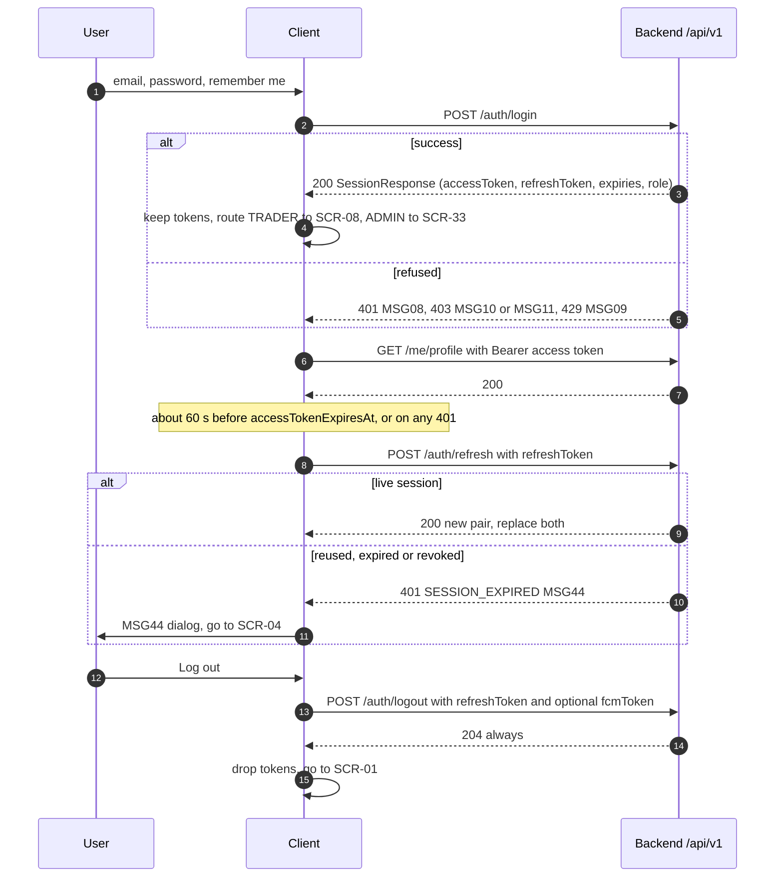
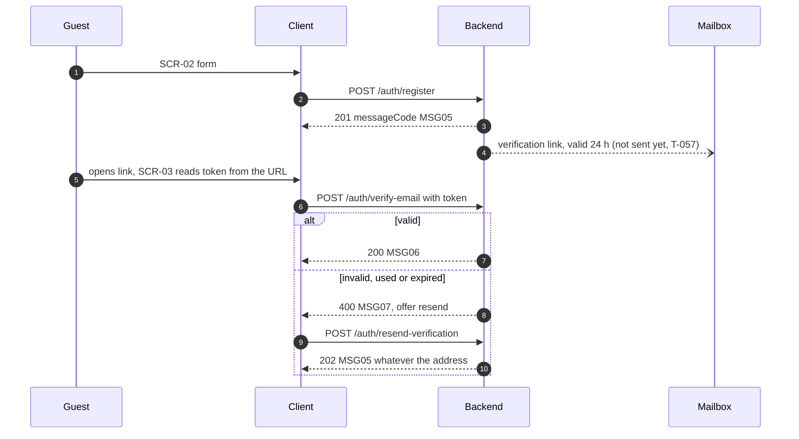

# 02 · Authentication and access

Endpoint details (request, response, errors) are in [modules/auth.md](modules/auth.md). This file is
the model.

## Tokens

| | Access token | Refresh token |
|---|---|---|
| Format | JWT, HS256 (RFC 7519) | Opaque 256-bit random string (URL-safe) |
| Lifetime | 15 minutes | 7 days; 30 days with `rememberMe: true` |
| Sent as | `Authorization: Bearer <token>` (RFC 6750) | JSON body of `/auth/refresh` and `/auth/logout` only |
| Expiry given in | `accessTokenExpiresAt` (ISO 8601 UTC) | `refreshTokenExpiresAt` (ISO 8601 UTC) |
| Rotation | New one on each refresh | **Single use.** Each refresh returns a new one and retires the old |
| Claims you may read | `sub` (user id, UUID), `role` (`TRADER`/`ADMIN`), `sid` (session id), `exp`, `iat`, `iss`, `jti` | — |

Rules the client must follow:

1. Replace **both** tokens with the pair a refresh returns. Presenting a refresh token a second time
   is treated as theft: the whole session (all tokens of that login) is revoked and the call answers
   401 `SESSION_EXPIRED` (MSG44). TD 7.15.
2. "Remember me" survives renewals: a 30-day session keeps 30 days at every refresh (D-26). The
   client does not resend `rememberMe` on refresh.
3. Do not decide expiry from the JWT clock alone; use `accessTokenExpiresAt` and refresh about
   60 s before it. A 401 can still arrive earlier (revoked session), so also refresh on 401.
4. A session revoked elsewhere (password change, password reset, logout of that session) stops the
   access token within at most one minute (`sid` liveness cache, D-33): the next call answers 401
   `AUTHENTICATION_REQUIRED` MSG44.

Source: `backend/src/main/resources/application.yml` (`cryptopilot.auth.token.*`),
`backend/src/main/java/com/cryptopilot/auth/config/TokenProperties.java#L64`,
`backend/src/main/java/com/cryptopilot/auth/service/impl/AccessTokenIssuer.java#L68`.
Spec: SRS 3.2.3, TD 5.3, TD 7.15, D-26, D-33.

## Token storage

| Client | Access token | Refresh token |
|---|---|---|
| Web | Memory only (a module variable or React state), never `localStorage` | The backend has no cookie flow; it must live in JS. Prefer `sessionStorage` when `rememberMe` is false, `localStorage` only when true. Never log it. Clear both on logout and on any 401 from `/auth/refresh` |
| Mobile | Memory | `flutter_secure_storage` (Keychain / Keystore). T-088 "refresh works after app restart" depends on this |

Because the refresh token is readable by script on the web, an XSS bug can steal a session. Keep a
strict Content-Security-Policy and avoid `dangerouslySetInnerHTML`. Moving the refresh token to an
`HttpOnly` cookie needs a backend change; it is not planned.

## Flows

### Sign in, call, refresh, sign out



### Concurrent requests and one refresh

Several requests can fail with 401 at the same moment. Run **one** refresh at a time and queue the
others behind it, then replay them with the new access token. Two parallel refreshes with the same
token make the second one a reuse, which revokes the session.

```ts
let refreshing: Promise<Session> | null = null;
function refreshOnce(): Promise<Session> {
  refreshing ??= api.post('/auth/refresh', { refreshToken: store.refreshToken })
    .then(save)
    .finally(() => { refreshing = null; });
  return refreshing;
}
```

### Register and verify



The link URL format is decided by the mail template (T-057) and is not in code yet. Plan SCR-03 to
read a `token` query parameter and send it in the body; never send the token in a URL to the API.

### Password reset

`POST /auth/forgot-password` always answers 202 MSG12 (no account enumeration). The reset link is
valid 30 minutes, once. `POST /auth/reset-password` answers 200 MSG13 and revokes **every** session
of the account, so send the user to SCR-04 to sign in again. Same mail caveat as above.

## Roles (RBAC)

Role rules are path rules in the security filter chain (D-27). Anything not listed answers 403.

| Path | Guest | TRADER | ADMIN |
|---|---|---|---|
| `POST /auth/register, verify-email, resend-verification, login, refresh, logout, forgot-password, reset-password` | ✔ | ✔ | ✔ |
| `GET /market/**` | ✔ | ✔ | ✔ |
| `/ws` (STOMP handshake) | ✔ | ✔ | ✔ |
| `PUT /me/password` | — | ✔ | ✔ |
| `/me/**` (except password), `/analysis/**`, `/watchlist/**`, `/alerts/**`, `/notifications/**`, `/plans/**`, `/journal/**`, `/performance`, `/posts/**`, `/comments/**`, `/media/**`, `/news/**`, `/ai/**`, `/billing/packages`, `/billing/orders/**`, `/billing/subscription` | — | ✔ | — (403) |
| `/admin/**` | — | — | ✔ |
| everything else | 403 | 403 | 403 |

- No token or an invalid/expired token on a protected path → 401 `AUTHENTICATION_REQUIRED` MSG44.
- Wrong role → 403 `ACCESS_DENIED` MSG43 (SRS has no "forbidden" message, A-24).
- An ADMIN calling a Trader path (e.g. `/me/profile`) gets 403. Admin screens use only the Security
  tab of SCR-07 (`PUT /me/password`).
- Paths listed for future modules return 403/404 until their controller exists; do not probe them.

Source: `backend/src/main/java/com/cryptopilot/auth/config/SecurityConfig.java#L143` (public auth),
`#L163` (market), `#L177` (ws), `#L188` (password), `#L194` (Trader area), `#L214` (admin).
Spec: SRS 3.1.3, TD 5.3, D-27.

### Route guards (T-030)

- Read `role` from `SessionResponse.role` at sign-in; keep it with the session. After a reload, read
  it from the access token's `role` claim (decode only, do not verify on the client).
- TRADER home = SCR-08, ADMIN home = SCR-33 (SRS 3.2.3).
- A guard is a convenience; the server decides. Always handle 401/403 from any call.

## Plan gating (subscription entitlements)

"Trader (PRO/PREMIUM)" is not a role. Plan features are checked per request by the backend
(`EntitlementApi`), D-54. Plan values (seed `V11`, configurable later by UC-47):

| Entitlement (`Feature`) | FREE | PRO | PREMIUM | Enforced today in |
|---|---|---|---|---|
| `FUTURES_ANALYSIS` — Futures analysis, Futures plans, Futures alerts | ✗ | ✔ | ✔ | Plans and alerts (develop). **Not** on `/analysis` or `/market` yet (T-107) |
| `SCORE_COMPONENTS` — setup score components | ✗ | ✔ | ✔ | Not enforced yet (T-107) |
| `ACTIVE_PLAN_MAX` — ACTIVE plans + open positions | 3 | unlimited | unlimited | Plans (develop) |
| `WATCHLIST_MAX` | 5 | 50 | 100 | Watchlist (develop) |
| `ACTIVE_ALERT_MAX` | 3 | 20 | 50 | Alerts (develop) |
| `INDICATOR_ALERT` | ✗ | ✔ | ✔ | Alerts (develop) |
| `EXTERNAL_ALERT_CHANNELS` — email/push for alerts | ✗ | ✔ | ✔ | Alerts (develop) |
| `ADVANCED_PERFORMANCE` | ✗ | ✔ | ✔ | Planned (T-051) |
| `NEWS_AI_INSIGHT` | ✗ | ✔ | ✔ | Planned (T-079) |
| `AI_CHAT_DAILY` — questions per day | 0 | 30 | 100 | Planned (T-075) |
| `AI_PERFORMANCE_CONTEXT` | ✗ | ✗ | ✔ | Planned (T-075) |
| `VIDEO_POST` | ✗ | ✗ | ✔ | Planned (T-062) |

How a refusal looks:

| Case | Status | `code` | `messageCode` | `messageArgs` |
|---|---|---|---|---|
| Feature not in plan | 403 | `PLAN_FEATURE_NOT_INCLUDED` | MSG29 | `[lowestTier]`, e.g. `["PRO"]` |
| Limit reached | 409 | `PLAN_LIMIT_REACHED` | MSG27 | `[max, items, tier]`, e.g. `["5", "watchlist items", "FREE"]` |
| Daily AI quota | 429 | `AI_DAILY_QUOTA_EXHAUSTED` | MSG30 | `[quota]` (planned) |

**Gap:** no endpoint tells the client the caller's plan or limits up front (`GET /billing/subscription`
is planned). CR-08 asks for lock icons on features the plan does not include, before the click.
Today the client can only learn it from a 403/409, or from `GET /watchlist` → `limit`. Recorded as
FEQ-02 in `07-open-questions.md`.

Source: `backend/src/main/java/com/cryptopilot/billing/model/enums/Feature.java#L13`,
`backend/src/main/java/com/cryptopilot/billing/service/impl/EntitlementServiceImpl.java#L79`,
`backend/src/main/resources/db/migration/V11__seed_subscription_packages.sql`.
Spec: SRS 3.1.3, Table 3.1, BR-62, CR-08, D-54, D-58, D-60.
