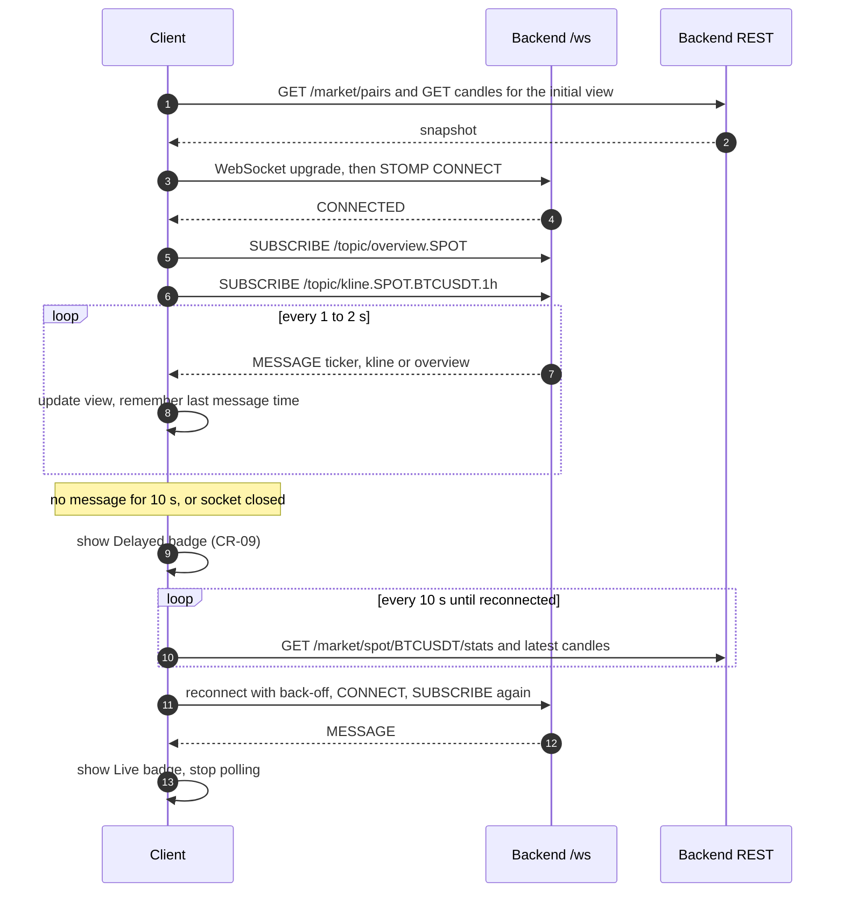

# 05 · Realtime (STOMP over WebSocket)

## Endpoint

| | |
|---|---|
| URL | `ws://<host>:8080/ws` (local: `ws://localhost:8080/ws`); `wss://` behind TLS |
| Transport | Plain WebSocket (RFC 6455). **No SockJS** fallback |
| Protocol | STOMP 1.2 frames over the socket |
| Auth on CONNECT | None today. Every implemented topic is public; a bearer header is ignored |
| Allowed browser origins | `CORS_ALLOWED_ORIGINS`, the list REST uses (D-83; `dev`: any localhost port, `prod`: none until set) |
| Client libraries | Web `@stomp/stompjs`; Flutter `stomp_dart_client` (TD 9) |
| Client → server messages | **Refused.** Any `SEND` gets an ERROR frame and the session is closed. Only `SUBSCRIBE`/`UNSUBSCRIBE` |
| Limits per session | Server send time limit 10 s, send buffer 512 KB; a client too slow to read is disconnected |

Source: `backend/src/main/java/com/cryptopilot/common/config/WebSocketConfig.java#L67` (endpoint),
`#L73` (broker), `#L55` (topic filter); `backend/src/main/resources/application.yml#L47` (origins).
Spec: TD 9, D-51, ADR-005.

## Destinations

### Implemented (develop)

| Destination | Content | Cadence |
|---|---|---|
| `/topic/ticker.{MARKET}.{SYMBOL}` | One pair's latest ticker | At most 1 message/s per destination (coalesced, latest wins) |
| `/topic/kline.{MARKET}.{SYMBOL}.{tf}` | Candle updates of one series, forming and closed | Pushed every 1 s; all candles that changed in that second, oldest first. A closed candle is never coalesced away |
| `/topic/overview.{MARKET}` | Latest ticker of every pair of the market seen since the backend started | Every 2 s |
| `/user/queue/positions` | `PositionUpdate`: one of the caller's positions closed (T-048b, branch `feat/t-048b-journal-exits`) | When it happens |
| `/user/queue/notifications` | Each new notification of the caller (SCR-15); admitted since T-048b (Q-75) | When it happens |

- `{MARKET}` is `SPOT` or `FUTURES` in upper case; `{SYMBOL}` upper case (`BTCUSDT`); `{tf}` is
  `15m`, `1h`, `4h` or `1d`.
- A SUBSCRIBE to anything else (wrong case included, e.g. `/topic/ticker.spot.btcusdt`) is refused
  with an ERROR frame and the connection is closed. The filter checks the pattern only: a well-formed
  destination for a pair that is not streamed is accepted and simply never receives a message.
- Only pairs an admin enabled on that market and that are TRADING are streamed (BR-07, D-44).

Source: `backend/src/main/java/com/cryptopilot/market/service/impl/MarketBroadcastServiceImpl.java#L118`
(overview), `#L124` (ticker destination); kline destination just below it.

### Planned (spec only, TD 9)

| Destination | Purpose | Needs |
|---|---|---|
| `/user/queue/ai` | AI answer ready | T-073 |
| Analysis push per series | NSF-05 "pushed to clients viewing the pair" | **Q-21 open** — destination, payload and auth undecided. Re-read `GET /analysis` on each closed kline instead |

## Payloads

Decimals are strings, instants ISO 8601 UTC. Fields that do not apply to the market are `null` in
the code as built (no omit-null setting); TD 9 and D-51 say "omitted". Handle both (M-04).

### Ticker — `/topic/ticker.*` and each item of `overview.tickers`

```ts
interface TickerUpdate {
  market: 'SPOT' | 'FUTURES';
  symbol: string;
  sourceTime: string;            // exchange event time
  // SPOT only (null on FUTURES)
  lastPrice: string | null;
  bestBid: string | null;
  bestAsk: string | null;
  high24h: string | null;
  low24h: string | null;
  changePercent24h: string | null; // percent, e.g. "1.25"
  baseVolume24h: string | null;
  quoteVolume24h: string | null;
  // FUTURES only (null on SPOT)
  markPrice: string | null;
  indexPrice: string | null;
  fundingRate: string | null;      // fraction, "0.0001" = 0.01 %
  nextFundingTime: string | null;
}
```

```json
{
  "market": "SPOT", "symbol": "BTCUSDT", "sourceTime": "2026-10-03T02:15:04.120Z",
  "lastPrice": "63000.01", "bestBid": "63000.00", "bestAsk": "63000.01",
  "high24h": "63950.00", "low24h": "61820.50", "changePercent24h": "1.254",
  "baseVolume24h": "18234.11", "quoteVolume24h": "1139455120.42",
  "markPrice": null, "indexPrice": null, "fundingRate": null, "nextFundingTime": null
}
```

**FUTURES tickers carry no last price and no 24h statistics** — only mark, index, funding rate and
next funding time (the futures stream ingested is the mark price stream). SCR-01's Futures tab asks
for last price, 24h change, high/low and volume (SRS 3.3.1); not available (M-09).

Source: `backend/src/main/java/com/cryptopilot/market/dto/response/TickerUpdateResponse.java#L29`.

### Kline — `/topic/kline.*`

```ts
interface KlineUpdate {
  market: 'SPOT' | 'FUTURES';
  symbol: string;
  timeframe: '15m' | '1h' | '4h' | '1d';
  openTime: string;
  closeTime: string;
  open: string; high: string; low: string; close: string;
  baseVolume: string;
  quoteVolume: string;
  closed: boolean;   // false = forming (provisional), true = final
  sourceTime: string;
}
```

Merge rule on the chart: key by `openTime`; replace the last bar when `openTime` matches, append
when it is newer. Draw `closed: false` as provisional (SRS 3.3.2). The REST candles endpoint returns
closed candles only, so the forming bar comes only from this topic.

Source: `backend/src/main/java/com/cryptopilot/market/dto/response/KlineUpdateResponse.java#L26`.

### Position update — `/user/queue/positions` (T-048b)

Needs a CONNECT with the Bearer token; a guest, or `/user/{id}/queue/...`, is refused with an ERROR
frame. Sent after the close commits; a lost push is not resent, so re-read `GET /plans/{id}` on
reconnect.

```ts
interface PositionUpdate {
  positionId: string;      // journal record id
  planId: string;
  market: 'SPOT' | 'FUTURES';
  symbol: string | null;
  status: 'CLOSED';
  closeReason: 'TAKE_PROFIT' | 'STOP_LOSS' | 'LIQUIDATION';
  exitPrice: string;
  exitTime: string;        // ISO instant
  realizedPnl: string;
  feeAmount: string;
  netPnl: string;
  provisional: boolean;    // funding incomplete: netPnl may still change
}
```

Source: `backend/src/main/java/com/cryptopilot/trading/dto/response/PositionUpdateResponse.java`.

### Overview — `/topic/overview.*`

```ts
interface MarketOverview {
  market: 'SPOT' | 'FUTURES';
  serverTime: string;
  tickers: TickerUpdate[];   // sorted by symbol
}
```

Not sent while the market has no ticker yet. A pair disabled while the backend runs may stay in the
list until restart; filter the list by `GET /market/pairs`.

Source: `backend/src/main/java/com/cryptopilot/market/dto/response/MarketOverviewResponse.java#L16`.

## Connect, subscribe, recover



Rules:

1. **Live / Delayed (CR-09):** Delayed when the last message of the screen's topics is older than
   10 s or the socket is down; poll REST every 10 s while Delayed (SRS 3.3.1, TD 9).
2. **Heartbeats:** the broker has no heartbeat scheduler in code, so do not depend on server
   heart-beats; use the 10 s staleness rule above. Client heart-beats can stay at the library default.
3. **Reconnect:** exponential back-off with jitter, e.g. 1 s doubling to 30 s. `@stomp/stompjs`:
   set `reconnectDelay` and re-subscribe in `onConnect` (subscriptions do not survive a reconnect).
4. **Gap fill:** after a reconnect, re-fetch candles from REST with `from` = last closed `openTime`
   before merging live updates, because klines missed while offline are not replayed.
5. **Subscribe narrowly:** one kline destination per visible chart; unsubscribe when the timeframe or
   pair changes. Use `overview` for lists, `ticker` for a single pair screen.
6. **No message on a valid destination** usually means the pair is not streamed (not enabled on that
   market) or the local backend is still back-filling.

```ts
import { Client } from '@stomp/stompjs';
const client = new Client({
  brokerURL: import.meta.env.VITE_WS_URL,      // dev: ws://localhost:8080/ws (or ws://localhost:5173/ws via a proxy)
  reconnectDelay: 2000,
  onConnect: () => {
    client.subscribe('/topic/overview.SPOT', m => onOverview(JSON.parse(m.body)));
  },
  onStompError: f => console.warn('STOMP error', f.headers.message),
});
client.activate();
```
